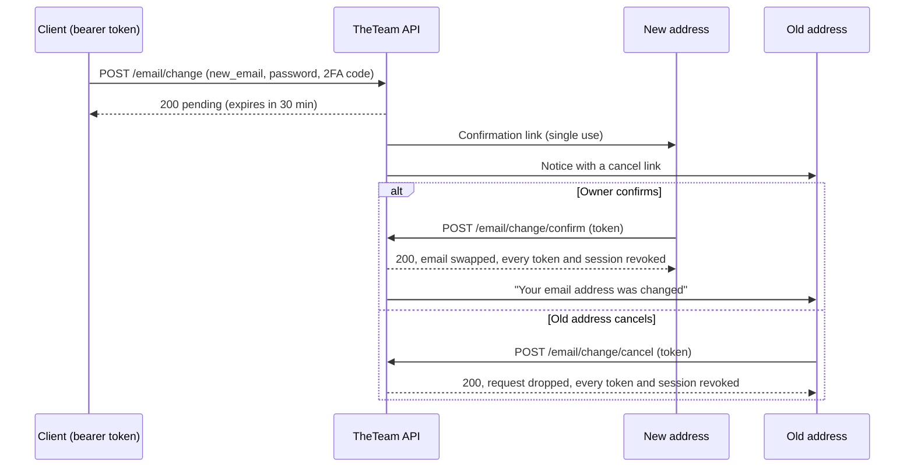

Almost the whole API is **public**: every content read and every public form works without credentials.
Authentication exists only for **staff accounts** (the people who use the admin panel) and relies on
[Laravel Sanctum](https://laravel.com/docs/sanctum) personal access tokens sent as a bearer header.

```http
Authorization: Bearer 3|EXAMPLE-TOKEN-NOT-A-REAL-VALUE
```

## Who can get a token

- **There is no public sign-up.** `POST /api/register` was removed on 2026-11-04 and answers `404`.
  Accounts are created in the admin panel, by invitation or under **Access → Users**.
- An account needs a **verified email** and a **built-in role** (`admin` or `content_manager`). An account
  with no role is refused with `403 Account has no access`.
- Accounts with **two-factor authentication** must send a TOTP code (`2fa_code`) or a recovery code
  (`2fa_recovery_code`). See [Log in](/api-reference/auth/login).

## Token lifecycle

<Steps>
  <Step title="Issue">
    [`POST /login`](/api-reference/auth/login) returns a plain-text token, shown once. The token is named
    after the device (`Safari on macOS`) and stamped with the IP and User-Agent.
  </Step>
  <Step title="Use">
    Send it as `Authorization: Bearer <token>`. Tokens **never expire** (Sanctum `expiration` is `null`).
  </Step>
  <Step title="Revoke">
    [`POST /logout`](/api-reference/auth/logout) revokes the current token,
    [`DELETE /devices/{id}`](/api-reference/auth/revoke-device) one token, and
    [`POST /logout-all`](/api-reference/auth/logout-all) every token of the account. Confirming or
    cancelling an email change, resetting the password from the admin panel, and an admin changing your
    roles also revoke every token.
  </Step>
</Steps>

## Protected endpoints

These ten endpoints sit behind `auth:sanctum`:

| Method | Path | Purpose |
| :-- | :-- | :-- |
| `GET` | [`/user`](/api-reference/auth/get-user) | Current account |
| `POST` | [`/logout`](/api-reference/auth/logout) | Revoke the current token |
| `GET` | [`/devices`](/api-reference/auth/list-devices) | Tokens issued to the account |
| `DELETE` | [`/devices/{id}`](/api-reference/auth/revoke-device) | Revoke one token |
| `POST` | [`/logout-all`](/api-reference/auth/logout-all) | Revoke every token |
| `POST` | [`/password/update`](/api-reference/auth/update-password) | Change the password |
| `GET` | [`/email/change`](/api-reference/email-change/get-pending) | Pending email change |
| `POST` | [`/email/change`](/api-reference/email-change/start) | Start an email change |
| `POST` | [`/email/change/resend`](/api-reference/email-change/resend) | Send fresh links |
| `DELETE` | [`/email/change`](/api-reference/email-change/discard) | Drop the pending change |

A request without a valid token returns:

```json 401
{
  "message": "Unauthenticated."
}
```

<Warning>
  Send `Accept: application/json`. Without it, an unauthenticated request is **redirected** (`302`) to
  the admin login page instead of receiving the `401` JSON above.
</Warning>

## Account recovery and security emails

| Flow | Endpoints | Notes |
| :-- | :-- | :-- |
| Email verification | [`GET /email/verify/{id}/{hash}`](/api-reference/auth/verify-email), [`POST /email/resend`](/api-reference/auth/resend-verification) | Login is refused until the email is verified |
| Forgotten password | [`POST /password/forgot`](/api-reference/auth/forgot-password) → emailed link → [`POST /password/reset`](/api-reference/auth/reset-password) | The emailed link opens the admin panel's reset page |
| Change password | [`POST /password/update`](/api-reference/auth/update-password) | Needs the current password |
| Change email | [Email change](/api-reference/email-change/start) endpoints | Password (and 2FA) re-check, confirmation link to the new address, cancel link to the old one |

Every successful password change, here or in the admin panel, emails the account a **"Votre mot de passe
a été modifié"** notice with the date, device, IP and a reset link.

## Email change flow



The emailed links open pages hosted by the backend (`/admin/email-change/...`), which work for API users
too. The two token endpoints exist for a client that wants to host its own confirmation screens.
