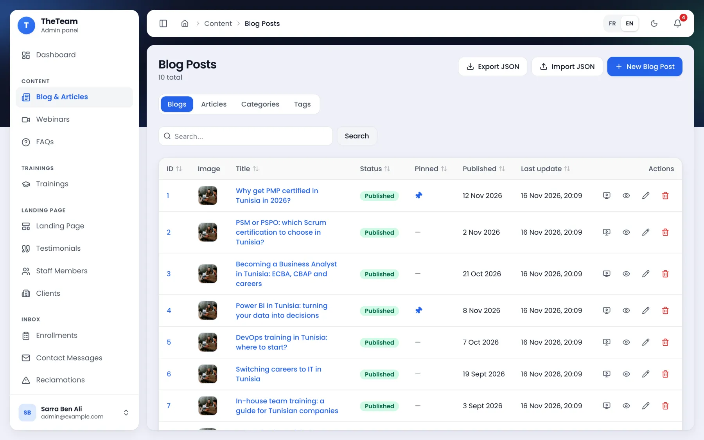
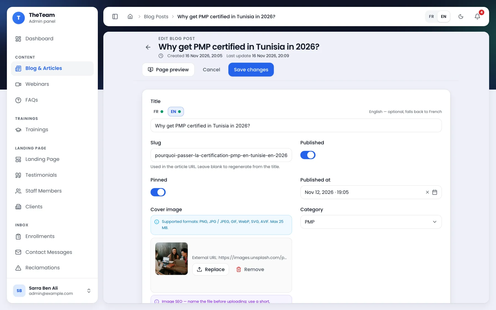
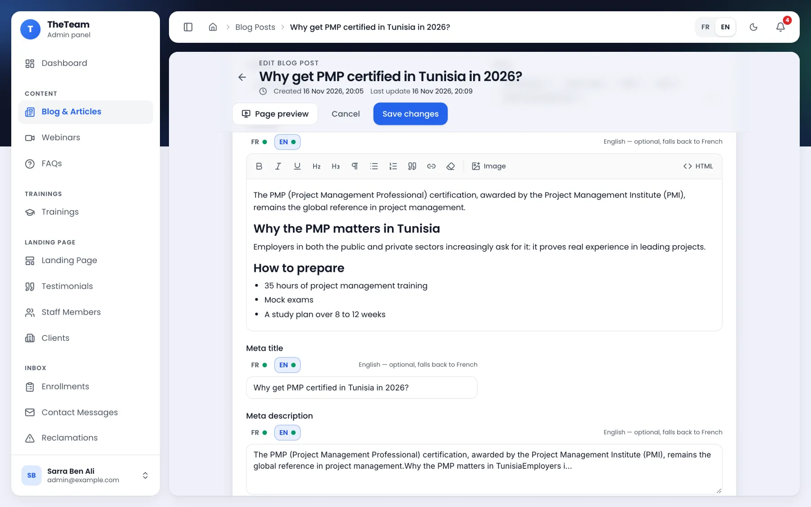
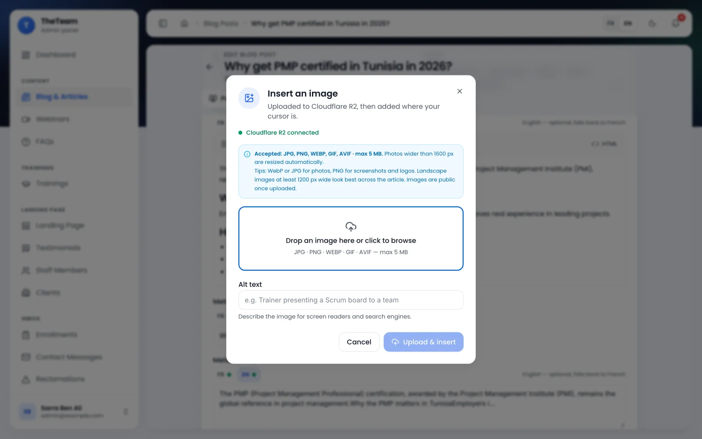
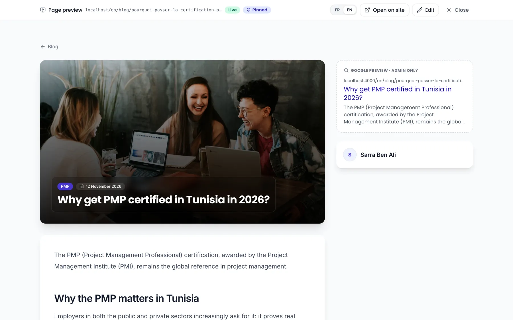
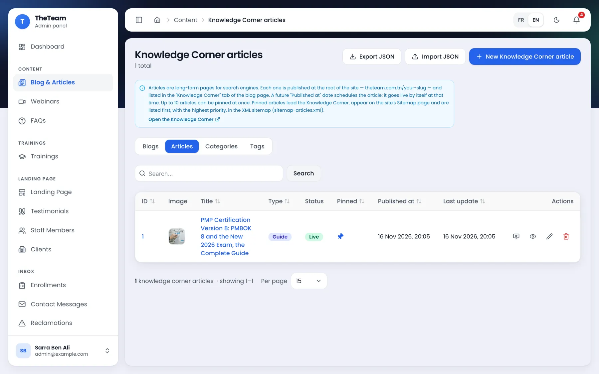
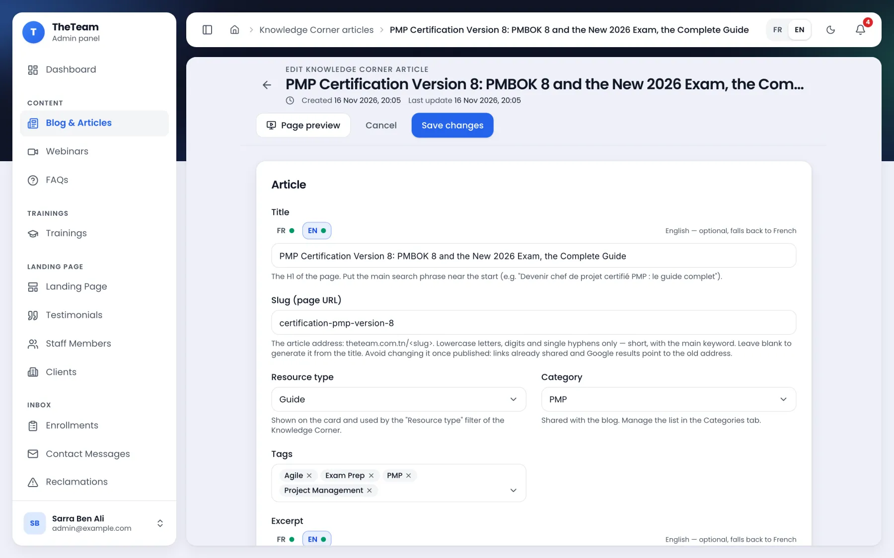
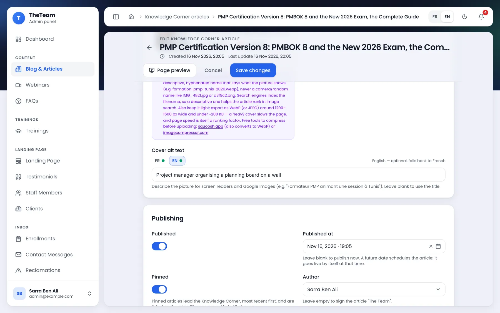
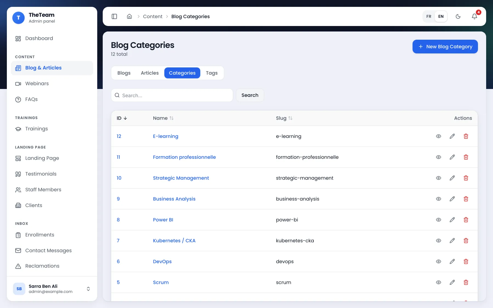

Menu **Content → Blog & Articles**. The page has four tabs:

| Tab | What it is |
| :-- | :-- |
| **Blogs** | The news and posts of the website's blog. |
| **Articles** | The in-depth **Knowledge Corner** articles, written with Google in mind. Each has its own address: `theteam.com.tn/nom-de-l-article`. |
| **Categories** | The topics (PMP, Scrum, DevOps…), shared by the blog and the articles. |
| **Tags** | More specific keywords, also shared. |

<Info>
  **Both roles** can create and edit. Only an **administrator** can delete.
</Info>

<Frame caption="The Blogs tab. The icons on each row: page preview, view, edit, delete.">
  
</Frame>

## Writing a blog post

<Steps>
  <Step title="Click « New Blog Post »">
    The blue button at the top right.
  </Step>
  <Step title="Fill in the title (FR, and EN if you have it)">
    The **slug** (the end of the page's address) is created automatically from the title.
  </Step>
  <Step title="Add a cover image">
    Required. Drag the image into the box or click to choose it.
  </Step>
  <Step title="Choose the category, the author and the tags">
    Tags are picked from a list: you can add several.
  </Step>
  <Step title="Write the content">
    With the text editor (see below).
  </Step>
  <Step title="Publish">
    Turn on **Published**, then click **Create** (or **Save changes**).
  </Step>
</Steps>

<Frame caption="A blog post record: title, slug, Published, Pinned, publication date, image and category.">
  
</Frame>

The publishing settings:

- **Published**: on = visible on the website; off = draft, invisible to visitors.
- **Pinned**: the post is featured at the top of the blog.
- **Published at**: the date shown on the post.

<Tip>
  **Naming the image well before uploading it** helps Google find the post: a short, descriptive name such as `formation-pmp-tunis-2026.webp`, rather than `IMG_4821.jpg`. Also keep the image light (under about 200 KB): the website loads faster. The free website [squoosh.app](https://squoosh.app/) compresses an image in a few seconds.
</Tip>

## The text editor

<Frame caption="The editor: the toolbar above the text.">
  
</Frame>

It works like a word processor: select a word then click **B** (bold), *I* (italic), **H2 / H3** (subheadings), bulleted or numbered lists, link…

**Inserting an image in the text**: place the cursor where you want it, click **Image**, drop the file, write some **alt text** (a short description of the image) then click **Upload & insert**. You can also simply paste or drag an image into the text.

<Frame caption="The « Insert image » window. The green line confirms that image storage is working.">
  
</Frame>

<Note>
  Accepted formats: JPG, PNG, WebP, GIF, AVIF, **5 MB maximum**. Large photos are reduced automatically. If the window shows a red box « Cloudflare R2 is not connected », let an administrator know: see [Website Settings](/en/guide-utilisateur/journal-et-parametres).
</Note>

## Previewing before publishing

The **Page preview** button (at the top of the record, or the screen icon in the list) opens the post as it will appear on the website, with a preview of the Google result. The preview's **FR / EN** button switches language.

<Frame caption="The preview of a blog post, before or after publishing.">
  
</Frame>

## Knowledge Corner articles

**Articles** tab. These are long articles, written to rank well on Google. Each one is published **at the root of the website**: `theteam.com.tn/votre-slug`.

<Frame caption="The Articles tab. The Status column shows Live, Scheduled or Draft.">
  
</Frame>

The form is split into sections, with help under each field:

- **Article**: title, **slug** (the page's address), resource type (article, guide, tutorial…), category, tags, **excerpt** (one or two sentences shown on the card) and content. Structure the text with **H2 / H3** subheadings: they build the page's table of contents.
- **Cover image** and its **alt text**.
- **Publishing**: Published, publication date, Pinned, author.
- **SEO**: how the article appears on Google (everything is optional).

<Frame caption="An article record: the Article section.">
  
</Frame>

### Scheduling an article

Turn on **Published** and choose a **future date** in **Published at**: the article stays « Scheduled » and **goes live on its own** on that date. Leave the date empty to publish straight away.

<Frame caption="The Publishing section.">
  
</Frame>

<Warning>
  **Avoid changing the slug of an article that is already published**: shared links and Google results point to the old address. Some words are also refused for the slug, because they already match pages of the website.
</Warning>

<Note>
  You can pin **up to 10 articles** at a time. To pin an eleventh, unpin another one first.
</Note>

## Categories and tags

**Categories** and **Tags** tabs: click **New**, give a name (the slug fills itself in) and save. These lists are shared between the blog and the articles.

<Frame caption="The Categories tab.">
  
</Frame>

<Note>
  **Export / Import JSON** (at the top of the Blogs and Articles lists) is used to copy an article from one website to another. It is a technical feature: only use it if you are asked to.
</Note>
