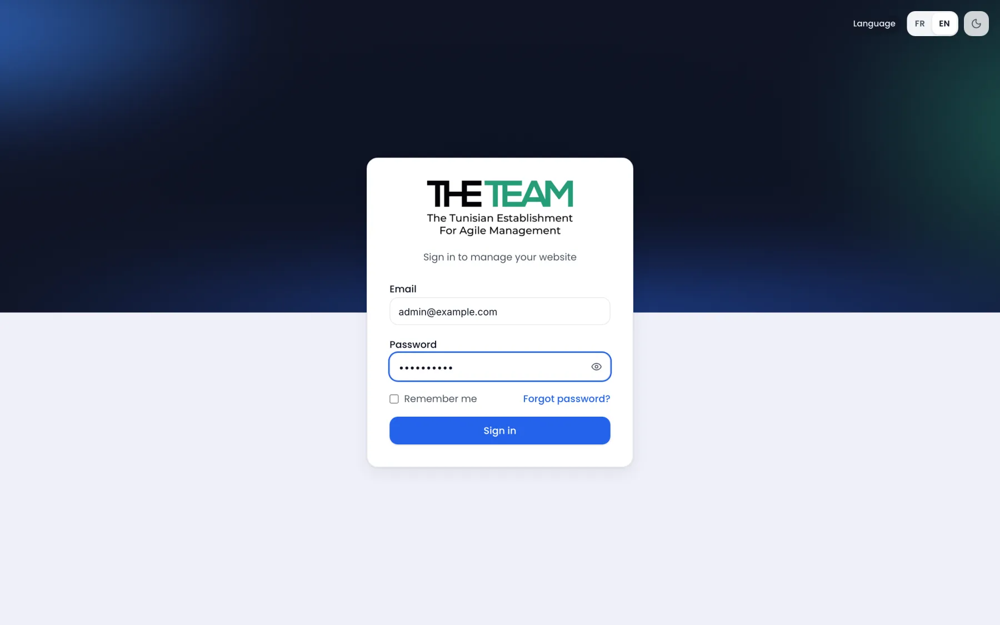
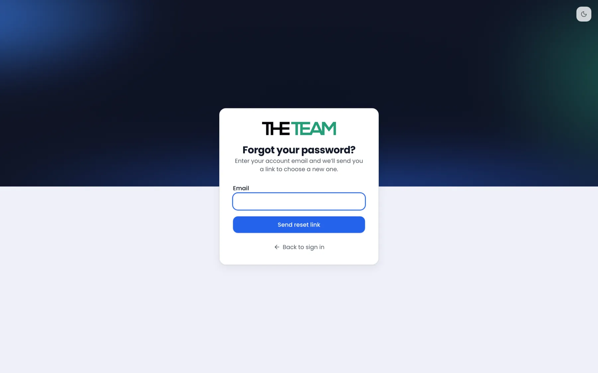
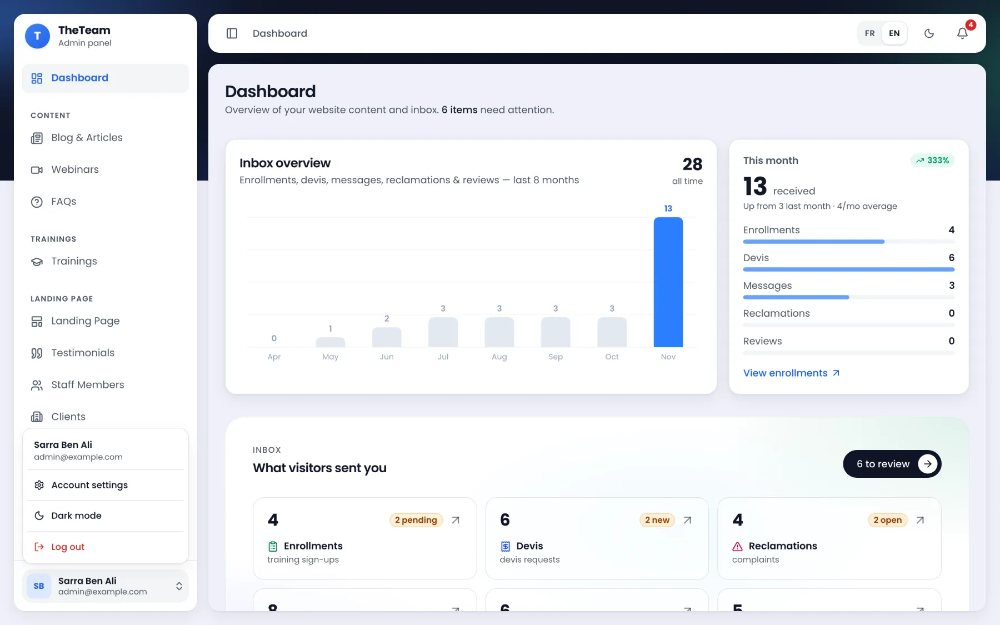

## First sign-in: the invitation

Nobody creates their own account. An **administrator sends you an invitation by email**.

<Steps>
  <Step title="Open the invitation email">
    Click the button in the email. **The link is only valid for 24 hours** and works only once. If it has expired, ask an administrator to send you the invitation again.
  </Step>
  <Step title="Choose your password">
    At least 8 characters, typed twice.
  </Step>
  <Step title="Sign in">
    You land on the sign-in page, with your address already filled in. Once signed in, complete your profile (your name, your photo): see [My account](/en/guide-utilisateur/mon-compte).
  </Step>
</Steps>

## Signing in

<Steps>
  <Step title="Open the sign-in page">
    Go to **admin.theteam.com.tn/admin**. The sign-in page appears.
  </Step>
  <Step title="Enter your email and password">
    The eye icon shows the password in plain text so you can check what you typed.
  </Step>
  <Step title="Click « Sign in »">
    Tick **Remember me** only on your personal computer, never on a shared one.
  </Step>
</Steps>

<Frame caption="The sign-in page. Top right: the language (FR / EN) and dark mode.">
  
</Frame>

<Note>
  If you have turned on **two-factor authentication**, a second page asks for the **6-digit code** shown in your Google Authenticator app. See [My account](/en/guide-utilisateur/mon-compte#two-factor-authentication).
</Note>

<Warning>
  After **5 failed attempts within one minute**, signing in is blocked for a short while. Wait a minute before trying again, or use « Forgot your password? ».
</Warning>

## Forgotten password

<Steps>
  <Step title="Click « Forgot your password? »">
    The link is below the password field.
  </Step>
  <Step title="Enter your email address">
    Then click **Send reset link**.
  </Step>
  <Step title="Open the email you receive">
    Click the link and choose a new password. Remember to check your junk mail (spam).
  </Step>
</Steps>

<Frame caption="The « Forgot your password? » page.">
  
</Frame>

## Logging out

At the bottom of the left-hand menu, click **your name**, then **Log out**.

<Frame caption="Your account menu, bottom left: account settings, dark mode and log out.">
  
</Frame>
