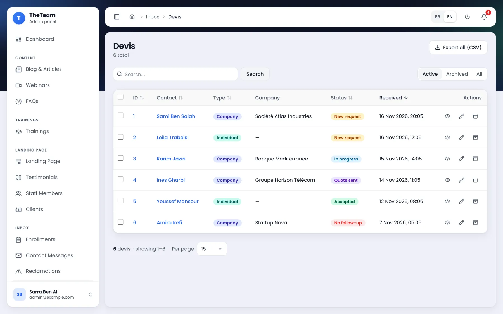
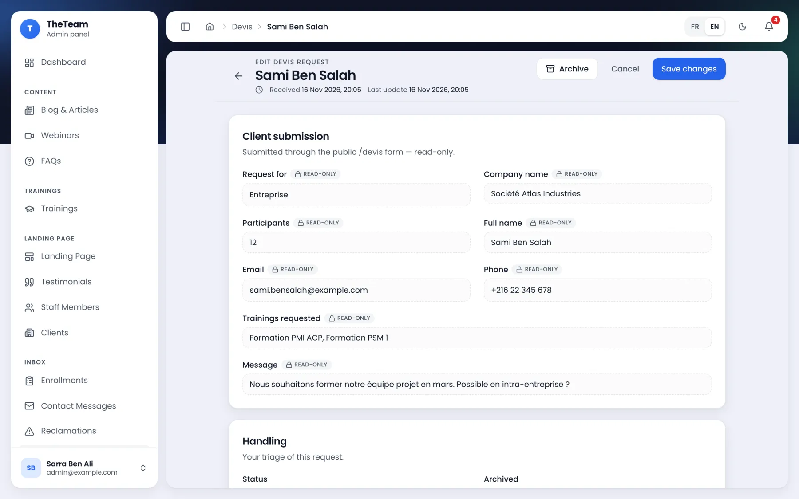
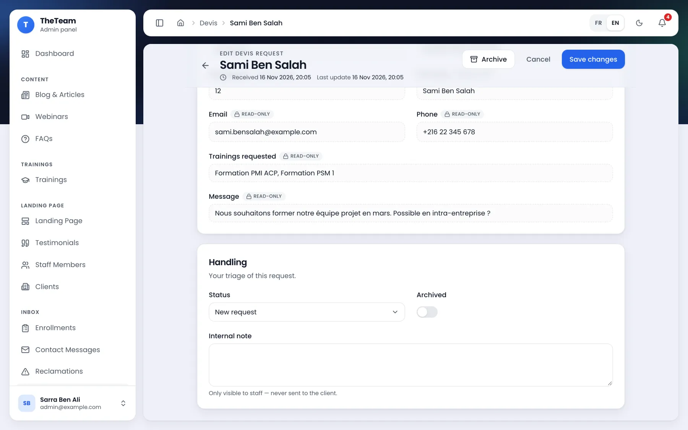

Menu **Inbox → Devis**. Every request sent with the website's **Cost estimate** form arrives here. A notification alerts you and the team also receives an email.

<Info>
  **Both roles** can view, handle, archive and export quote requests. Only an **administrator** can delete a quote request, and only after archiving it.
</Info>

<Tip>
  To see the form as the visitor fills it in on the website, read [The quote form](/en/guide-utilisateur/formulaire-devis) (visitor side).
</Tip>

<Frame caption="The Devis list: contact, type (company or individual), company, status and date received.">
  
</Frame>

## Statuses

The status shows where each request stands. You change it as you handle the request.

| Status | Meaning |
| :-- | :-- |
| **New request** | Nobody has handled it yet. |
| **In progress** | Someone is dealing with it (phone call, emails…). |
| **Quote sent** | The offer has been sent to the client. |
| **Accepted** | The client accepted. |
| **No follow-up** | The client did not follow up. |

## Handling a request

<Steps>
  <Step title="Open the request">
    Click the contact's name or the pencil.
  </Step>
  <Step title="Read the client's request">
    The **Client submission** section shows what the visitor filled in: company or individual, number of participants, contact details, requested trainings and message. These fields are **read-only**.
  </Step>
  <Step title="Contact the client">
    By phone or by email, using the details shown. The panel does not send the quote itself.
  </Step>
  <Step title="Update the status and the internal note">
    In the **Handling** section, choose the **Status** and write down what was done in the **Internal note** (date of the call, price offered…). Click **Save changes**.
  </Step>
</Steps>

<Frame caption="A quote request record: the client's request, read-only.">
  
</Frame>

<Frame caption="The Handling section, at the bottom of the record.">
  
</Frame>

<Tip>
  The **internal note** is **never sent to the client**: it is for the team. If a colleague takes over the request, they know straight away where you are.
</Tip>

## Archiving

When a request is finished (Accepted or No follow-up), **archive it** to keep the list tidy: **Archive** button at the top of the record, or the box icon in the list. Find it again with the **Archived** filter.

## Exporting

**Export all (CSV)** downloads the quote requests as a file to open in Excel. Tick rows first to export only those.

<Note>
  Each requester's email address is also added to the [Newsletter](/en/guide-utilisateur/newsletter-et-avis) list.
</Note>
