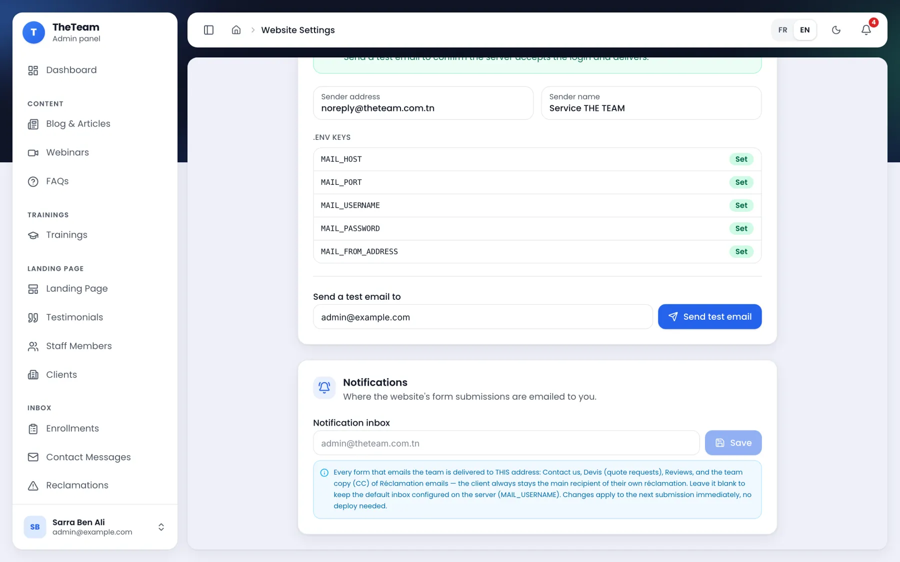

Menu **System → Website Settings**, **Email sending (SMTP)** card.

**SMTP** is the service that sends the website's emails: copies of the contact, quote and review forms to the team, reclamation emails to the client, staff invitations, password resets… If sending does not work, requests still arrive in the panel's **Inbox**, but **no email goes out any more**.

<Info>
  **Administrators** and **content managers** can view this card and send a test email. The configuration itself is done on the server (`.env` file) by the person in charge of technical matters.
</Info>

<Frame caption="The Email sending (SMTP) card: sender address, configuration keys and test email.">
  
</Frame>

## Reading the card's status

| Message shown | Meaning | What to do |
| :-- | :-- | :-- |
| **SMTP is configured** (green) | All the settings are present. | Send a test email to confirm that emails arrive. |
| **SMTP is not configured** (red) | Some settings are missing on the server; they are listed by name. | Let the person in charge of technical matters know. |
| **Emails are not delivered (test mode)** (orange) | The server writes emails into its log instead of sending them. Normal on a development computer, **not normal on the real website**. | Let the person in charge of technical matters know. |

The card also shows the **Sender address** (the address that appears as the sender, for example `noreply@theteam.com.tn`) and the **Sender name**. The configuration keys are listed by their **name** marked **Set** or **Missing**: their value (password, username) is **never shown**.

## Sending a test email

<Steps>
  <Step title="Enter your address">
    In the **Send a test email to** field (your address is suggested by default).
  </Step>
  <Step title="Click « Send test email »">
    The email is sent immediately.
  </Step>
  <Step title="Check your inbox">
    A green message confirms: « Test email sent to … Check the inbox (and the spam folder). » You receive an email titled **« Test email — THETEAM »**. Remember the **spam** folder.
  </Step>
</Steps>

<Note>
  You can send **5 test emails per minute** at most. Beyond that: « Too many test emails. Wait a minute and try again. »
</Note>

## If the test email fails

A red message explains the cause. Pass it on as it is to the person in charge of technical matters:

| Message | What it means |
| :-- | :-- |
| « The SMTP server rejected the login… » | The email account's username or password is wrong. |
| « The SMTP server cannot be reached… » | The sending server does not respond (address, port, or a host that blocks sending). |
| « The secure connection to the SMTP server failed… » | Wrong security setting (port 465 or 587). |
| « The SMTP server refused the sender or the recipient… » | The sender address is not allowed by this email account. |
| « Email sending is not configured… » | Some settings are missing on the server. |
| « The test email could not be sent. The details were written to the server log. » | Another error: the technical details are in the server log. |

<Warning>
  **The message is green but nothing arrives?** Look in the **spam** folder, then try again with another address (Gmail, Outlook…). If still nothing arrives, let the person in charge of technical matters know: the server accepted the email but is not delivering it.
</Warning>

## Which address do the forms go to?

The team address that receives the website's forms is set just below, in the **Notifications** card: see [Log and settings](/en/guide-utilisateur/journal-et-parametres). After changing it, send a test email to check that everything works.
