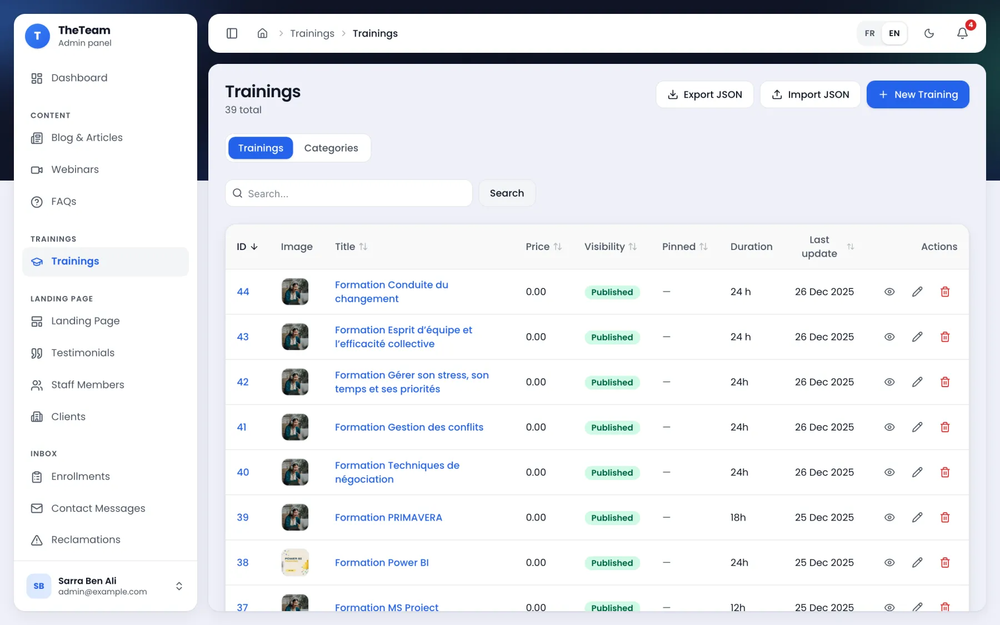
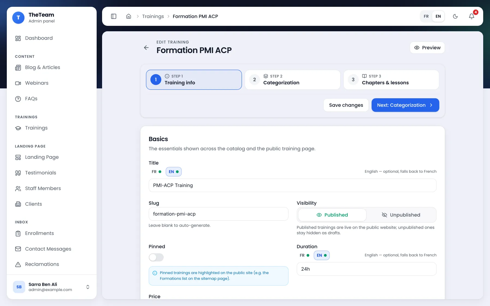
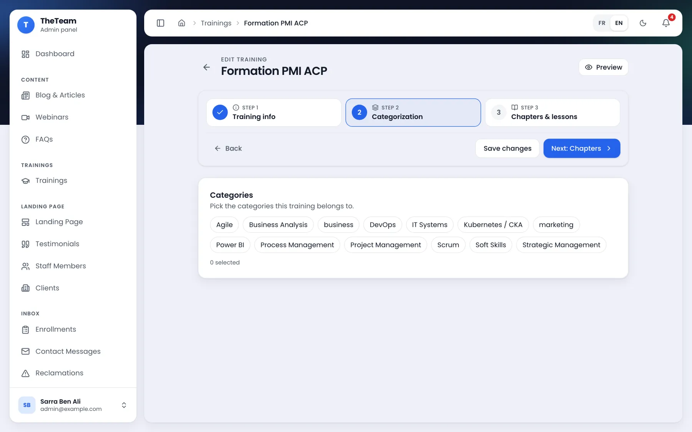
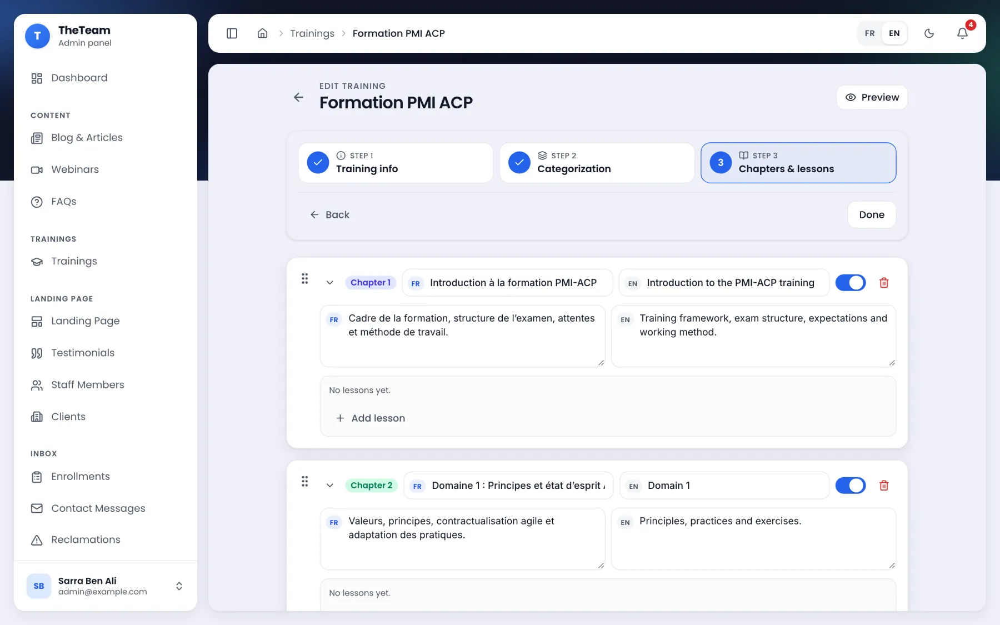
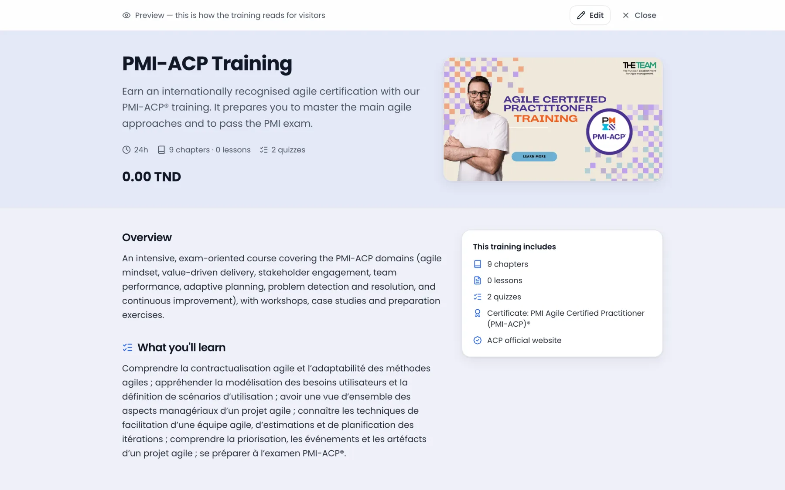
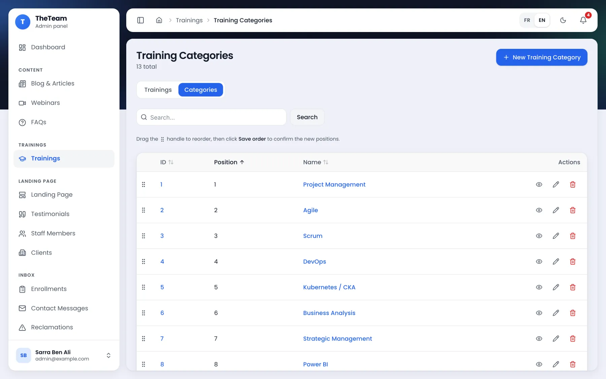

Menu **Trainings**. This is where you manage the catalogue shown on the website.

<Info>
  **Both roles** can create and edit trainings and categories. Only an **administrator** can delete.
</Info>

<Frame caption="The list of trainings. Icons on each row: preview, edit, delete.">
  
</Frame>

## Creating or editing a training

Click **New Training**, or the pencil of an existing training. The form is filled in over **three steps**, shown at the top of the page. You can save at any time with **Save changes**.

### Step 1 — Training info

<Frame caption="Step 1: the training's information.">
  
</Frame>

The form is split into blocks:

| Block | Content |
| :-- | :-- |
| **Basics** | Title, slug (leave it empty: it is created automatically), **Visibility**, Pinned, Duration, Price. |
| **Media** | Featured image, certification badge image. |
| **Description** | Introduction and presentation of the training. |
| **Certification** | Name and official link of the certification. |
| **E-learning & resources** | E-learning access, number of quizzes, included resource. |
| **Additional details** | Prerequisites and learning objectives. |

- **Visibility → Published**: the training is online. **Unpublished**: it stays hidden (draft).
- **Pinned**: the training is featured on the website.

Click **Next: Categorization**.

### Step 2 — Categorization

Click the categories the training belongs to (you can choose several). They are used for the catalogue filters on the website.

<Frame caption="Step 2: click a category to select it.">
  
</Frame>

### Step 3 — Chapters & lessons

This is the training's **programme**. A new training must first be saved (steps 1 and 2) before you can add chapters.

<Frame caption="Step 3: each chapter has a title, a summary and its lessons.">
  
</Frame>

- **Add chapter** then, in each chapter, **Add lesson**.
- Each title and summary has a **FR** version and, optionally, an **EN** one.
- **Reorder**: drag a chapter or a lesson by its handle (on the left).
- The arrow collapses or expands a chapter to keep things clear.

Click **Done** when the programme is complete.

## Previewing

The **Preview** button (top right of the form, or the eye icon in the list) shows the training as visitors will see it.

<Frame caption="The preview of a training.">
  
</Frame>

<Note>
  **A change does not show up on the website straight away?** That is normal: the website keeps the training catalogue in memory for **up to 5 minutes** so it loads faster. Wait a few minutes then reload the page.
</Note>

## Training categories

**Categories** tab, at the top of the list of trainings. Click **New Training Category** to create one. Drag the rows then click **Save order** to choose the display order on the website.

<Frame caption="The Categories tab.">
  
</Frame>
