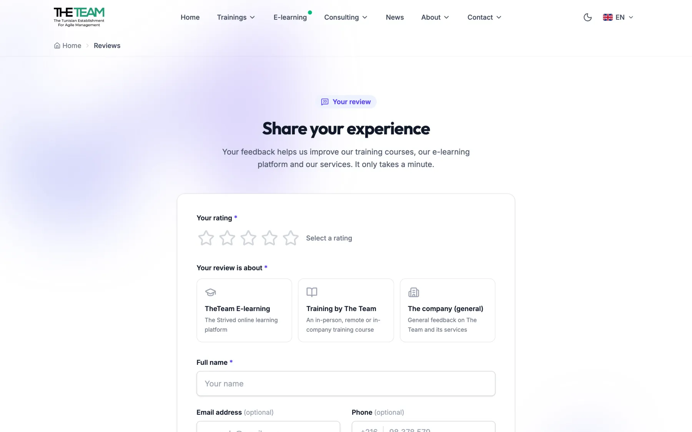
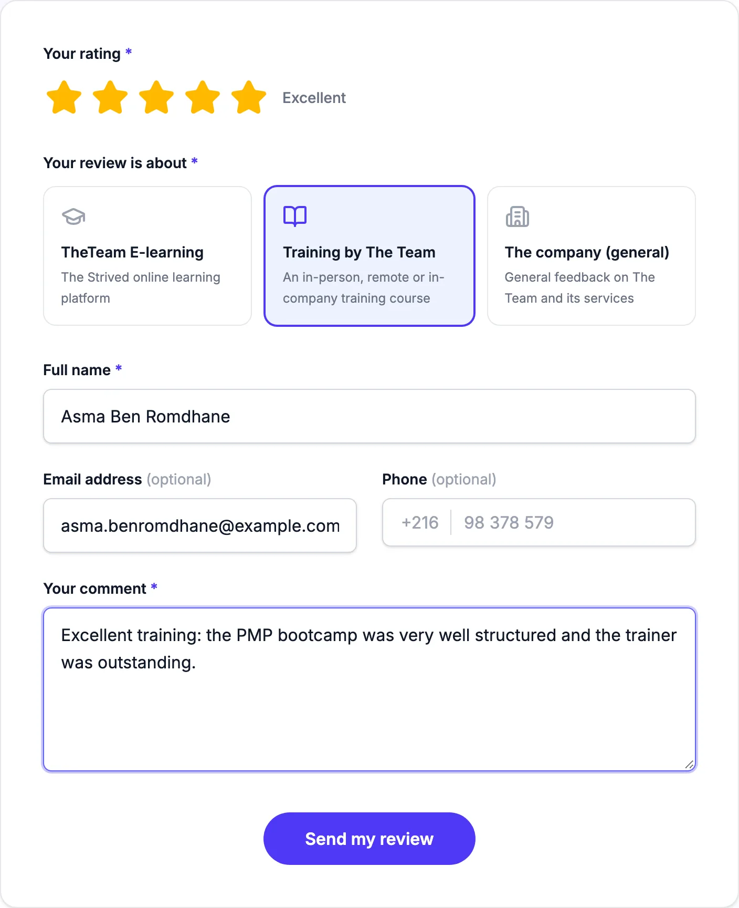
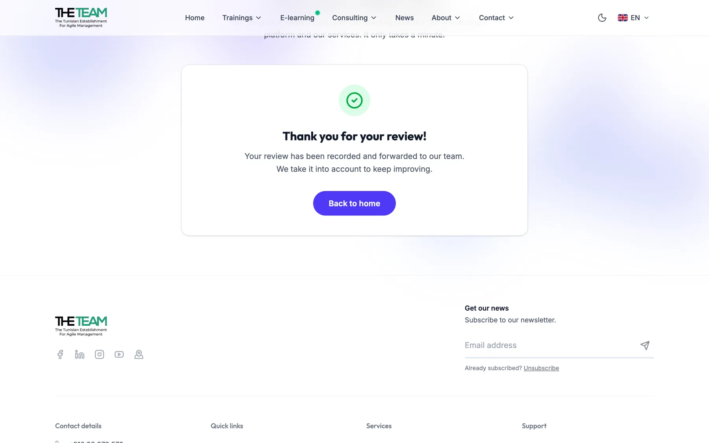
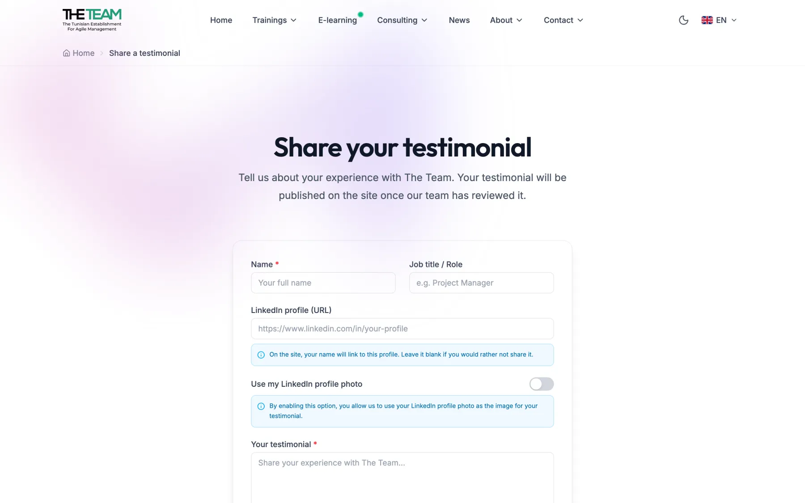
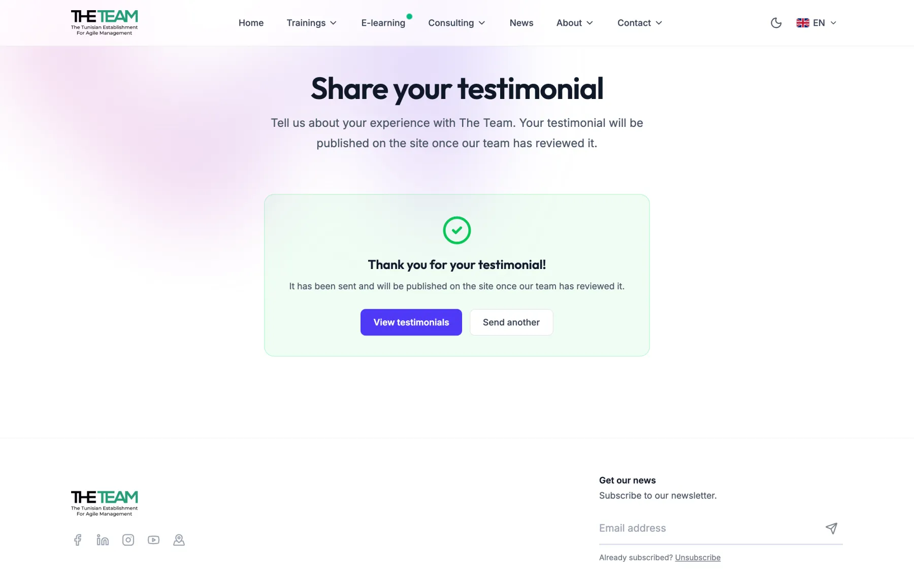

Two forms let visitors give their opinion. They do not serve the same purpose:

| | Review | Testimonial |
| :-- | :-- | :-- |
| **Purpose** | Feedback for the team (rating and comment). | A text meant to be **published** on the website. |
| **Address** | theteam.com.tn/en/review | theteam.com.tn/en/testimonials/submit |
| **Visible on the website?** | No | Yes, **after you approve it** |
| **In the panel** | Inbox → Reviews | Landing Page → Testimonials |

## The review form

<Frame caption="The “Share your experience” page.">
  
</Frame>

| Field | Required | Note |
| :-- | :-- | :-- |
| **Your rating** | Yes | From 1 to 5 stars. |
| **Your review is about** | Yes | *TheTeam E-learning*, *Training by The Team* or *The company (general)*. |
| **Full name** | Yes | |
| **Email address** | No | |
| **Phone** | No | |
| **Your comment** | Yes | |

<Frame caption="A filled-in review: 5 stars for a training course.">
  
</Frame>

After sending, the visitor sees **“Thank you for your review!”**.

<Frame caption="The confirmation shown to the visitor.">
  
</Frame>

**On your side:** the review arrives in **Inbox → Reviews** (read-only), with a **“New review”** notification and an **email** to the team. See [Newsletter and reviews](/en/guide-utilisateur/newsletter-et-avis).

## The testimonial form

<Frame caption="The “Share your testimonial” page.">
  
</Frame>

| Field | Required | Note |
| :-- | :-- | :-- |
| **Name** | Yes | |
| **Job title / Role** | No | |
| **LinkedIn profile (URL)** | No | On the website, the name will link to this profile. |
| **Use my LinkedIn profile photo** | No | By turning it on, the author allows you to use their LinkedIn photo. |
| **Your testimonial** | Yes | |

<Frame caption="A filled-in testimonial.">
  
</Frame>

After sending, the visitor sees **“Thank you for your testimonial!”**: the website tells them it will be published **once the team has reviewed it**.

<Frame caption="The confirmation shown to the visitor.">
  
</Frame>

**On your side:** the testimonial arrives **unpublished** in **Landing Page → Testimonials**, with a **“New testimonial”** notification. Read it through, add the photo if the author allowed it, then turn on **Published**: see [Landing Page](/en/guide-utilisateur/page-accueil).
