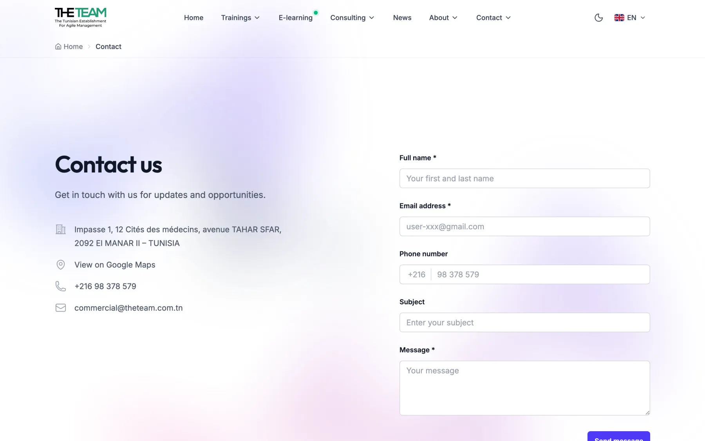
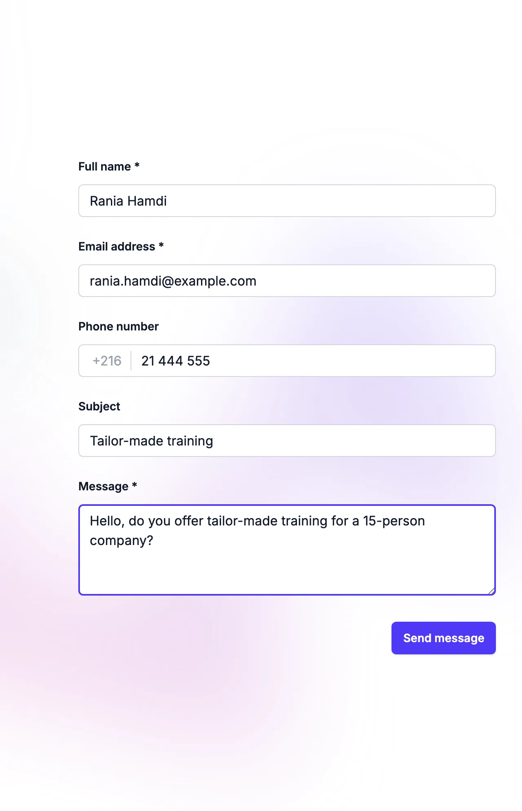
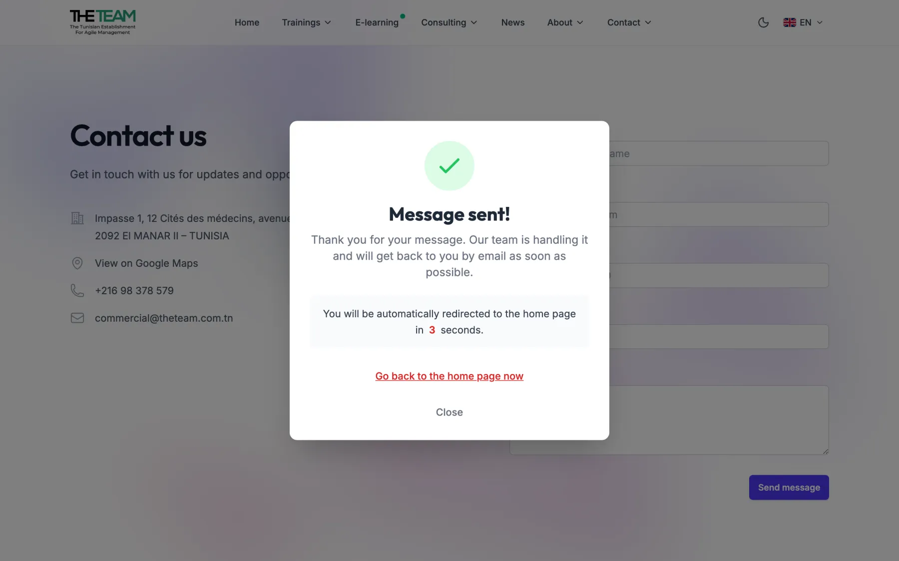

Address: **theteam.com.tn/en/contact-us** ("Contact" menu on the website). On the left, the visitor finds the company's contact details; on the right, the form.

<Frame caption="The “Contact us” page.">
  
</Frame>

## What the visitor fills in

| Field | Required |
| :-- | :-- |
| **Full name** | Yes |
| **Email address** | Yes |
| **Phone number** | No |
| **Subject** | No |
| **Message** | Yes |

<Frame caption="The filled-in form.">
  
</Frame>

## After sending

A **“Message sent!”** window confirms the message has gone and announces a reply by email. The visitor is then taken back to the home page automatically.

<Frame caption="The confirmation shown to the visitor.">
  
</Frame>

## On your side

- The message appears in **Inbox → Contact Messages**.
- A **“New contact message”** notification arrives on the bell, and the team receives an **email**.
- The visitor's address is added to the **Newsletter** list.

**Reply from your own mailbox**, to the address the visitor gave: see [Messages and complaints](/en/guide-utilisateur/messages-et-reclamations).
