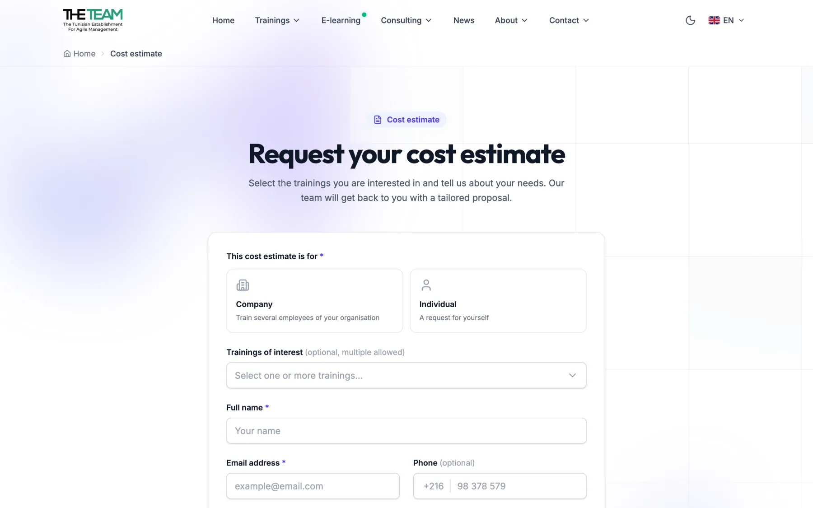
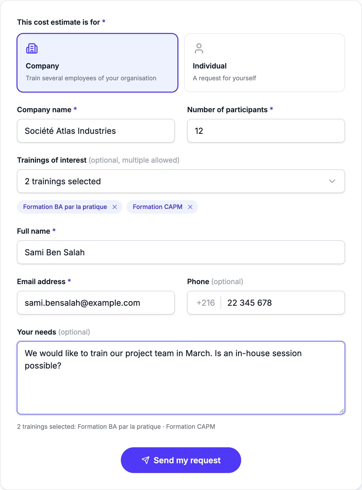
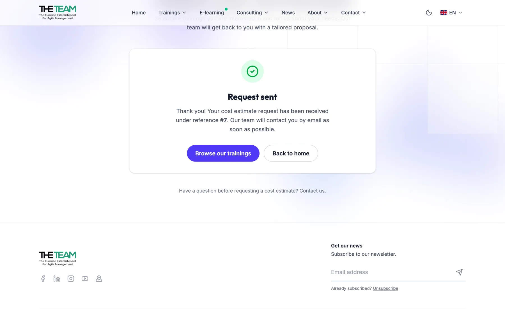

Address: **theteam.com.tn/en/devis** ("Cost estimate" link in the website footer). Here the visitor asks for a price offer for one or more training courses.

<Frame caption="The “Request your cost estimate” page, as the visitor first sees it.">
  
</Frame>

## What the visitor fills in

| Field | Required | Note |
| :-- | :-- | :-- |
| **This cost estimate is for** | Yes | *Company* (train several employees) or *Individual* (for themselves). |
| **Company name** and **Number of participants** | Yes, for a company | Only shown if “Company” is chosen. |
| **Trainings of interest** | No | A list from the catalogue; several choices allowed. |
| **Full name** | Yes | |
| **Email address** | Yes | |
| **Phone** | No | The +216 dialling code is suggested by default. |
| **Your needs** | No | Preferred dates, format (in person, remote…), questions. |

<Frame caption="A form filled in by a company, with two training courses chosen.">
  
</Frame>

## After sending

The visitor sees the message **“Request sent”** with a **reference number** (here #7): this is the request's number in the panel. The message tells them that the team will contact them by email.

<Frame caption="The confirmation shown to the visitor.">
  
</Frame>

## On your side

- The request appears in **Inbox → Devis**, with the status **New request**.
- A **“New devis request”** notification arrives on the bell, and the team receives an **email**.
- The visitor's address is added to the **Newsletter** list.

How to handle it: [Devis](/en/guide-utilisateur/devis).
