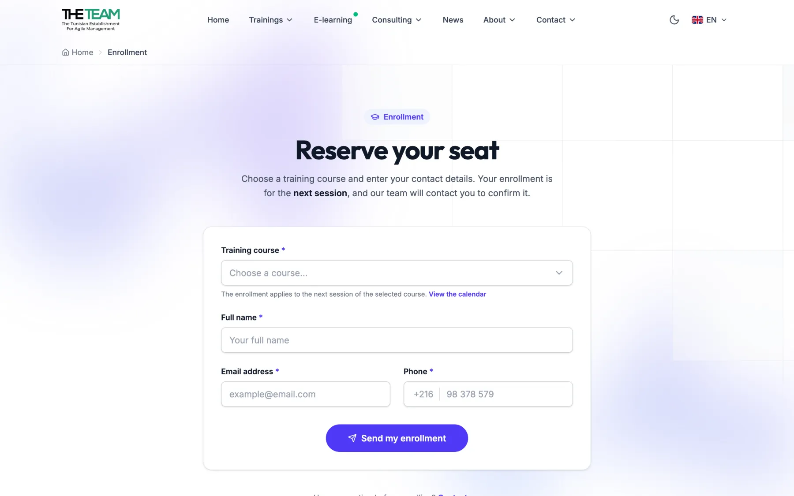
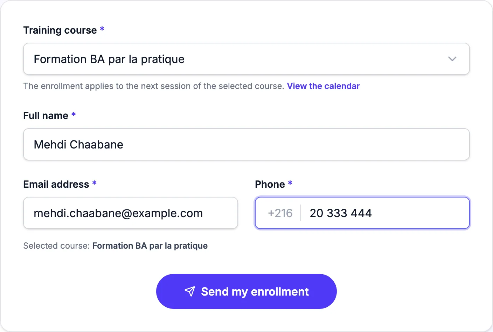
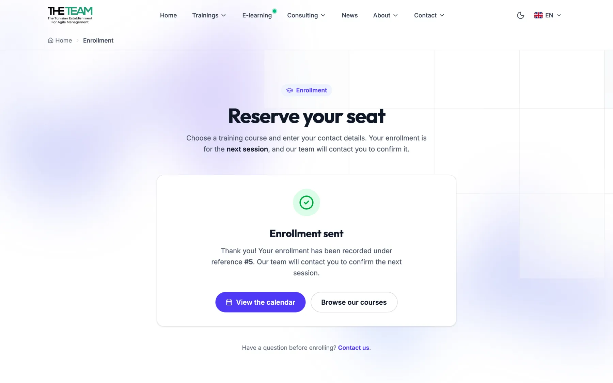

Address: **theteam.com.tn/en/enrollment** ("Training enrollment" link in the footer). Here the visitor reserves a seat at the **next session** of a training course.

<Frame caption="The “Reserve your seat” page.">
  
</Frame>

## What the visitor fills in

| Field | Required | Note |
| :-- | :-- | :-- |
| **Training course** | Yes | List of **published** training courses. A “View the calendar” link shows the session dates. |
| **Full name** | Yes | |
| **Email address** | Yes | |
| **Phone** | Yes | |

<Frame caption="The filled-in form.">
  
</Frame>

<Note>
  Only **published** training courses are offered. A draft training course does not appear in the list.
</Note>

## After sending

The visitor sees **“Enrollment sent”** with a reference number, and a note that the team will contact them to confirm the next session.

<Frame caption="The confirmation shown to the visitor.">
  
</Frame>

## On your side

- The enrollment appears in **Inbox → Enrollments**, not confirmed.
- A **“New enrollment”** notification arrives on the bell. No email is sent: **keep an eye on the bell**.

How to handle it: [Enrollments](/en/guide-utilisateur/inscriptions).
