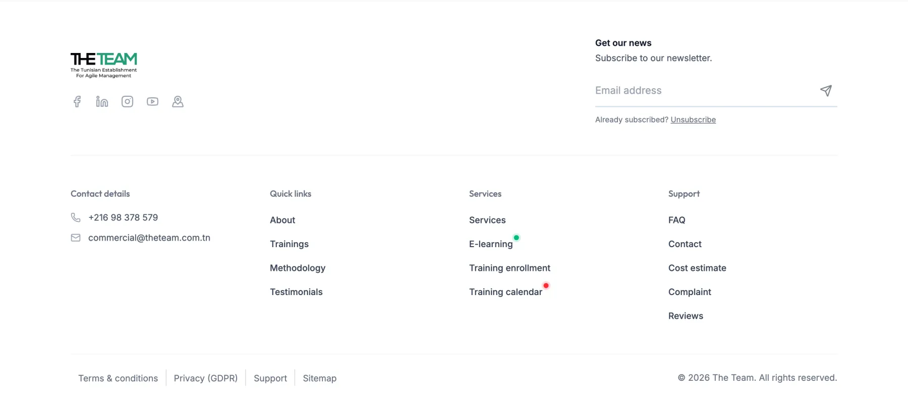
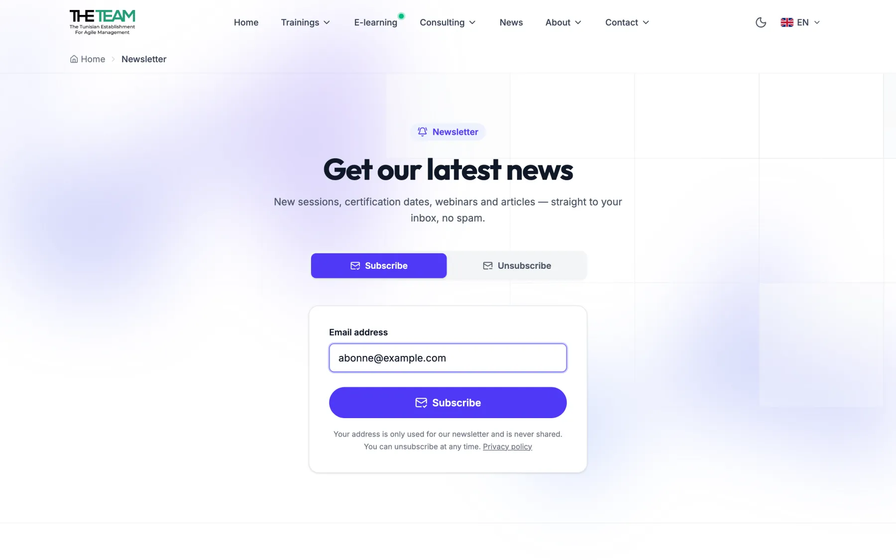
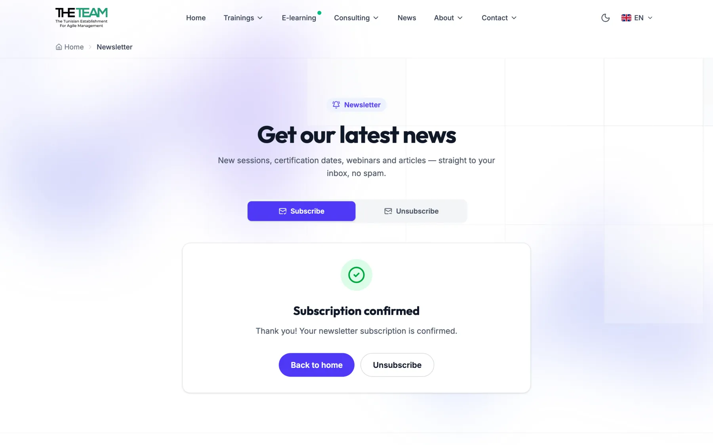

A visitor can subscribe to the newsletter in two ways.

## 1. From the footer, on every page

At the bottom of every page of the website, the **“Get our news”** block contains an email field: the visitor types their address and clicks the arrow. The **“Unsubscribe”** link just below opens the unsubscribe page.

<Frame caption="The website footer, with the sign-up field at the top right.">
  
</Frame>

## 2. From the Newsletter page

Address: **theteam.com.tn/en/newsletter**. The page has two tabs: **Subscribe** and **Unsubscribe**. An email address is all it takes.

<Frame caption="The Newsletter page, “Subscribe” tab, with an address entered.">
  
</Frame>

After clicking **Subscribe**, the visitor sees **“Subscription confirmed”** and the message “Thank you! Your newsletter subscription is confirmed.”

<Frame caption="The confirmation shown to the visitor.">
  
</Frame>

<Note>
  An address that is already subscribed can sign up again without an error. With the **Unsubscribe** tab, the address is removed from your list automatically.
</Note>

## On your side

- The address appears in **Inbox → Newsletter**, with the source **Newsletter form**.
- A **“New newsletter subscriber”** notification arrives on the bell (only for a new address).
- Addresses left in the **cost estimate**, **contact** and **complaint** forms are also added to this list, with their own source.

See [Newsletter and reviews](/en/guide-utilisateur/newsletter-et-avis).
