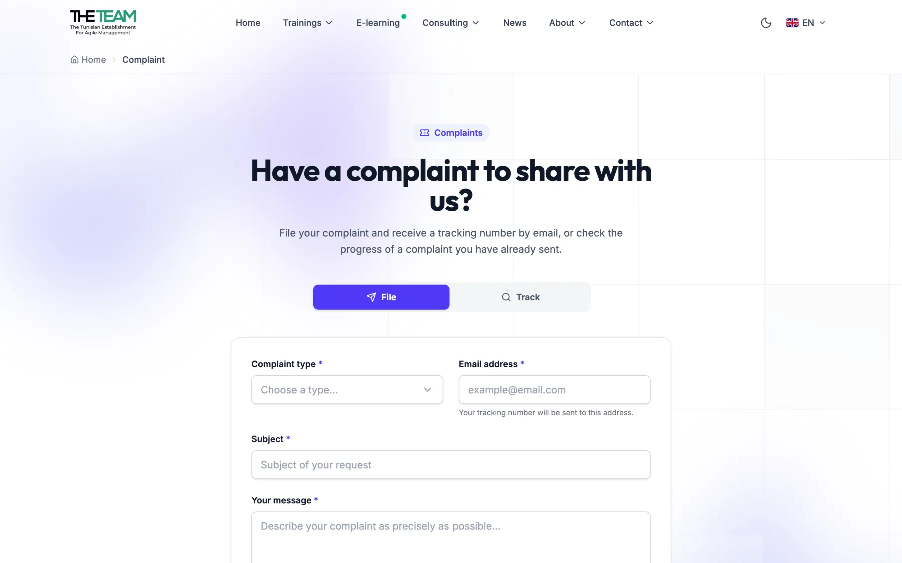
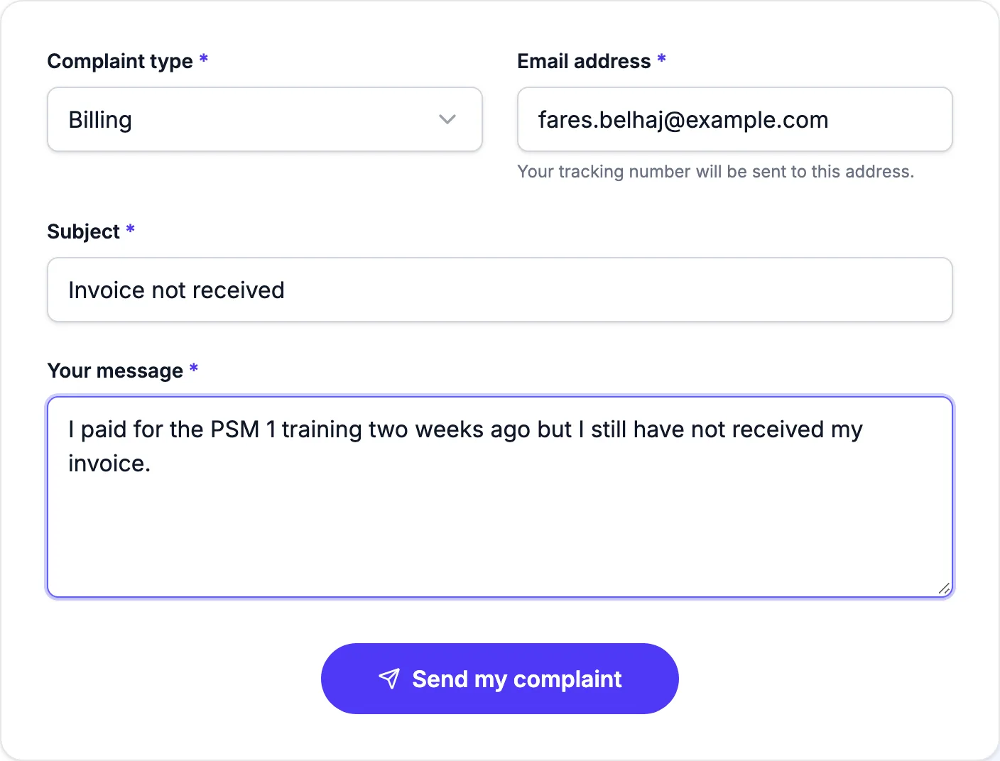
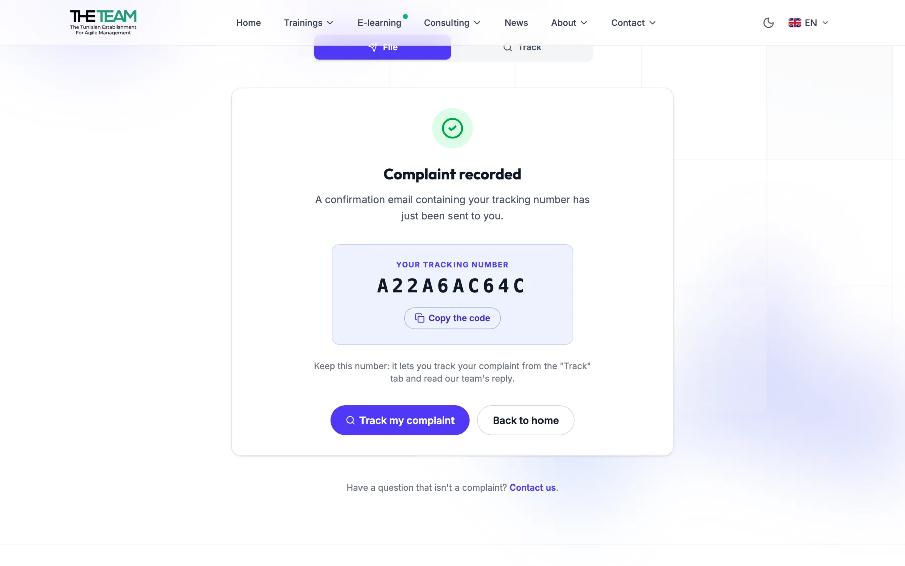
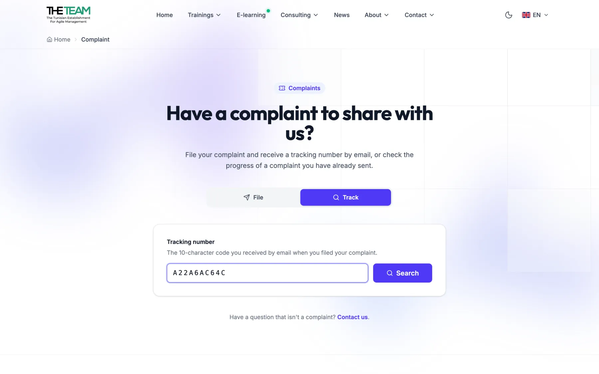
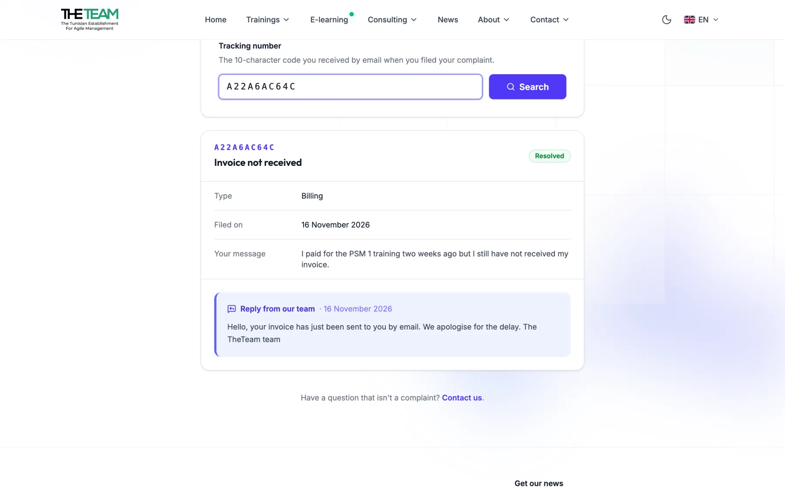

Address: **theteam.com.tn/en/reclamation** ("Complaint" link in the footer). The page has two tabs:

- **File**: send a new complaint;
- **Track**: check the progress of a complaint with its **tracking number**.

<Frame caption="The complaints page, “File” tab.">
  
</Frame>

## Filing a complaint

| Field | Required | Note |
| :-- | :-- | :-- |
| **Complaint type** | Yes | Refund, Complaint, Technical issue, Billing or Other. |
| **Email address** | Yes | The tracking number is sent to this address. |
| **Subject** | Yes | |
| **Your message** | Yes | |

<Frame caption="The filled-in form.">
  
</Frame>

## After sending: the tracking number

The visitor sees **“Complaint recorded”** and their 10-character **tracking number** (for example `A22A6AC64C`), with a button to copy it. They also receive it **by email**; the team is in copy of that email.

<Frame caption="The confirmation and the tracking number.">
  
</Frame>

## Tracking a complaint

Later, the client opens the **Track** tab, enters their number and clicks **Search**.

<Frame caption="The “Track” tab: the client enters their tracking number.">
  
</Frame>

They then see the **status** of their complaint and **the team's reply** as soon as it has been saved in the panel.

<Frame caption="The tracking result: “Resolved” status and the team's reply.">
  
</Frame>

<Tip>
  What you write in the panel's **Answer** field is **visible to the client** on this page, even before you click “Notify client by email”. Write it as a message to the client.
</Tip>

## On your side

- The complaint appears in **Inbox → Reclamations**, with the status **Pending review**.
- A **“New reclamation”** notification arrives on the bell.
- The client's address is added to the **Newsletter** list.

How to reply: [Messages and complaints](/en/guide-utilisateur/messages-et-reclamations).
