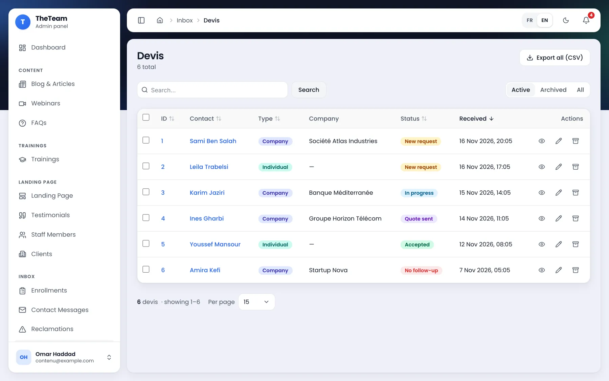
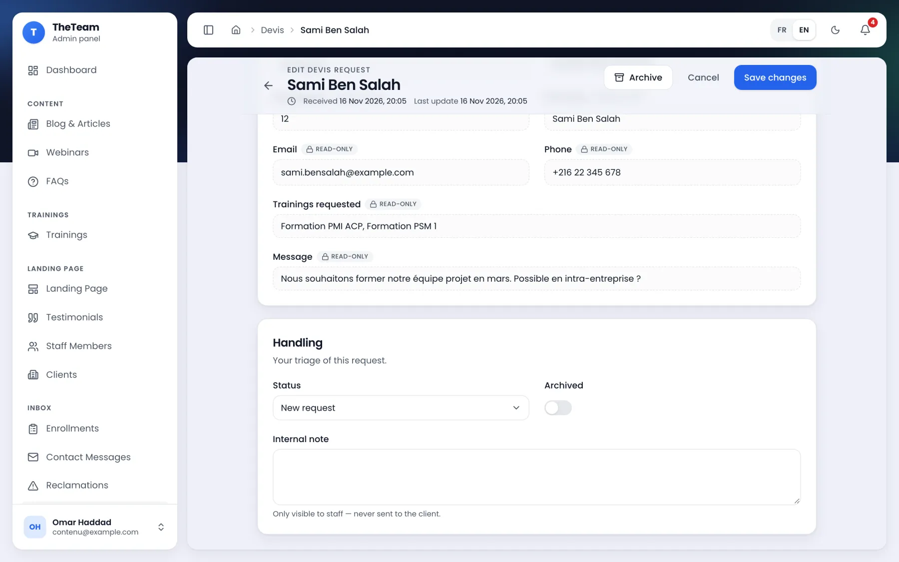
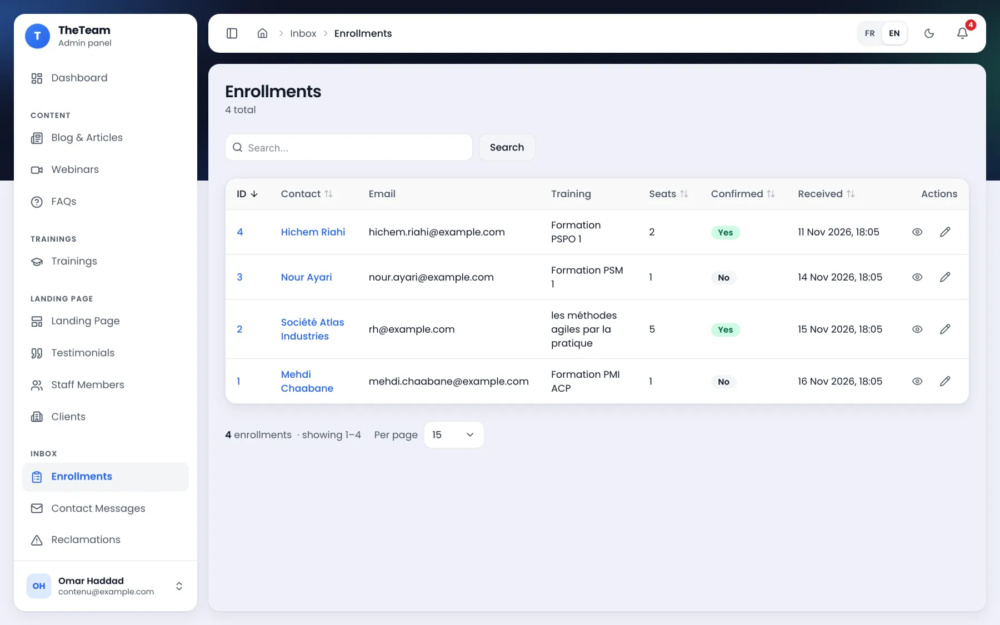
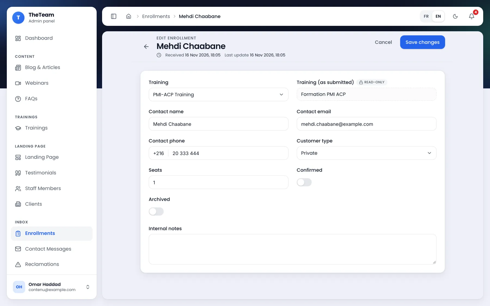
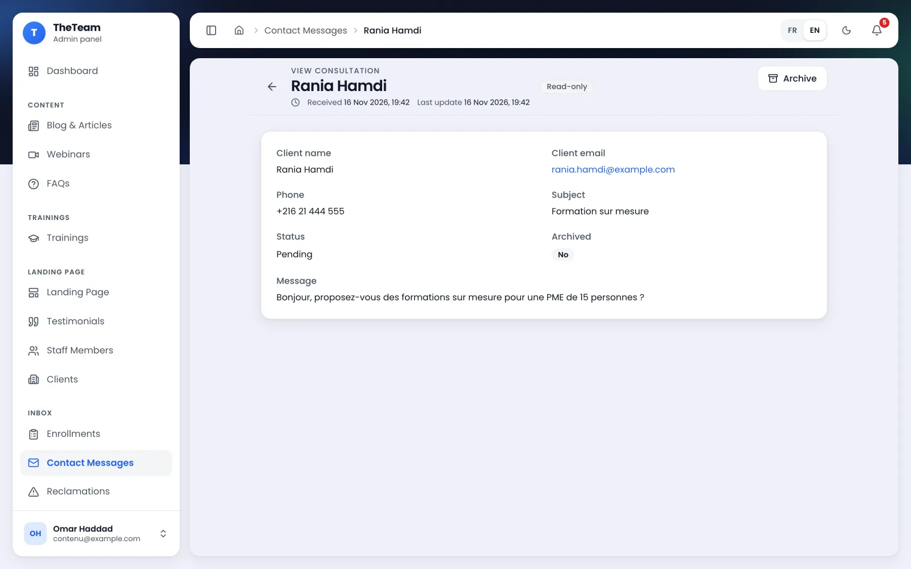
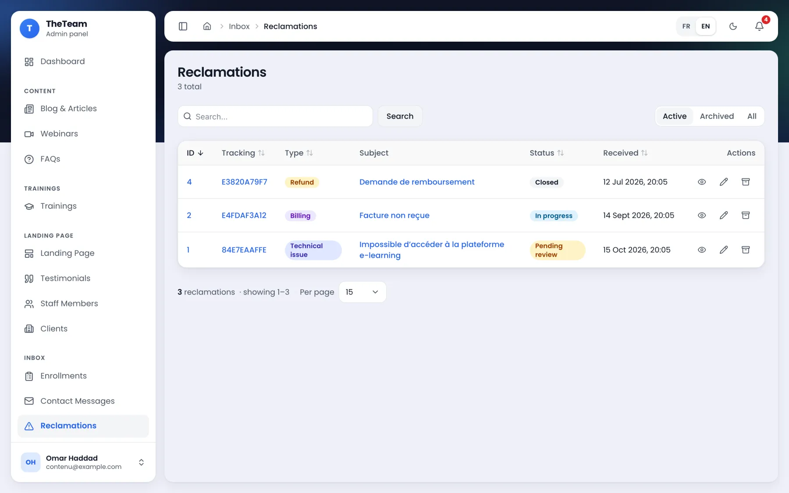
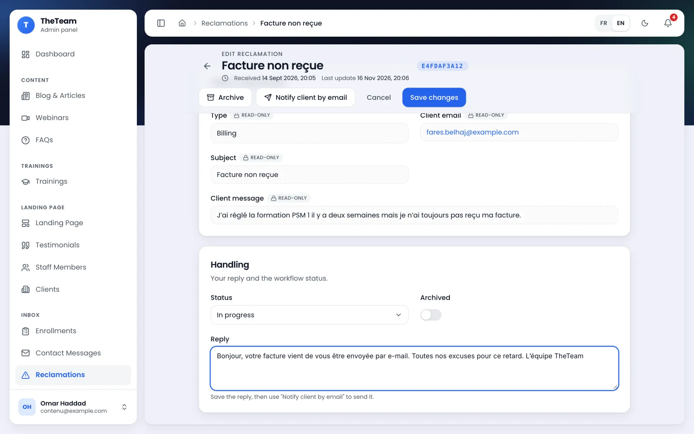
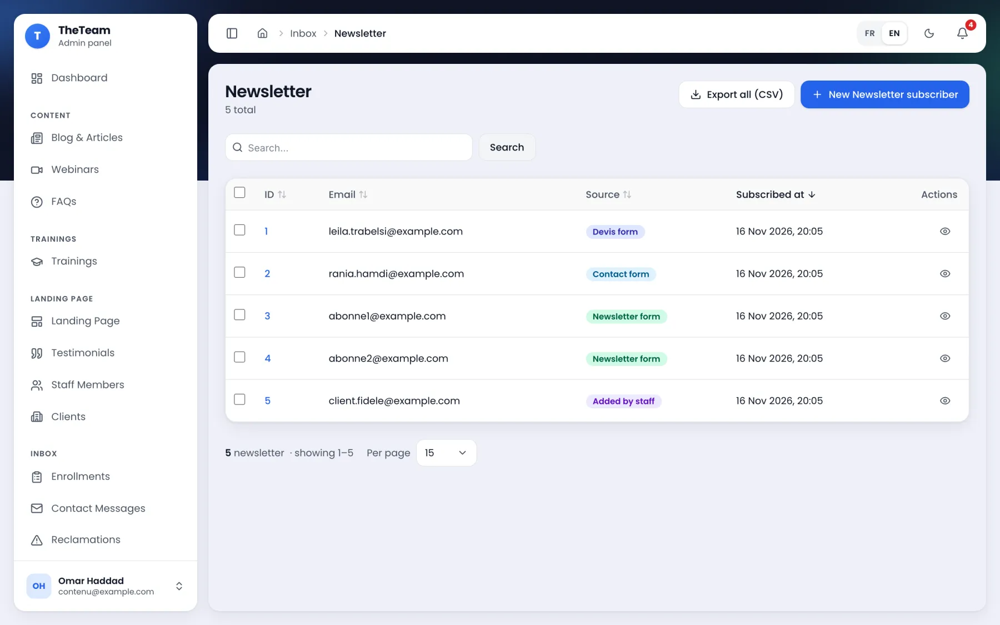
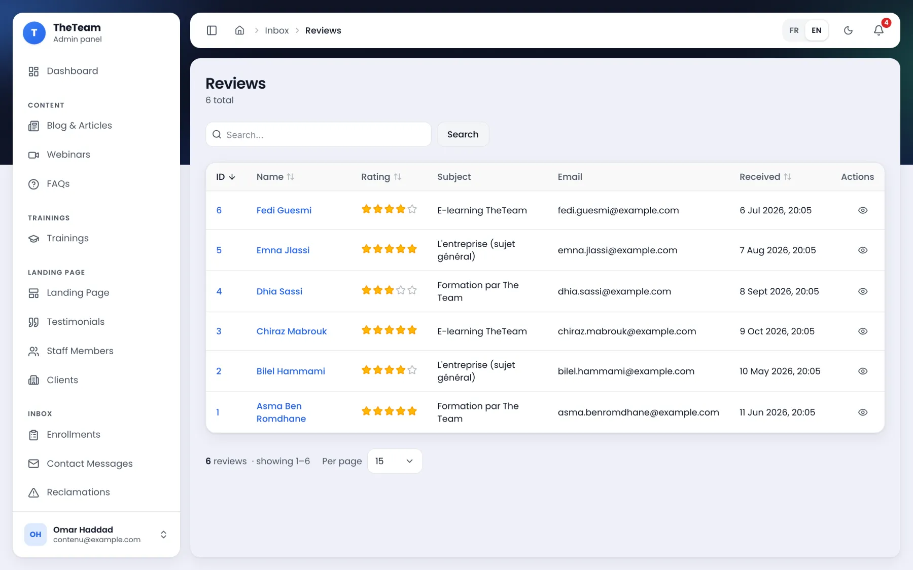

Every form filled in on the website arrives in the menu's **Inbox**, with a notification on the bell.

| Request | What you can do |
| :-- | :-- |
| Devis | Read, change the status, add a note, archive, export |
| Enrollments | Read, edit, confirm |
| Contact Messages | Read, archive |
| Reclamations | Read, reply, notify the client, archive |
| Newsletter | View, add an address, export |
| Reviews | Read |

<Info>
  You cannot delete anything: **archive** what is finished. Archived items can still be viewed with the **Archived** filter.
</Info>

## Quote requests

Menu **Inbox → Devis**.

<Frame caption="The list of quote requests: view, edit and archive icons.">
  
</Frame>

<Steps>
  <Step title="Open the request">
    The **Client submission** section (read-only) shows what the visitor filled in: company or individual, participants, contact details, requested trainings, message.
  </Step>
  <Step title="Contact the client">
    By phone or email. The panel does not send the quote itself.
  </Step>
  <Step title="Update the status and the internal note">
    **Handling** section: **New request → In progress → Quote sent → Accepted** or **No follow-up**. The **internal note** is never sent to the client. Save.
  </Step>
  <Step title="Archive when it is finished">
    **Archive** button at the top of the form.
  </Step>
</Steps>

<Frame caption="The Handling section of a quote request.">
  
</Frame>

**Export all (CSV)** downloads the quote requests for Excel (tick rows to export only those).

## Enrollments

Menu **Inbox → Enrollments**.

<Frame caption="The list of enrollments.">
  
</Frame>

Open the enrollment (pencil), contact the person to confirm the session, then turn on **Confirmed** and save. The **Internal notes** are for the team.

<Frame caption="An enrollment form.">
  
</Frame>

## Contact messages

Menu **Inbox → Contact Messages**. Messages are **read-only**: open one (eye), **reply from your email** to the address shown, then click **Archive**.

<Frame caption="An open contact message, with the Archive button.">
  
</Frame>

## Complaints

Menu **Inbox → Reclamations**. Each complaint has a **tracking number** the client uses to follow its progress on the website.

<Frame caption="The list of complaints.">
  
</Frame>

<Steps>
  <Step title="Open the complaint">
    Read the **Client submission** (read-only).
  </Step>
  <Step title="Write the reply and choose the status">
    **Handling** section: **Reply** and **Status** (Pending review, In progress, Resolved, Closed).
  </Step>
  <Step title="Save">
    The reply becomes visible to the client on the website's tracking page.
  </Step>
  <Step title="Click “Notify client by email”">
    The client receives your reply by email (with the team in copy).
  </Step>
</Steps>

<Frame caption="The Handling section: status and reply to the client.">
  
</Frame>

<Warning>
  **Save first, notify second**: the button sends the **saved** reply. Write it as a message to the client.
</Warning>

## The newsletter

Menu **Inbox → Newsletter**: the subscribed addresses. The **Source** column shows where they came from (newsletter form, quote request, contact, complaint, or added by the team).

<Frame caption="The list of subscribers.">
  
</Frame>

- **Adding an address**: **New Newsletter subscriber**, enter the email, **Create**.
- **Exporting**: **Export all (CSV)** for your email-sending tool.

## Reviews

Menu **Inbox → Reviews**: rating out of 5, subject and comment. Reviews are **read-only**; open one (eye) to read the full comment.

<Frame caption="The list of reviews.">
  
</Frame>
