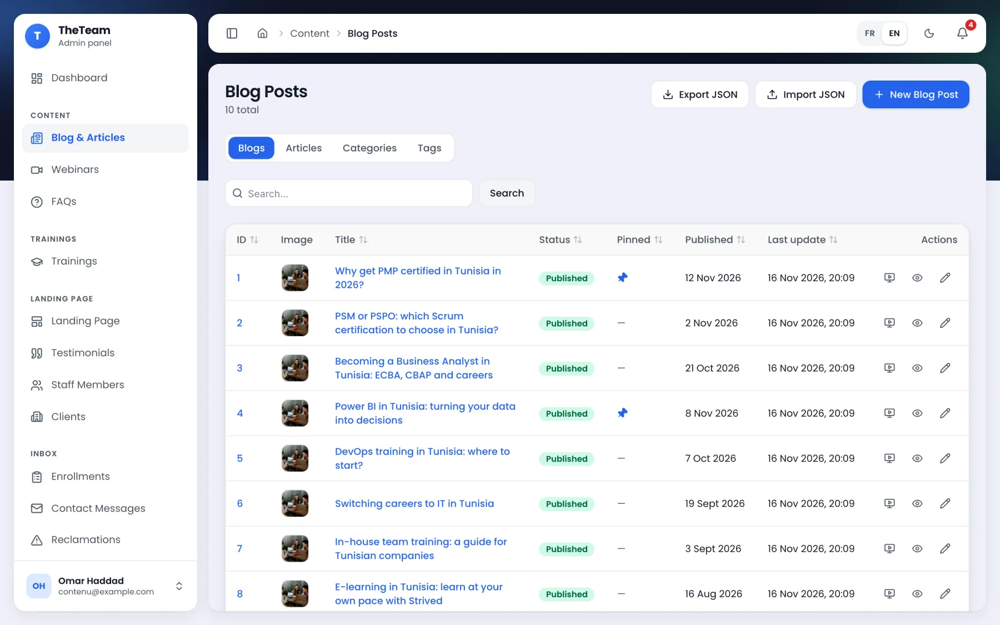
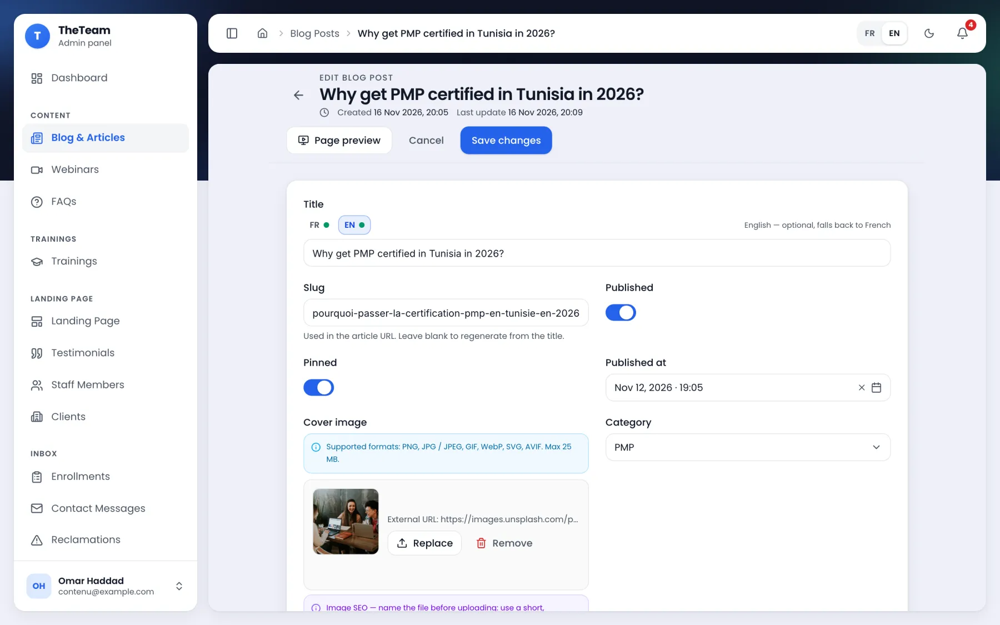
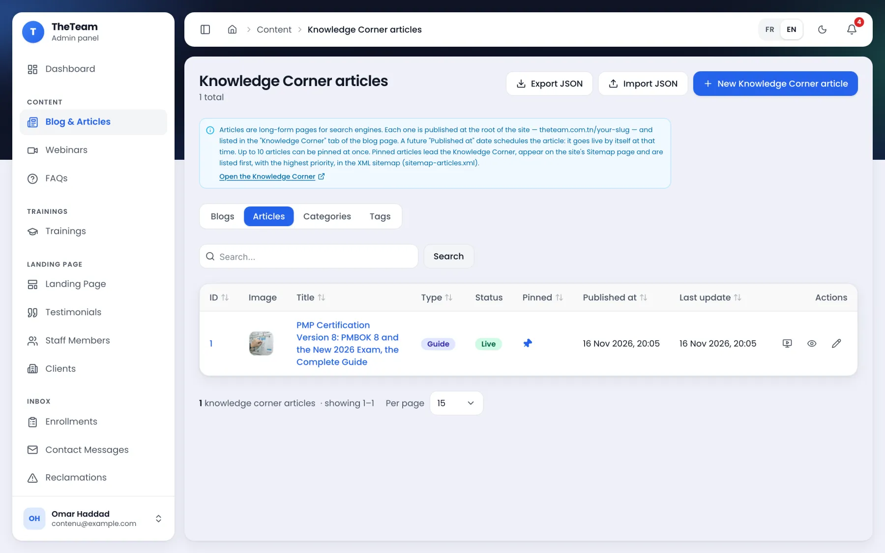
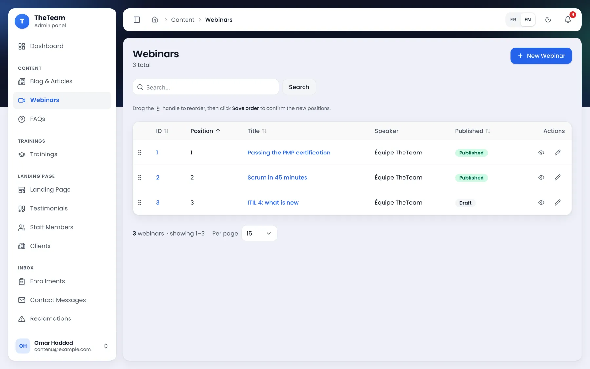
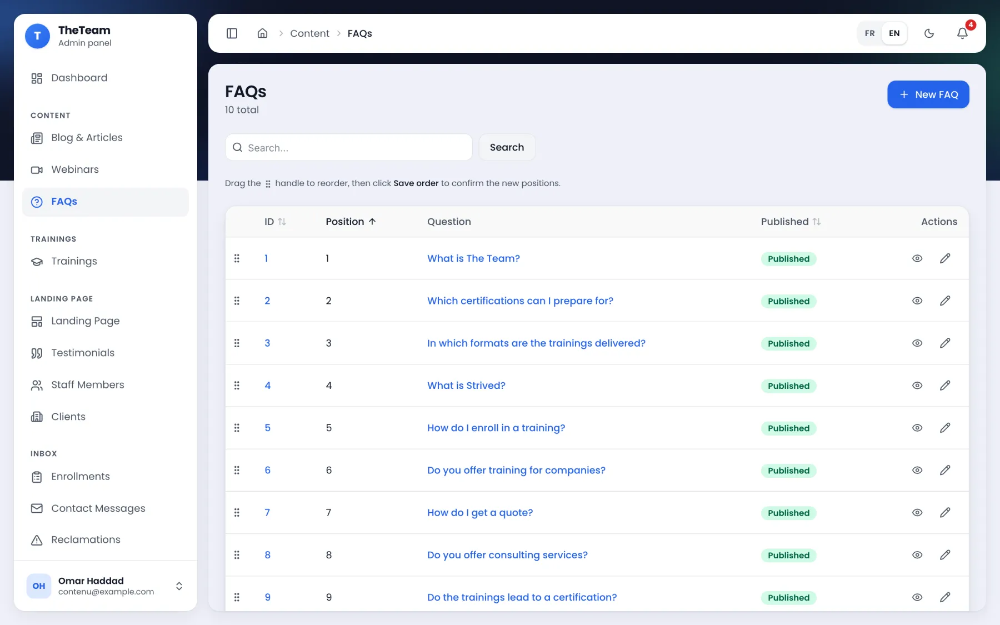
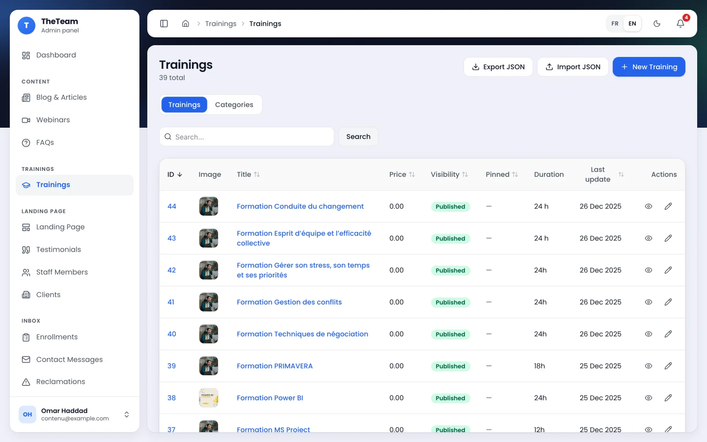
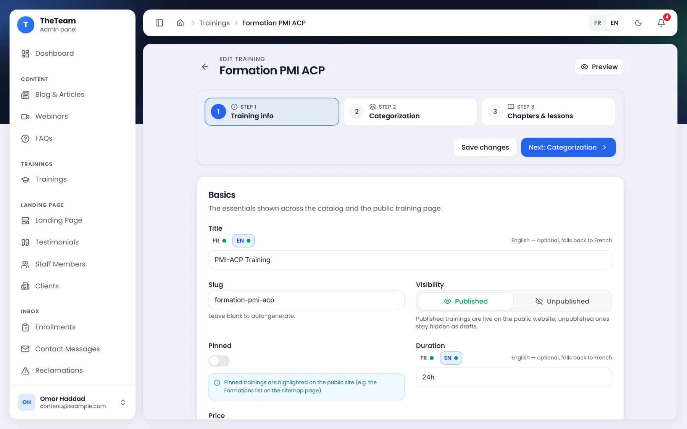
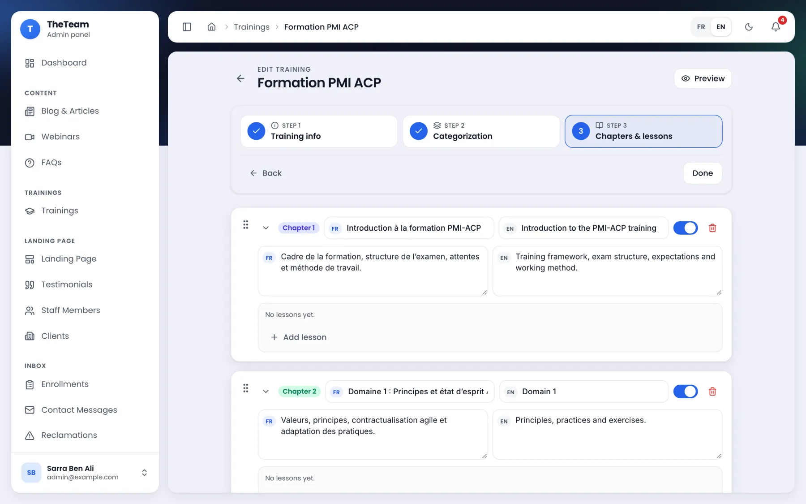

You can **create, edit and publish** all the website's content. The only thing you cannot do is **delete**: to take content off the website, **unpublish it** (see the bottom of the page).

## The blog

Menu **Content → Blog & Articles**, **Blogs** tab.

<Frame caption="The list of blog posts: preview, view and edit icons (no deletion for your role).">
  
</Frame>

<Steps>
  <Step title="Click “New Blog Post”">
    Or the pencil of an existing post.
  </Step>
  <Step title="Fill in the title, cover image, category and author">
    The slug (end of the address) is created automatically. The cover image is required.
  </Step>
  <Step title="Write the content">
    The editor works like a word processor (bold, H2/H3 subheadings, lists, links). The **Image** button inserts an image into the text.
  </Step>
  <Step title="Check with “Page preview”">
    The post opens as it will appear on the website.
  </Step>
  <Step title="Turn on “Published” and save">
    **Pinned** features the post at the top of the blog.
  </Step>
</Steps>

<Frame caption="A blog post form.">
  
</Frame>

<Tip>
  Before uploading an image, give it a descriptive name (`formation-pmp-tunis-2026.webp` rather than `IMG_4821.jpg`) and keep it light (under about 200 KB, for example with [squoosh.app](https://squoosh.app/)): the website will rank better and load faster.
</Tip>

## Knowledge Corner articles

**Articles** tab. In-depth articles designed for Google, published at the address `theteam.com.tn/votre-slug`.

<Frame caption="The Articles tab. The Status column shows Live, Scheduled or Draft.">
  
</Frame>

- Fill in the sections **Article** (title, slug, type, excerpt, content structured with H2/H3), **Cover image**, **Publishing** and **SEO** (optional). Each field has help text below it.
- **Scheduling**: turn on **Published** and choose a future date in **Published at**: the article will go live on its own.
- **Pinning**: up to 10 articles at a time.
- **Avoid changing the slug** of an article that is already published: existing links would stop working.

The **Categories** and **Tags** tabs work the same way (**New**, a name, **Create**).

## Webinars

Menu **Content → Webinars**.

<Frame caption="The list of webinars.">
  
</Frame>

**New Webinar** → title, **YouTube link** (the video link or the embed code), speaker, description. Check the **live preview** at the bottom of the form, turn on **Published** and save. The **How do I get the YouTube embed code?** link shows the path on YouTube (Share → Embed → Copy).

## The FAQ

Menu **Content → FAQs**.

<Frame caption="The list of questions. The handle on the left lets you change the order.">
  
</Frame>

- **Adding**: **New FAQ**, then Question, Answer, **Published**, **Create**.
- **Changing the order**: drag the rows, then **Save order**.

## Trainings

Menu **Trainings**.

<Frame caption="The list of trainings.">
  
</Frame>

A training is filled in over **three steps**, shown at the top of the form:

<Steps>
  <Step title="Training info">
    Title, **Visibility** (Published / Unpublished), duration, price, images, description, certification, prerequisites and objectives.
  </Step>
  <Step title="Categorization">
    Click the training's categories (several are possible).
  </Step>
  <Step title="Chapters & lessons">
    The program: **Add chapter**, then **Add lesson** in each chapter. Drag to reorder. For a new training, save steps 1 and 2 first.
  </Step>
</Steps>

<Frame caption="Step 1 of a training.">
  
</Frame>

<Frame caption="Step 3: chapters and lessons.">
  
</Frame>

The **Preview** button shows the training as visitors will see it.

<Note>
  A change to a training can take **up to 5 minutes** to appear on the website: this is normal, the website keeps the catalog in memory to be faster.
</Note>

## Taking content off the website

You cannot delete, but you can **hide**:

| Content | To take it off the website |
| :-- | :-- |
| Blog post, Knowledge Corner article | Turn off **Published** |
| Webinar, FAQ question | Turn off **Published** |
| Training | **Visibility** → **Unpublished** |

The content stays in the panel (as a draft) and can be republished at any time. If a permanent deletion is needed, ask an administrator.
