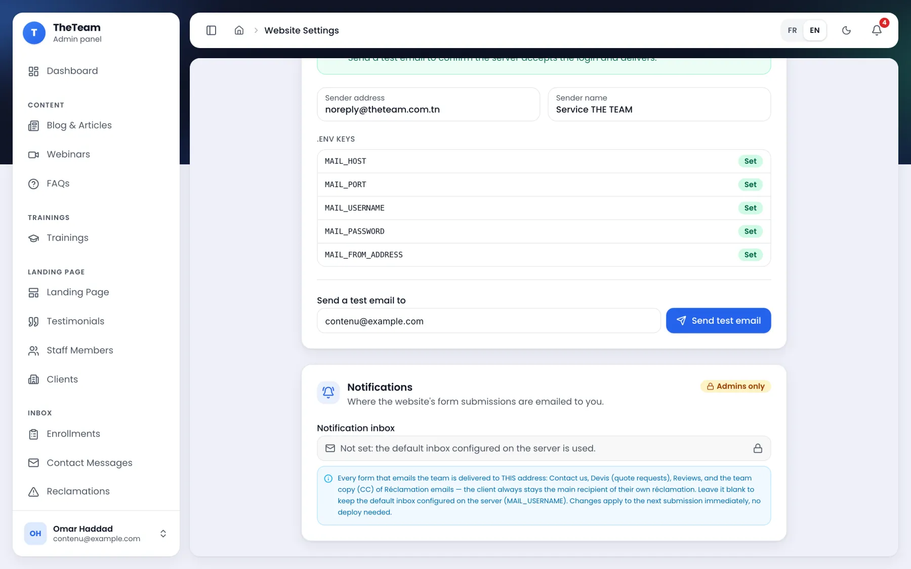

Menu **System → Website Settings**, **Email sending (SMTP)** card.

**SMTP** is the service that sends the website's emails: copies of contact, quote request and review forms to the team, complaint emails to the client (for example when you click “Notify client by email”), invitations, password resets… If sending does not work, requests still arrive in your **Inbox**, but **no email goes out any more**.

<Info>
  You can **view this card** and **send a test email**. You cannot change anything here: the configuration is done on the server. If there is a problem, let an administrator or the person in charge of technical matters know.
</Info>

<Frame caption="The Email sending (SMTP) card: sender address, configuration keys and test email.">
  
</Frame>

## Reading the card's status

| Message shown | Meaning | What to do |
| :-- | :-- | :-- |
| **SMTP is configured** (green) | All settings are present. | Send a test email to confirm that emails arrive. |
| **SMTP is not configured** (red) | Some settings are missing on the server. | Let an administrator know. |
| **Emails are not delivered (test mode)** (orange) | The server does not send emails, it only writes them to its log. | Let an administrator know. |

The card also shows the **Sender address** (the sender of the website's emails, for example `noreply@theteam.com.tn`) and the **Sender name**. The configuration keys are listed by name with **Set** or **Missing**; their value is never shown.

## Sending a test email

Do this, for example, if a client says they did not receive your reply to their complaint.

<Steps>
  <Step title="Check the address">
    The **Send a test email to** field suggests your address; you can enter another one.
  </Step>
  <Step title="Click “Send test email”">
    The email is sent immediately.
  </Step>
  <Step title="Check your inbox">
    A green message confirms: “Test email sent to … Check the inbox (and the spam folder).” You receive an email titled **“E-mail de test — THETEAM”**. Remember to check the **spam** folder.
  </Step>
</Steps>

<Note>
  **5 test emails per minute** at most. Beyond that: “Too many test emails. Wait a minute and try again.”
</Note>

## If the test email fails

A red message appears. **Take a screenshot and pass it on to an administrator**: the message tells them what to fix.

| Message | In plain words |
| :-- | :-- |
| “The SMTP server rejected the login…” | The email account's password or username is incorrect. |
| “The SMTP server cannot be reached…” | The sending server is not responding. |
| “The secure connection to the SMTP server failed…” | A security setting is incorrect. |
| “The SMTP server refused the sender or the recipient…” | The sender address is not allowed. |
| “Email sending is not configured…” | Some settings are missing on the server. |
| “The test email could not be sent…” | Another error, detailed in the server log. |

<Warning>
  **Green message but nothing arrives?** Look in the **spam** folder, then try again with another address. If still nothing arrives, let an administrator know.
</Warning>

## The address that receives the forms

The team's address that receives the website's forms is shown in the **Notifications** card, just below. It is **read-only** for you: see [Website settings](/en/guide-utilisateur/gestionnaire/parametres).
