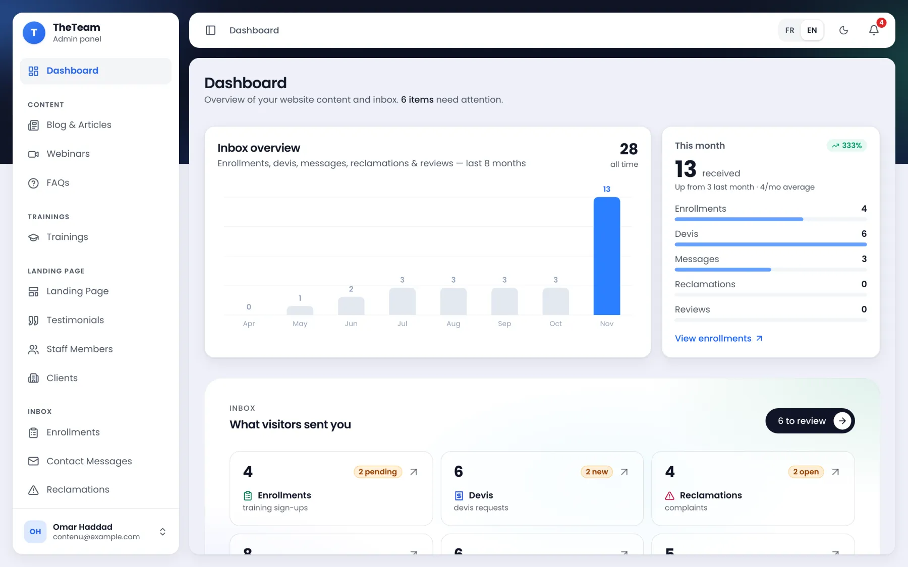
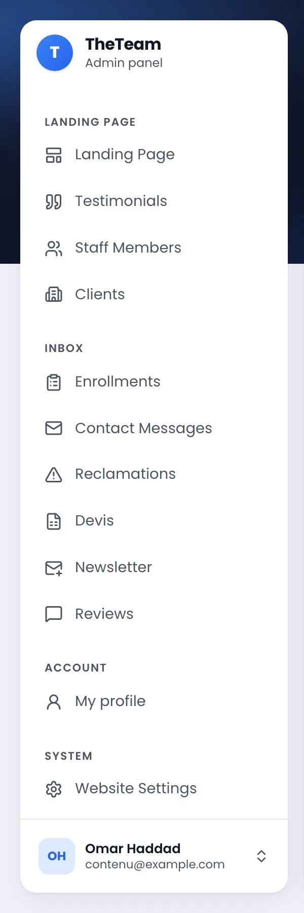

As a **Content Manager**, you keep the **theteam.com.tn** website alive: you publish articles, trainings, webinars and the FAQ, and you **handle the requests** sent by visitors (quote requests, enrollments, complaints…).

This guide is written for you: every screenshot was taken with a content manager account, so you see **exactly your screen**.

<Frame caption="Your dashboard, right after signing in.">
  
</Frame>

## What you can do

<CardGroup cols={2}>
  <Card title="Publish content" icon="newspaper" href="/en/guide-utilisateur/gestionnaire/contenu">
    Blog, Knowledge Corner articles, webinars, FAQ and trainings: create, edit, publish.
  </Card>
  <Card title="Landing page" icon="house" href="/en/guide-utilisateur/gestionnaire/page-accueil">
    Promo banner, banner strip, testimonials and clients.
  </Card>
  <Card title="Handle requests" icon="inbox" href="/en/guide-utilisateur/gestionnaire/boite-de-reception">
    Quote requests, enrollments, messages, complaints, newsletter and reviews.
  </Card>
  <Card title="Website settings" icon="gear" href="/en/guide-utilisateur/gestionnaire/parametres">
    Check that email sending and image storage are working.
  </Card>
</CardGroup>

## Your permissions at a glance

| Part of the panel | What you can do |
| :-- | :-- |
| Blog, articles, categories, tags | Create, edit, publish |
| Webinars, FAQ | Create, edit, publish, reorder |
| Trainings and training categories | Create, edit, publish |
| Landing Page | Edit **only** the promo banner and the banner strip |
| Testimonials | Review, edit, publish |
| Staff Members | View |
| Clients | Add, edit |
| Devis, Reclamations | View, handle, archive, export |
| Enrollments | View, edit, confirm |
| Contact Messages | Read, archive |
| Newsletter | View, add an address, export |
| Reviews | Read |
| Website Settings | Run the tests; notification address is read-only |

## What is reserved for administrators

- **Deleting** anything. You can **archive** (put away without losing) or **unpublish** (hide from the site). For a real deletion, ask an administrator.
- Staff accounts (**Users**), **roles and permissions** and the **activity log**: these entries do not appear in your menu.
- The Landing Page fields marked **ADMINS ONLY** (name, logos, contact details, social networks…).
- The email address that receives the website's forms.

<Tip>
  The panel only shows what you are allowed to do: no **Delete** button, no **Users** entry. If a button is missing, that is normal.
</Tip>

## Your menu

<Frame caption="The bottom of your menu: the inbox, then “My profile” and “Website Settings”.">
  
</Frame>

## Where to start?

<Steps>
  <Step title="Getting started">
    [Sign in and understand the screen](/en/guide-utilisateur/gestionnaire/prise-en-main), then [turn on notifications](/en/guide-utilisateur/gestionnaire/notifications).
  </Step>
  <Step title="Your daily tasks">
    [Publish content](/en/guide-utilisateur/gestionnaire/contenu) and [handle requests](/en/guide-utilisateur/gestionnaire/boite-de-reception).
  </Step>
  <Step title="The website from the visitor's side">
    To find out what the visitor filled in, the **Visitor side** tab shows each form on the website.
  </Step>
</Steps>
