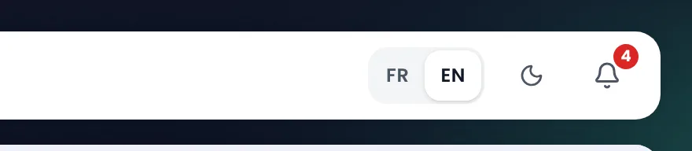
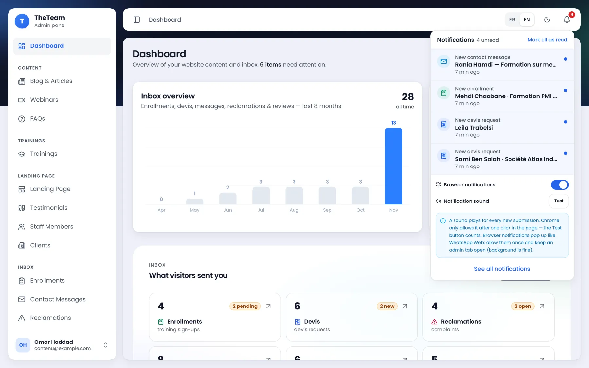
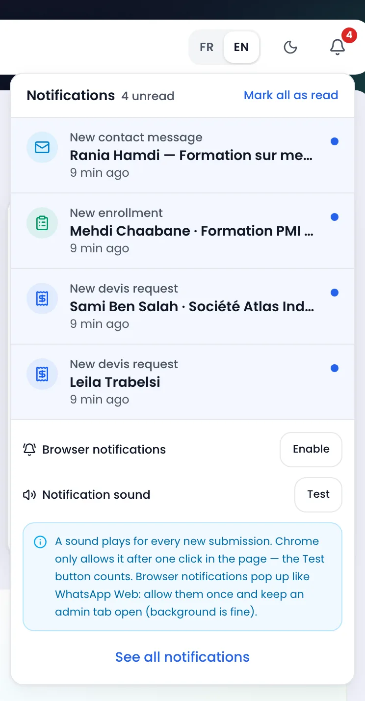
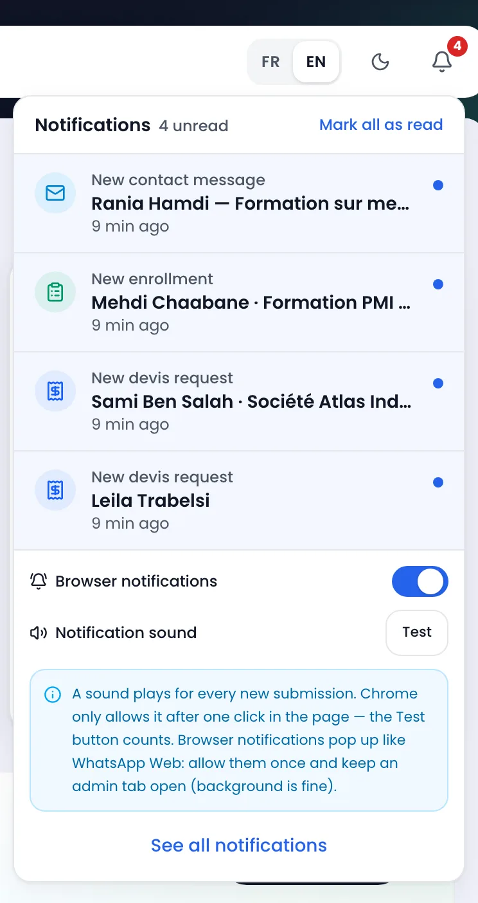
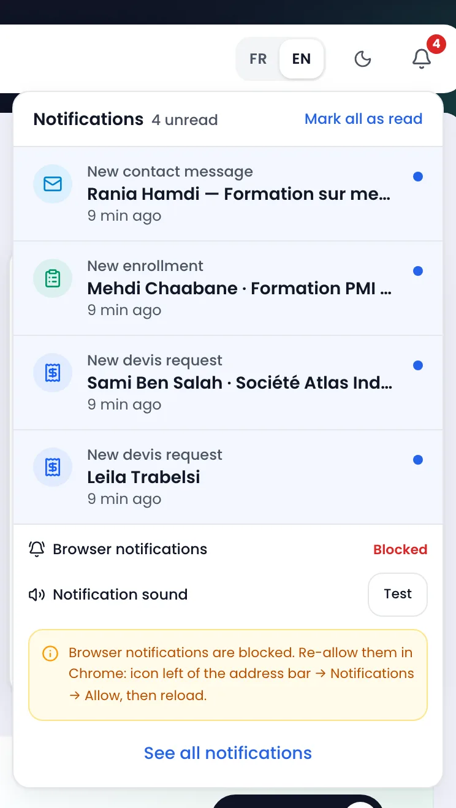

Every time a visitor fills in a form on the website, the panel alerts you with the **bell**, at the top right. Your notifications are **personal**: what you read stays unread for your colleagues.

## What triggers a notification

| Form filled in on the website | Notification received | Where to handle it |
| :-- | :-- | :-- |
| Quote request | **New devis request** | Inbox → Devis |
| Training enrollment | **New enrollment** | Inbox → Enrollments |
| Contact form | **New contact message** | Inbox → Contact Messages |
| Complaint | **New reclamation** | Inbox → Reclamations |
| Review | **New review** | Inbox → Reviews |
| Newsletter sign-up | **New newsletter subscriber** | Inbox → Newsletter |
| Testimonial | **New testimonial** | Landing Page → Testimonials |

How to handle each request: [Handle requests](/en/guide-utilisateur/gestionnaire/boite-de-reception).

## The bell

The **red number** on the bell shows your unread notifications. The panel checks for new requests **roughly every 25 seconds** and as soon as you come back to the tab: no need to reload the page.

<Frame caption="The bell with 4 unread notifications.">
  
</Frame>

Click the bell:

- the latest requests appear, unread ones in bold with a blue dot;
- **click a request** to open it directly;
- **Mark all as read** resets the counter to zero;
- **See all notifications** opens the full page, with the history.

<Frame caption="The bell menu open on your dashboard.">
  
</Frame>

## The two alerts

At the bottom of the bell menu:

| Alert | What it does |
| :-- | :-- |
| **Notification sound** | A short sound for each new request, as long as a panel tab is open. |
| **Browser notifications** | A pop-up from your computer (like WhatsApp Web) when you are on another tab or another application. Click it to open the request. |

<Frame caption="Before turning them on: the “Enable” button and the “Test” button.">
  
</Frame>

## Turn on notifications (once per computer)

<Steps>
  <Step title="Open the panel in Google Chrome">
    Chrome is recommended; Edge and Firefox work the same way.
  </Step>
  <Step title="Click the bell, at the top right">
    The notifications menu opens.
  </Step>
  <Step title="Click “Enable”, then “Allow”">
    To the right of **Browser notifications**. The browser shows a small window near the address bar: click **Allow**. A **“Notifications enabled”** pop-up confirms it, and the button becomes a **blue switch**.
  </Step>
  <Step title="Click “Test”">
    To the right of **Notification sound**: you hear the sound. This click unlocks the sound from then on.
  </Step>
  <Step title="Keep a panel tab open">
    Even in the background or in a minimized window.
  </Step>
</Steps>

<Frame caption="Notifications enabled: the switch is blue.">
  
</Frame>

- **Several requests at once**: a single pop-up sums them up (“3 new submissions”).
- **Pausing the pop-ups**: turn off the blue switch. The setting applies to this browser and this computer: turn it on again on each computer.

## The menu shows “Blocked”

If permission was refused, the menu shows **Blocked** in red and an orange frame.

<Frame caption="Browser notifications are blocked.">
  
</Frame>

<Steps>
  <Step title="Click the icon to the left of the address">
    In Chrome, the settings icon just before `admin.theteam.com.tn`.
  </Step>
  <Step title="Set “Notifications” to “Allow”">
    Otherwise: **Site settings** → **Notifications** → **Allow**.
  </Step>
  <Step title="Reload the page">
    Press **F5** (or **Cmd + R** on a Mac).
  </Step>
</Steps>

## The sound or pop-ups do not work

- **No sound**: click **Test** once. Otherwise, in Chrome: icon to the left of the address → **Site settings** → **Sound** → **Allow**. Also check your computer's volume.
- **No pop-up** even though the switch is blue: your computer may be blocking them.

<Tabs>
  <Tab title="Windows">
    **Settings → System → Notifications**: allow **Google Chrome** and turn off **Focus assist** (“Do not disturb”).
  </Tab>
  <Tab title="Mac">
    **System Settings → Notifications → Google Chrome**: turn on **Allow notifications**, and check that no **Focus** mode is active.
  </Tab>
</Tabs>

<Warning>
  **The browser must stay open.** If all panel tabs are closed, you are not alerted. Nothing is lost: the requests are waiting for you in the bell and in the **Inbox**.
</Warning>

## In short

<Check>
  1. Click the bell, then **Enable** and **Allow**.
  2. Click **Test** to unlock the sound.
  3. Keep a panel tab open, even in the background.
</Check>
