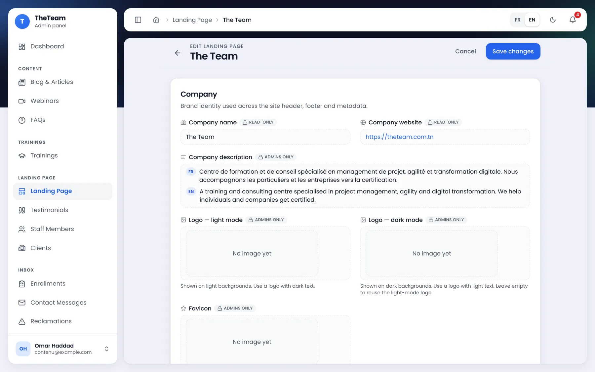
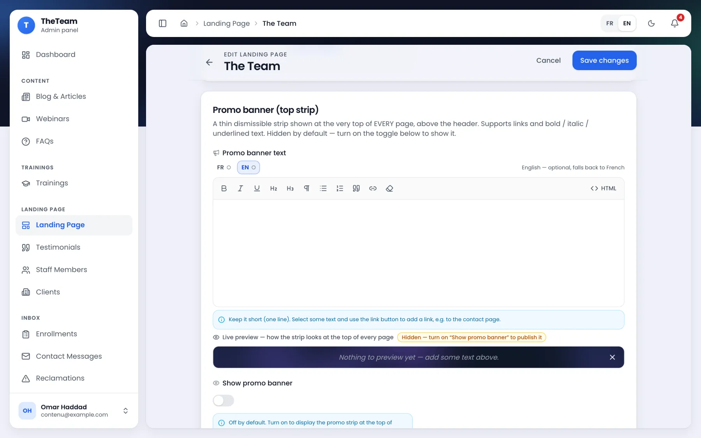
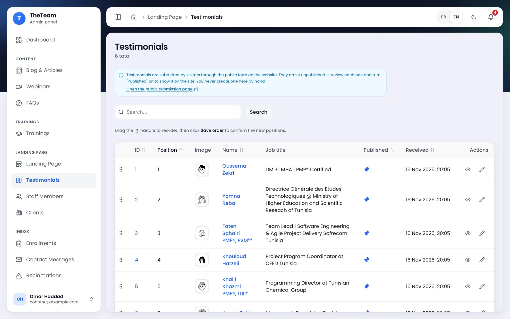
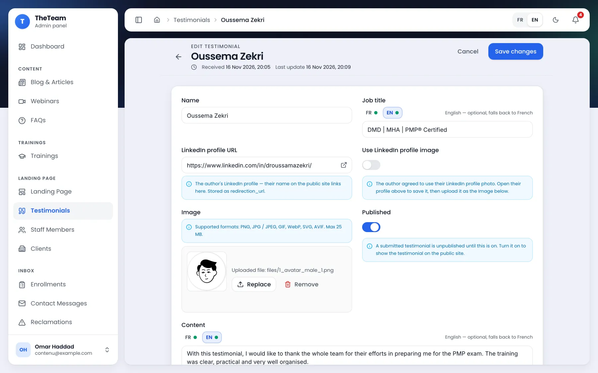
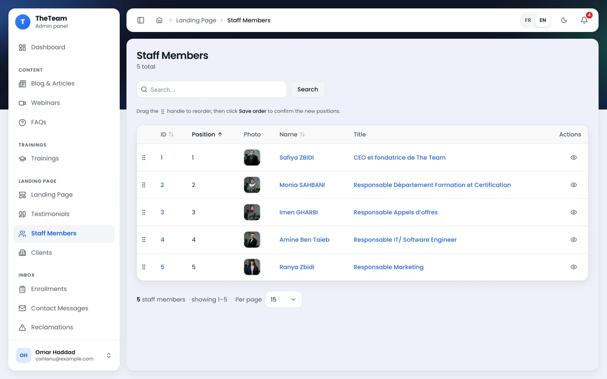
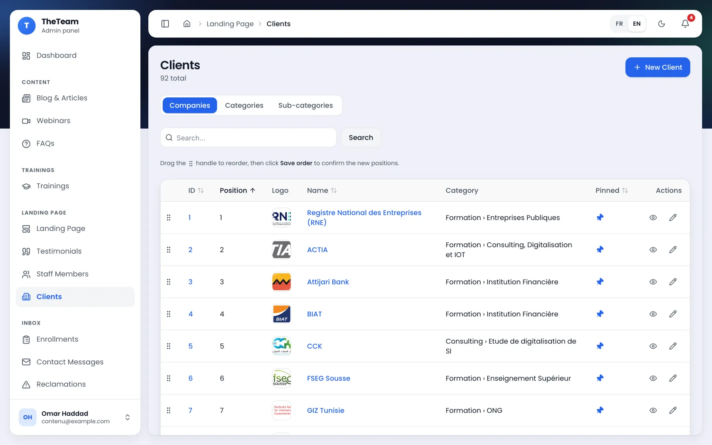

| Part | What you can do |
| :-- | :-- |
| Landing Page | Edit the **promo banner** and the **banner strip** |
| Testimonials | Review, correct, publish |
| Staff Members | View |
| Clients | Add, edit |

## The landing page

Menu **Landing Page**, then the pencil. You see the whole form, but most fields carry the **ADMINS ONLY** badge: company name, logos, header, contact details, social networks. You can read them, not change them.

<Frame caption="The landing page form: the company fields are locked for your role.">
  
</Frame>

You can edit two sections:

<Frame caption="The Banner and Promo banner sections, which you can edit.">
  
</Frame>

### The promo banner

A thin strip at the very top of **every page** of the website (for example “New PMP session in March: sign up now!”).

<Steps>
  <Step title="Write the text">
    In **Promo banner text**. Bold, italics and links are possible.
  </Step>
  <Step title="Turn on “Show promo banner”">
    Turn it off to hide it without erasing the text.
  </Step>
  <Step title="Click “Save changes”">
    At the top right.
  </Step>
</Steps>

### The banner strip

A promotional strip between two sections of the landing page: a **title**, a **link** (the page opened on click) and an **image**. Leave it empty if you do not want one.

## Testimonials

Menu **Testimonials**. Visitors send their testimonial from the website; it arrives **unpublished** and a notification alerts you.

<Frame caption="The list of testimonials.">
  
</Frame>

<Steps>
  <Step title="Open the testimonial (pencil)">
    Reread the text and correct any typo.
  </Step>
  <Step title="Add the photo if the author allowed it">
    If **Use LinkedIn profile image** is turned on: open their profile with the link, save the photo, then upload it in **Image**.
  </Step>
  <Step title="Turn on “Published” and save">
    The testimonial appears on the website.
  </Step>
</Steps>

<Frame caption="A testimonial form.">
  
</Frame>

To change the display order: drag the rows of the list, then **Save order**. To take a testimonial off the website, turn off **Published**.

## Staff members

Menu **Staff Members**: you can view the profiles (eye icon). To add or edit a member, ask an administrator.

<Frame caption="Staff members, view only.">
  
</Frame>

## Clients

Menu **Clients**: the logos of client companies. Tabs **Companies**, **Categories** and **Sub-categories**.

<Frame caption="The list of clients.">
  
</Frame>

**Adding a client**: **New Client**, enter the name, choose the category, add the logo and the website, then **Create**. Drag the rows then **Save order** for the display order.
