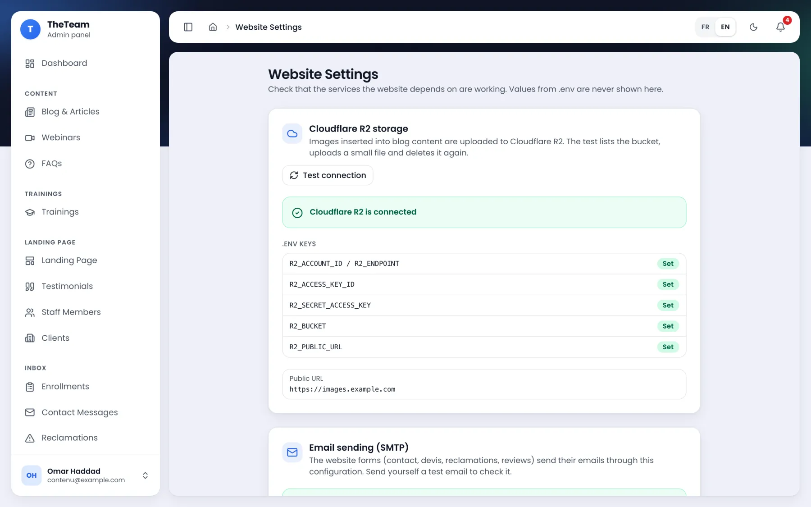
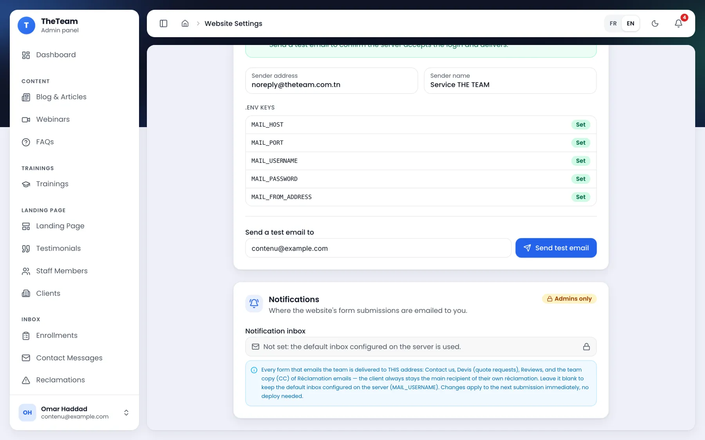

Menu **System → Website Settings**. This page checks that the services the website depends on are working. You can **run the tests**; the notification address is **reserved for administrators**.

<Frame caption="The website settings: image storage (Cloudflare R2), then email sending.">
  
</Frame>

## Image storage (Cloudflare R2)

This is where the images inserted into articles go. A **green** “Cloudflare R2 is connected” frame means everything is fine. **Test connection** runs a full check.

## Email sending (SMTP)

This is the service that sends the emails from the website's forms. To check it: enter your address in **Send a test email to**, click **Send test email**, then look in your inbox.

<Card title="Email sending (SMTP): the full guide" icon="paper-plane" href="/en/guide-utilisateur/gestionnaire/envoi-emails-smtp" horizontal>
  Read the card's status, send a test email and know what to pass on in case of an error.
</Card>

## The address that receives the forms

The **Notifications** card shows the team's address that receives the forms (contact, quote requests, reviews, copy of complaints). For you, it is **read-only**: ask an administrator to change it.

<Frame caption="The Notifications card: read-only, marked “Admins only”.">
  
</Frame>

<Warning>
  **A red or orange frame?** The setting is made on the server, not in the panel. Let an administrator or the person in charge of technical matters know, with a screenshot.
</Warning>
