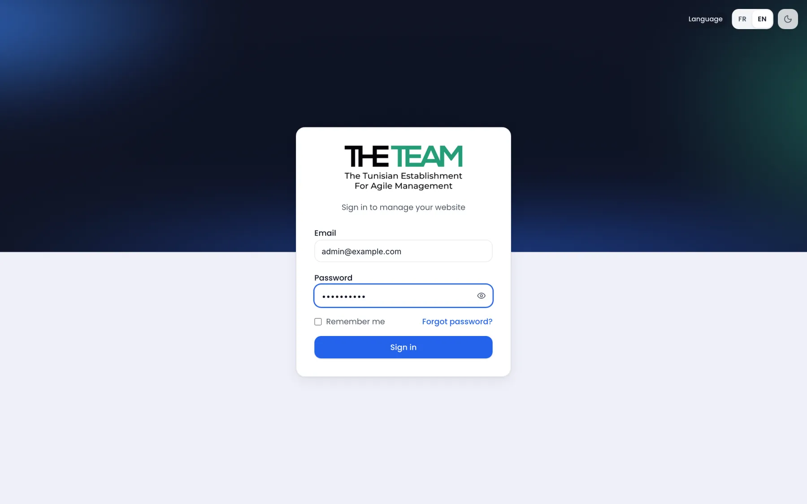
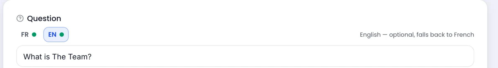
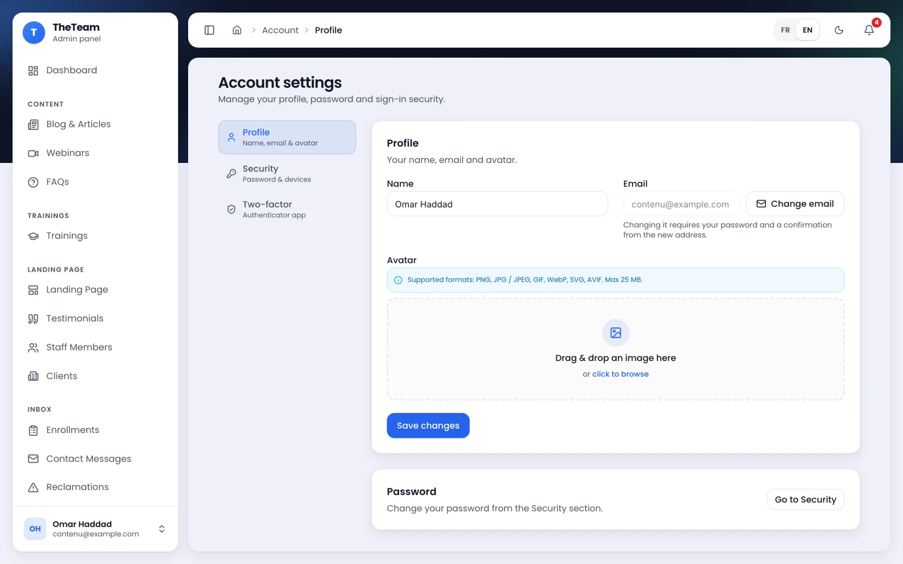

## Signing in

**The first time:** an administrator sends you an **email invitation**. Click the button in the email (the link is valid for **24 hours**), choose your password (at least 8 characters), then sign in.

**After that:** go to **admin.theteam.com.tn/admin**, enter your email and password, then click **Sign in**.

<Frame caption="The sign-in page.">
  
</Frame>

- **Forgot your password?** Click the link under the field, enter your email and follow the link you receive.
- **Locked out after several attempts?** After 5 failed attempts within one minute, wait a minute.
- **Logging out:** click your name at the bottom of the menu, then **Log out**.

## The screen

- **On the left, the menu**: your parts of the panel.
- **At the top, the toolbar**: the language (FR / EN), dark mode (moon) and the notifications **bell**.
- **In the middle, the open page.** The dashboard summarizes the requests received; an orange badge (“2 new”, “3 open”) flags what is waiting to be handled. Click a tile to open the list.

<Tip>
  **Never miss a request**: the **bell**, at the top right, alerts you to every form sent on the website. Turn on the sound and your computer's notifications in two clicks: see [Notifications](/en/guide-utilisateur/gestionnaire/notifications).
</Tip>

## Lists and forms

All lists work the same way: **Search**, click a column title to sort, filters **Active / Archived / All**, and icons at the end of each row:

| Icon | Action |
| :-- | :-- |
| Eye | View without editing |
| Pencil | Edit |
| Box | Archive (put away without deleting) |

In a form: **Cancel** discards your changes, **Save changes** saves them. A green message confirms; a red message under a field tells you what to fix. **READ-ONLY** fields are shown for information.

## French and English

The website's texts have two tabs, **FR** (required) and **EN** (optional). If the English is empty, the English version of the website shows the French.

<Frame caption="The FR / EN tabs of a field.">
  
</Frame>

## My profile

Menu **Account → My profile**. Three tabs:

- **Profile**: your name (shown as the author of your articles), your photo, your email.
- **Security**: change your password, see and log out connected devices.
- **Two-factor**: a 6-digit code on your phone each time you sign in. **Recommended.**

<Frame caption="Your profile.">
  
</Frame>
