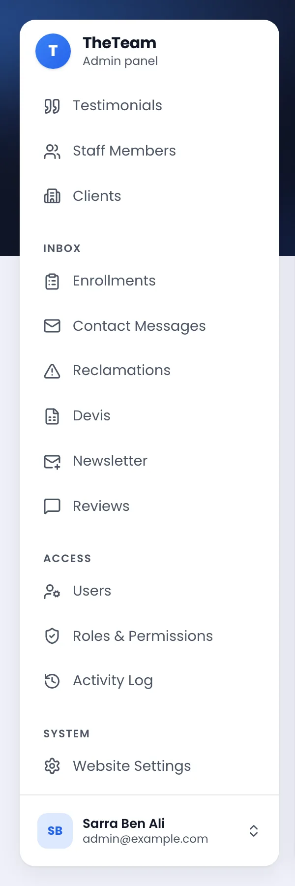
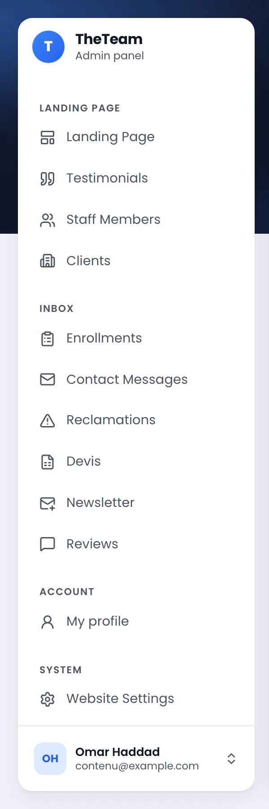

This guide explains, step by step, how to manage the **theteam.com.tn** website from the **admin panel**. No technical knowledge is needed: every screen is shown in a picture.

<Info>
  The admin panel is at **admin.theteam.com.tn/admin**. It is in **French** by default.
</Info>

## Choose your part

The guide is split into three tabs, at the top of the page:

<CardGroup cols={3}>
  <Card title="Administrator" icon="user-shield" href="/en/guide-utilisateur/connexion">
    The complete guide: the whole panel, including staff accounts, the activity log and the settings.
  </Card>
  <Card title="Content manager" icon="pen" href="/en/guide-utilisateur/gestionnaire">
    A dedicated guide, with your own screens: publishing content and handling incoming requests.
  </Card>
  <Card title="Visitor side" icon="globe" href="/en/guide-utilisateur/site-public">
    The website's forms as visitors see them and fill them in.
  </Card>
</CardGroup>

## The two roles

Each account has **a single role**. An administrator chooses it.

<CardGroup cols={2}>
  <Card title="Administrator" icon="user-shield">
    Has **access to everything**: content, inbox, staff accounts, activity log and website settings. It is the only role that can **delete permanently**.
  </Card>
  <Card title="Content Manager" icon="pen">
    **Manages the website's content** and **handles incoming requests**: they can view, create, edit and archive, but **never delete**.
  </Card>
</CardGroup>

## What each role sees in the menu

The menu adapts to the role. At the bottom, the administrator has the **ACCESS** section (users, roles, activity log); the content manager has the **My profile** entry instead.

<Columns cols={2}>
  <Frame caption="The bottom of an administrator's menu.">
    
  </Frame>
  <Frame caption="The bottom of a content manager's menu.">
    
  </Frame>
</Columns>

## Who can do what?

| Part of the panel | Administrator | Content Manager |
| :-- | :-- | :-- |
| Blog, articles, categories, tags | Everything | Create and edit |
| Webinars, FAQs | Everything | Create and edit |
| Trainings (and their categories) | Everything | Create and edit |
| Landing Page | Everything | Only the **promo banner** and the **banner** |
| Testimonials | Everything | View, edit and publish |
| Staff Members | Everything | View only |
| Clients | Everything | Create and edit |
| Devis, reclamations | Everything | View, handle and archive |
| Enrollments | Everything | View and edit |
| Contact Messages | Everything | View and archive |
| Newsletter | Everything | View, add an address and export |
| Reviews | Everything | View only |
| Users, roles and permissions | Everything | No access |
| Activity Log | View and back up | No access |
| Website Settings | Everything | Run the tests; notification address read-only |

<Tip>
  If a button described in this guide does not appear for you, that is normal: your role does not allow it. The panel only shows what you are allowed to do.
</Tip>

## How to read the Administrator tab

<Steps>
  <Step title="Start with the basics">
    [Signing in](/en/guide-utilisateur/connexion), [Getting to know the panel](/en/guide-utilisateur/interface) and [Notifications](/en/guide-utilisateur/notifications) introduce the actions used everywhere.
  </Step>
  <Step title="Then go to the part you need">
    **Website content** to publish, **Inbox** to handle visitors' requests.
  </Step>
  <Step title="Then the Administration part">
    Managing staff accounts, the activity log and the website settings.
  </Step>
</Steps>

<Note>
  The screenshots were taken on a test copy filled with **fictional data** (names, companies, email addresses on `example.com`). They do not show any real data.
</Note>
