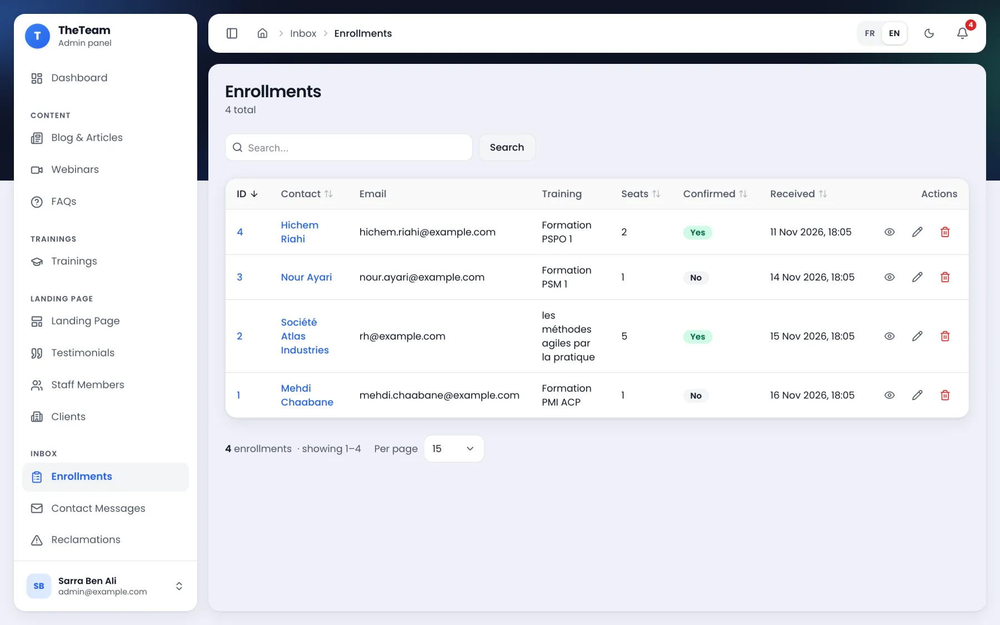
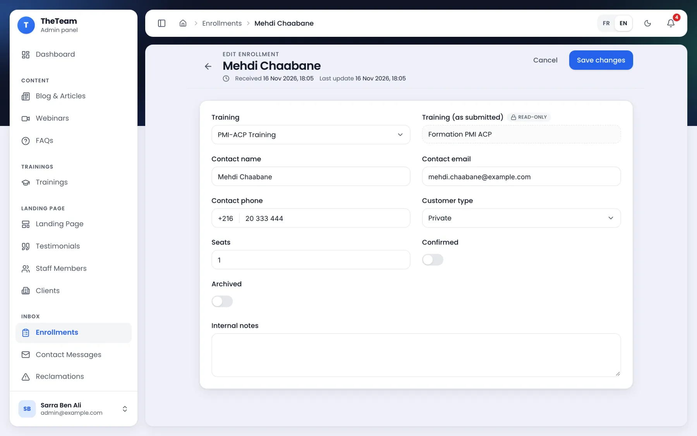

Menu **Inbox → Enrollments**. When a visitor enrolls in a training on the website, the enrollment arrives here and a notification alerts you.

<Info>
  **Both roles** can view and edit enrollments. Only an **administrator** can delete.
</Info>

<Tip>
  To see the form as the visitor fills it in on the website, read [The enrollment form](/en/guide-utilisateur/formulaire-inscription) (visitor side).
</Tip>

<Frame caption="The list of enrollments: contact, training, number of seats and confirmation.">
  
</Frame>

## Handling an enrollment

<Steps>
  <Step title="Open the enrollment">
    Click the pencil on the row.
  </Step>
  <Step title="Check the information">
    Training, name, email, phone, client type (individual or company) and number of seats. **Training (as submitted)** keeps the exact title at the time of enrollment, even if the training is renamed later.
  </Step>
  <Step title="Contact the person">
    To confirm the session, the payment, etc.
  </Step>
  <Step title="Confirm">
    Turn on **Confirmed**, add **Internal notes** if needed, then click **Save changes**.
  </Step>
</Steps>

<Frame caption="An enrollment record.">
  
</Frame>

<Tip>
  On the dashboard, the **« pending »** badge on the Enrollments box counts the enrollments not yet confirmed.
</Tip>

The **Archived** switch on the record lets you mark an enrollment as finished.
