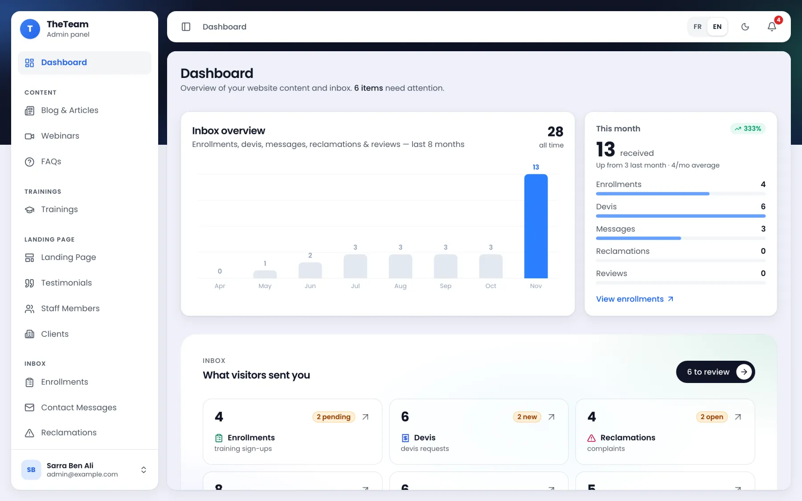
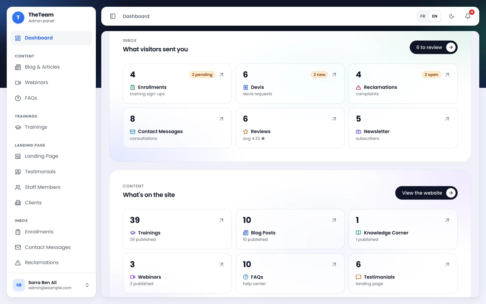
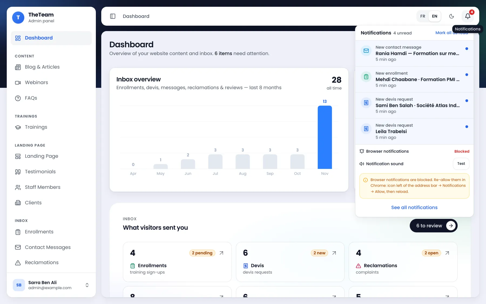
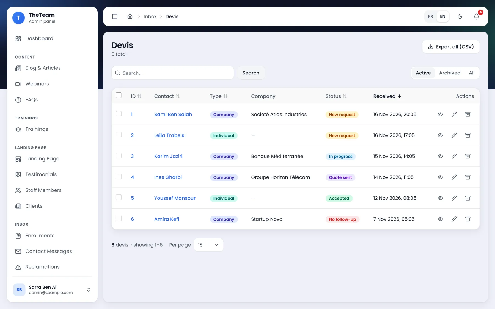
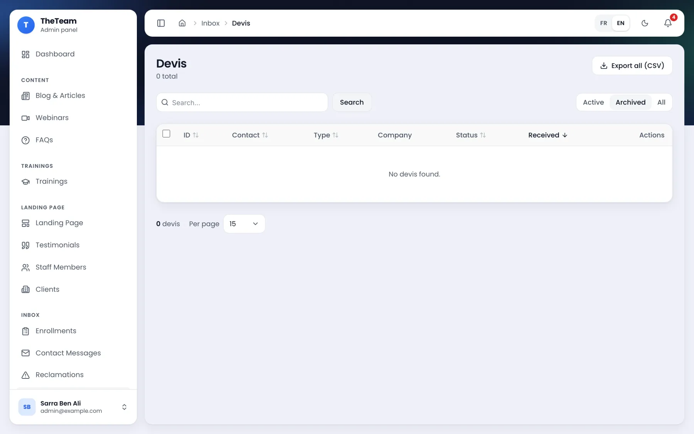
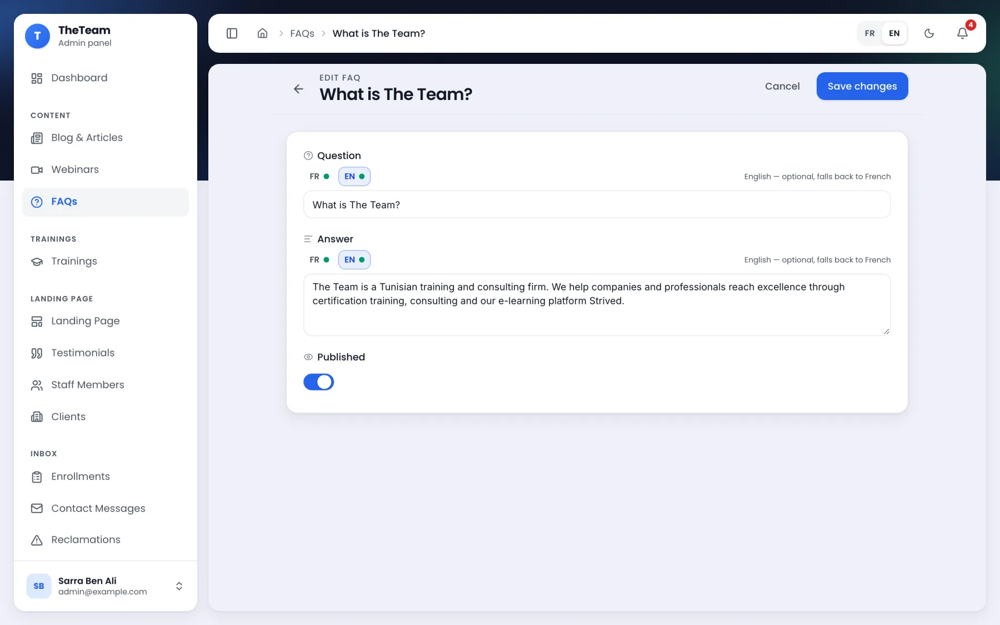
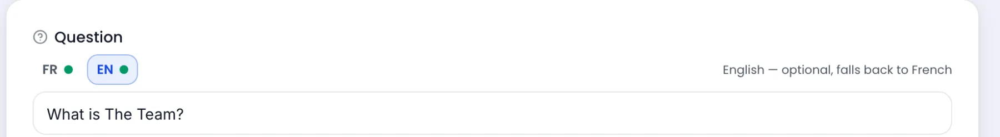
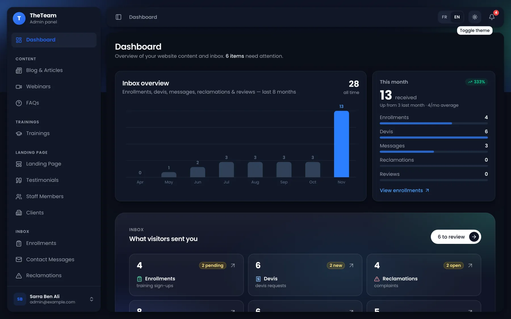

## The main screen

After signing in, you land on the **dashboard**. The screen is always laid out the same way:

- **on the left, the menu**: every part of the panel, grouped by theme (Content, Trainings, Landing Page, Inbox…);
- **at the top, the toolbar**: where you are, the language (FR / EN), dark mode and the notification bell;
- **in the centre, the page** you have opened.

<Frame caption="An administrator's dashboard.">
  
</Frame>

## The dashboard

It sums up activity at a glance:

- **Inbox overview**: the number of requests received (enrollments, devis, messages, reclamations, reviews) for each of the last 8 months.
- **This month**: what you received this month, compared with last month.
- **What visitors sent you**: one box per type of request. An orange badge (« 2 new », « 3 open »…) flags what is waiting to be handled. Click a box to open the matching list.
- **What's on the site**: the number of trainings, articles, webinars… visible to visitors.

<Frame caption="Further down the dashboard: requests received and content online.">
  
</Frame>

## Notifications

Every time a visitor fills in a form on the website (quote request, enrollment, message, reclamation, review, testimonial, newsletter sign-up), **a notification arrives** on the bell, top right. The red number shows how many notifications are unread.

<Frame caption="Click the bell to see the latest requests. Click a request to open it.">
  
</Frame>

<Tip>
  **Never miss a request again**: turn on sound and your computer's notifications in two clicks. Everything is explained in [Notifications](/en/guide-utilisateur/notifications).
</Tip>

## Lists

Each part of the menu opens a **list**. They all work the same way:

<Frame caption="Example: the Devis list.">
  
</Frame>

| Item | What it is for |
| :-- | :-- |
| **Search** | Type a name, an email, a title… then press Enter. |
| **Column headings** | Click a heading (with the small arrows) to sort the list. |
| **Active / Archived / All** | Shows current items, the ones you have archived, or everything. |
| **Tabs** (Blogs, Articles, Categories…) | Some parts group several lists: switch from one to another. |
| **Eye** | See the details without changing anything. |
| **Pencil** | Edit. |
| **Box** | Archive (put away without deleting). |
| **Red bin** | Delete — administrators only. |
| **Export all (CSV)** | Downloads the list as a file that opens in Excel. Tick rows to export only those. |
| **Per page** | Number of rows shown; the next pages are at the bottom. |

<Note>
  **Changing the display order.** In some lists (FAQs, webinars, testimonials, staff, clients), a six-dot handle appears at the start of each row. Drag the rows into the order you want, then click **Save order**: that is the order used on the website.
</Note>

## Archive or delete?

- **Archive** moves an item out of the main list. Nothing is lost: it stays visible with the **Archived** filter, and can be **unarchived** at any time. Both roles can archive.
- **Delete** erases permanently. Only **administrators** can do it. For devis, messages and reclamations, you must **archive first** before you can delete.

Every important action asks for confirmation:

<Frame caption="The confirmation window. « No, cancel » closes the window without changing anything.">
  
</Frame>

## Records and forms

Click a name or the pencil to open the **record**. At the top, you always find:

- the **back arrow** (←) to return to the list;
- the **Created / Received** and **Last update** dates;
- **Cancel** (discards your changes) and **Save changes**.

<Frame caption="A record being edited (here an FAQ question).">
  
</Frame>

<Warning>
  Nothing is saved until you click **Save changes** (or **Create** for a new item). A green message confirms the save; a red message under a field tells you what to correct.
</Warning>

A few pointers in the forms:

- **READ-ONLY**: the field is shown for information but cannot be changed (for example what the visitor wrote in their request).
- **ADMINS ONLY**: only an administrator can change this field.
- **Blue switch** (Published, Pinned…): blue = on, grey = off.

## French and English

The website exists in **French** (main language) and **English**. Texts shown on the website therefore have two tabs, **FR** and **EN**:

<Frame caption="The FR / EN tabs of a field. The green dot means that language is filled in.">
  
</Frame>

- **French is required**, English is **optional**.
- If English is left empty, the English version of the website shows the French text.
- The **FR / EN** switch in the top bar changes the panel's language **and** the tab opened by default in forms.

## Dark mode

The moon icon, top right, switches the panel to **dark mode** (easier on the eyes in the evening). Click again to return to light mode. This setting changes nothing on the public website.

<Frame caption="The dashboard in dark mode.">
  
</Frame>
