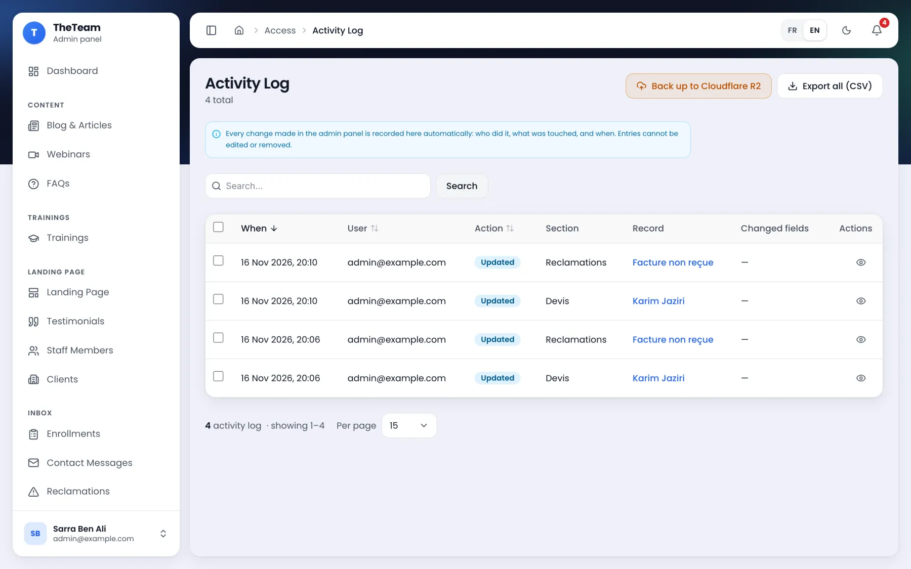
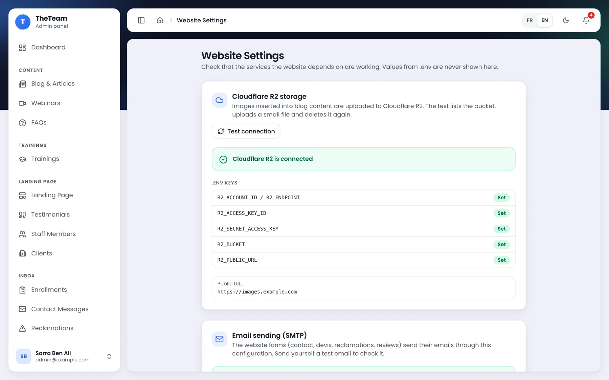
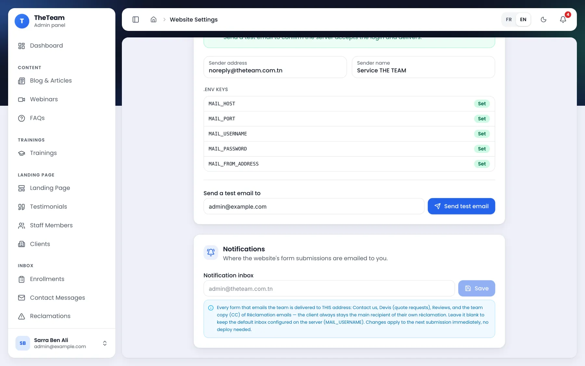
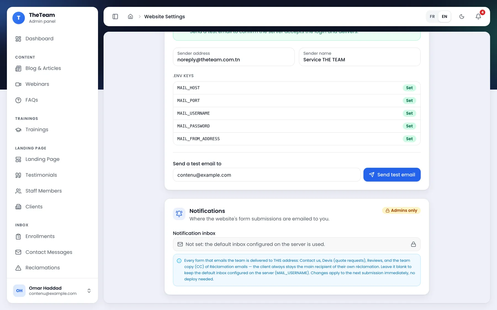

## The activity log

<Warning>
  **Administrators only.**
</Warning>

Menu **Access → Activity Log**. Every change made in the panel is recorded there automatically: **when**, **by whom**, **what action** (created, updated, archived, deleted…), in **which part** and on **which item**. Nobody can change or erase a line of the log.

<Frame caption="The activity log.">
  
</Frame>

- The eye icon on a line shows the details, and for a change, **the old and the new value** of each field.
- **Export all (CSV)** downloads the log for Excel.
- **Back up to Cloudflare R2** archives the whole log in a file on online storage, **then empties the log**. Nothing is erased if the backup fails. Backups are retrieved from the Cloudflare dashboard (ask the person in charge of technical matters).

## Website Settings

Menu **System → Website Settings**. This page checks that the services the website depends on are working.

| | Administrator | Content Manager |
| :-- | :-- | :-- |
| See the page and run the tests | Yes | Yes |
| Change the notification address | Yes | No (read-only) |

<Frame caption="The website settings: image storage (Cloudflare R2), then email sending.">
  
</Frame>

### Cloudflare R2 storage

This is where the images inserted in blog posts are kept. A **green** box « Cloudflare R2 is connected » means everything is fine. **Test connection** runs a full check.

### Email sending (SMTP)

This is the service that sends the emails from the website's forms (contact, quote requests, reclamations, reviews). To check it, enter your address in **Send a test email to**, click **Send test email** and look in your inbox.

<Card title="Email sending (SMTP): the complete guide" icon="paper-plane" href="/en/guide-utilisateur/envoi-emails-smtp" horizontal>
  Read the card's status, send a test email and understand each error message.
</Card>

### Notifications: the address that receives the forms

The **Notification inbox** is the team's email address that receives the website's forms: Contact us, Devis, Reviews, and the copy of reclamations.

<Frame caption="The Notifications card (administrator).">
  
</Frame>

To change it: click **Edit**, enter the new address and click **Save**. The change applies immediately. If left empty, the server's default address is used.

<Frame caption="The same card seen by a content manager: read-only, marked « Admins only ».">
  
</Frame>

<Warning>
  **A red or orange box on this page?** The technical keys (shown only by their name, never their value) need to be completed on the server. This cannot be set from the panel: let the person in charge of the website's technical side know, with a screenshot.
</Warning>
