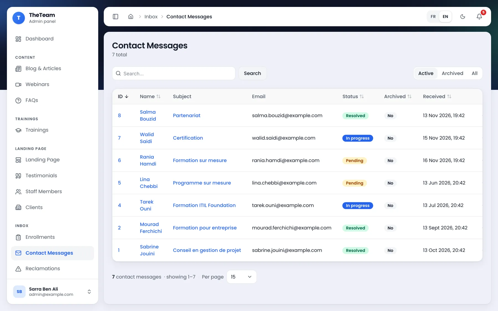
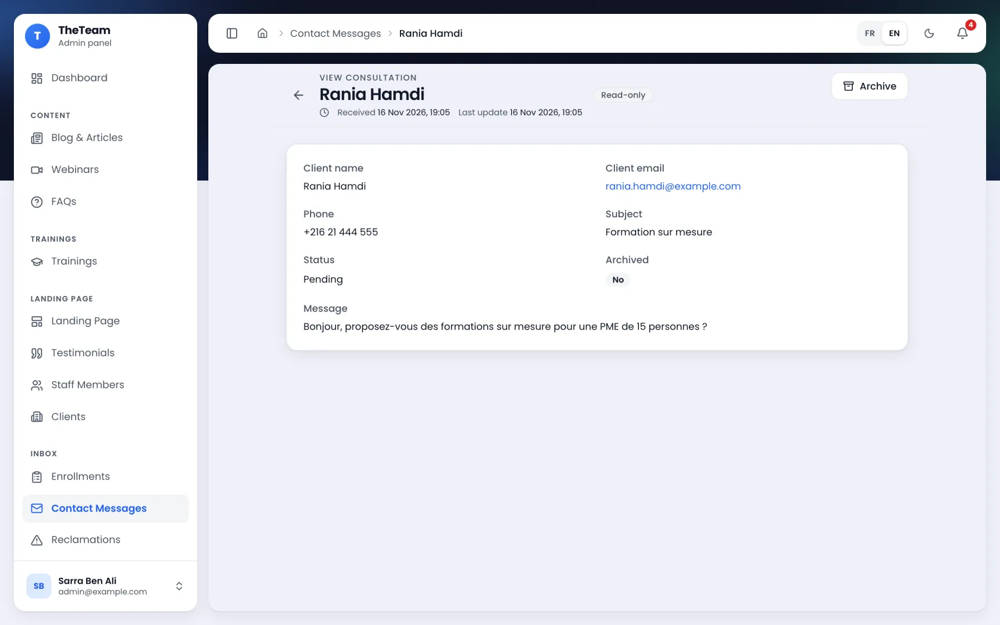
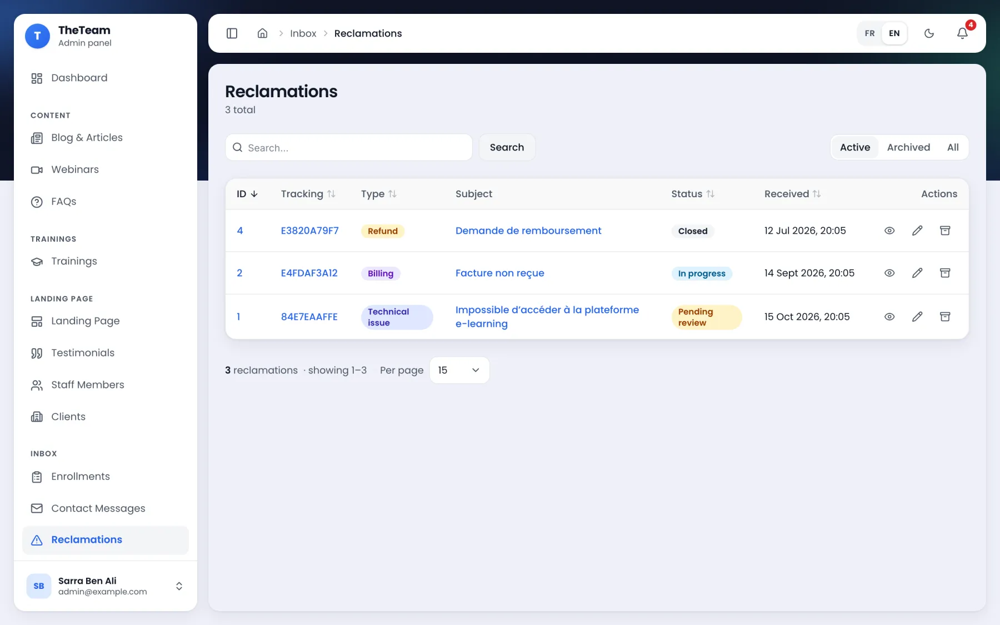
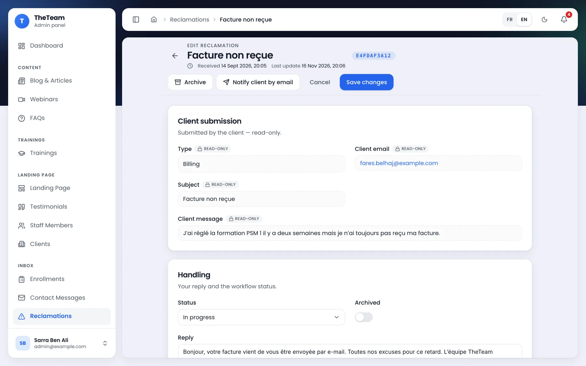
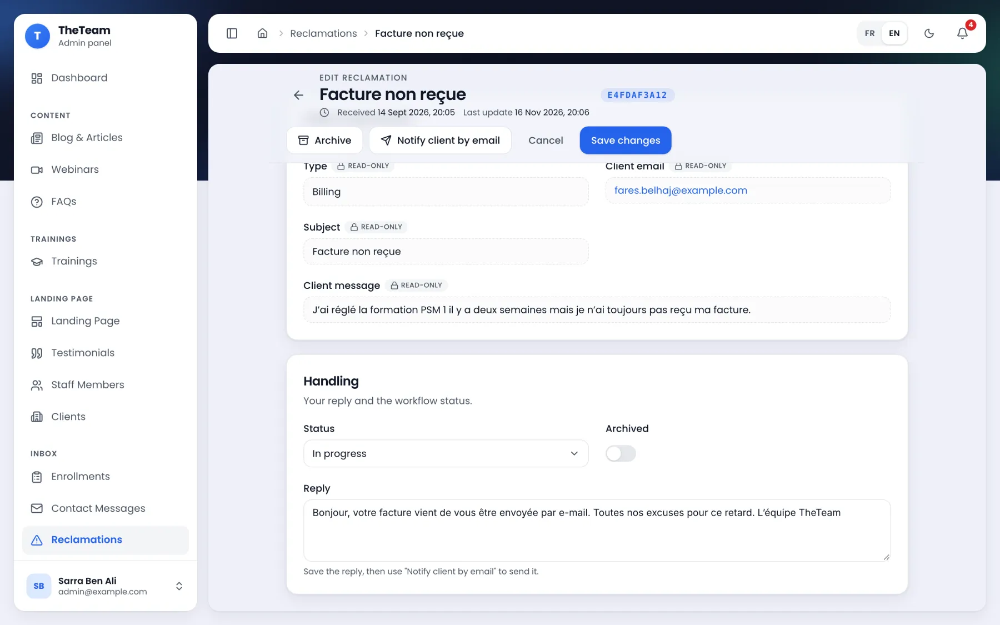

## Contact messages

Menu **Inbox → Contact Messages**: the messages sent with the website's **Contact us** form. A copy also reaches the team by email. See also [the form on the visitor side](/en/guide-utilisateur/formulaire-contact).

<Info>
  **Both roles** can read and archive messages. Only an **administrator** can delete a message, and only after archiving it.
</Info>

<Frame caption="The list of contact messages.">
  
</Frame>

Messages are **read-only**: open one (eye icon) to read the name, email, phone, subject and message, then **reply directly from your own mailbox** to the address shown. Once the message is dealt with, click **Archive**.

<Frame caption="An open contact message.">
  
</Frame>

## Reclamations

Menu **Inbox → Reclamations**. A client who has a problem (refund, billing, technical issue…) fills in the website's **Complaint** form. They receive a **tracking number** (for example `6280896D06`) that lets them follow progress on the website: see [the complaint form on the visitor side](/en/guide-utilisateur/formulaire-reclamation).

<Info>
  **Both roles** can reply, change the status, notify the client and archive. Only an **administrator** can delete, after archiving.
</Info>

<Frame caption="The list of reclamations, with the tracking number, the type and the status.">
  
</Frame>

### Statuses

| Status | Meaning |
| :-- | :-- |
| **Pending review** | Nobody has handled it yet. |
| **In progress** | Someone is dealing with it. |
| **Resolved** | The problem is solved. |
| **Closed** | The case is closed. |

The client sees this status, and your reply, when they track their complaint on the website with their number.

### Replying to a reclamation

<Steps>
  <Step title="Open the reclamation">
    At the top, the **Client submission** section (read-only) shows the client's type, email, subject and message.
  </Step>
  <Step title="Write your reply">
    In the **Handling** section, write the **Reply** and choose the **Status**.
  </Step>
  <Step title="Save">
    Click **Save changes**.
  </Step>
  <Step title="Notify the client">
    Click **Notify client by email**: the client receives your reply by email, with the team in copy.
  </Step>
</Steps>

<Frame caption="A reclamation record. The tracking number is shown next to the title.">
  
</Frame>

<Frame caption="The Handling section: status and reply.">
  
</Frame>

<Warning>
  **Save first, notify afterwards.** The **Notify client by email** button sends the **saved** reply. If no reply has been saved yet, the panel tells you and sends nothing.
</Warning>

When the case is closed, click **Archive** to put it away.
