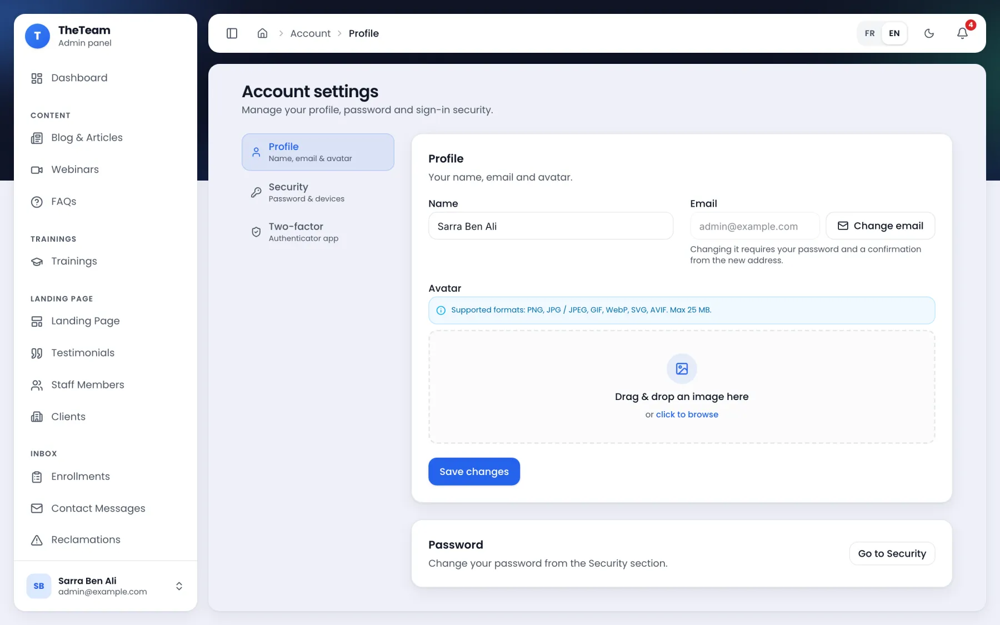
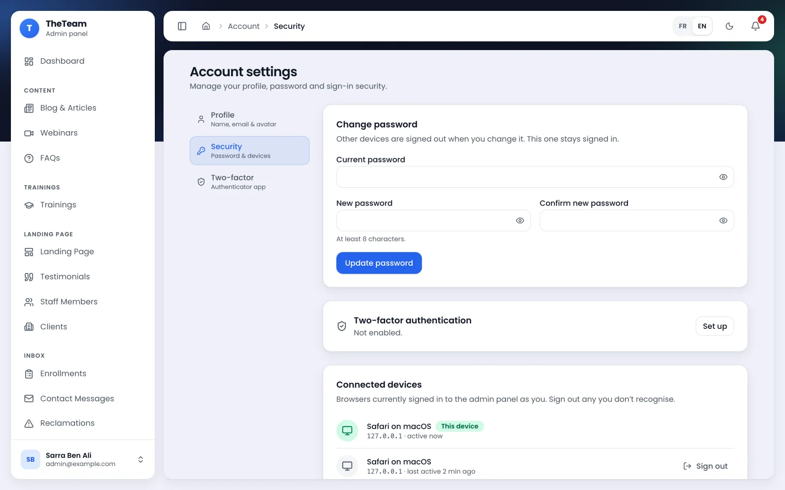
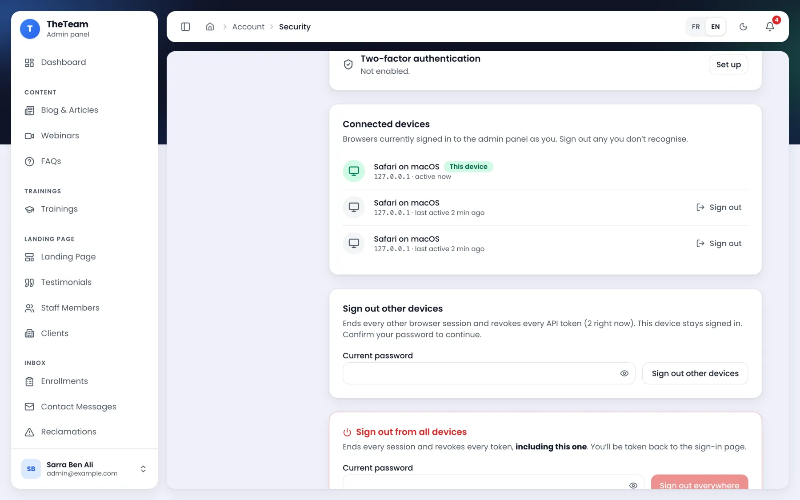
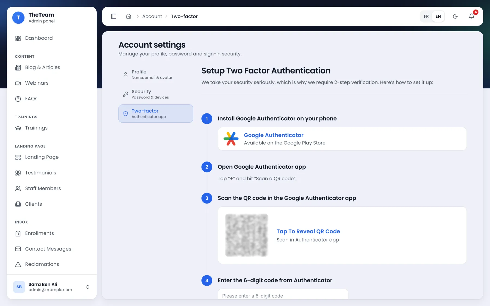

Your personal settings are in **Account settings**: click your name at the bottom of the left-hand menu, then **Account settings** (content managers also have the **My profile** entry in the menu). The page has three tabs: **Profile**, **Security** and **Two-factor**.

## Profile: name, email and photo

<Frame caption="The Profile tab.">
  
</Frame>

- **Name**: it appears in the menu and as the author of your articles.
- **Avatar**: drag a photo into the box, or click inside it to choose one.
- Click **Save changes**.

**Changing your email address**: click **Change email**, enter the new address and your password. A confirmation email is sent to the **new** address: the change only happens once you click its link.

## Security: password and devices

<Frame caption="The Security tab.">
  
</Frame>

**Change password**: enter your current password, then the new one twice (at least 8 characters), and click **Update password**. Your other devices are then signed out; the one you are using stays signed in.

Further down, **Connected devices** lists the browsers signed in to your account.

<Frame caption="Connected devices. « This device » is the one you are using right now.">
  
</Frame>

- **Sign out** on a line: signs out that specific device.
- **Sign out other devices**: keeps only this one (your password is required).
- **Sign out everywhere**: signs out everything, including this device.

<Warning>
  Do you see a device you do not recognise? Sign it out, **change your password** and let an administrator know.
</Warning>

## Two-factor authentication

Two-factor authentication adds a **6-digit code**, shown on your phone, when you sign in. Even if someone finds out your password, they cannot get in without your phone. **We recommend it for everyone.**

<Frame caption="The Two-factor tab, before activation.">
  
</Frame>

<Steps>
  <Step title="Install Google Authenticator">
    A free app, on the Google Play Store or the App Store.
  </Step>
  <Step title="Scan the QR code">
    In the app, tap **+** then **Scan a QR code**. On the page, click **Tap To Reveal QR Code** and point your phone at it.
  </Step>
  <Step title="Enter the 6-digit code">
    Type the code shown in the app, then click **Activate**.
  </Step>
  <Step title="Keep your recovery codes">
    **Recovery codes** are displayed. Write them down and keep them somewhere safe: each one lets you sign in once if you lose your phone.
  </Step>
</Steps>

Each time you sign in, after your password, just open the app and type the current code.
