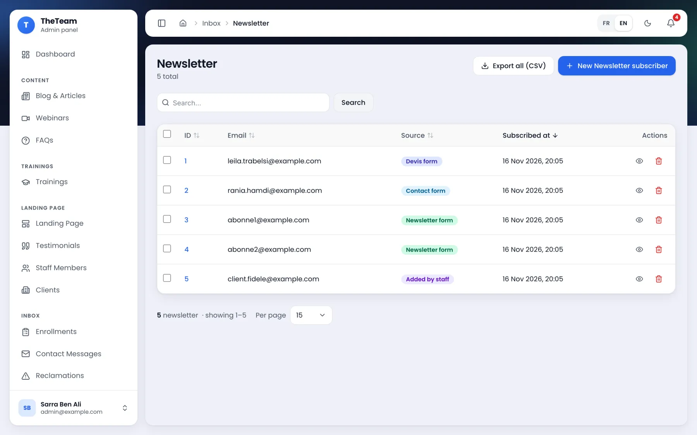
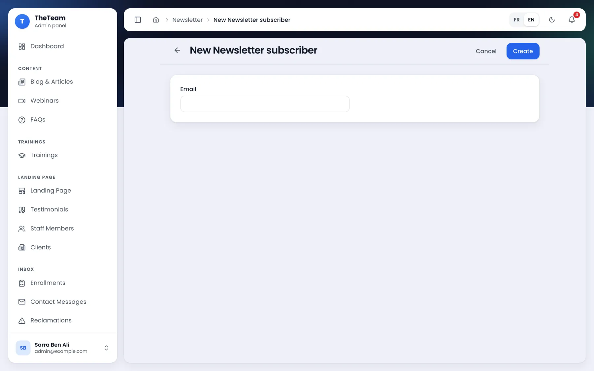
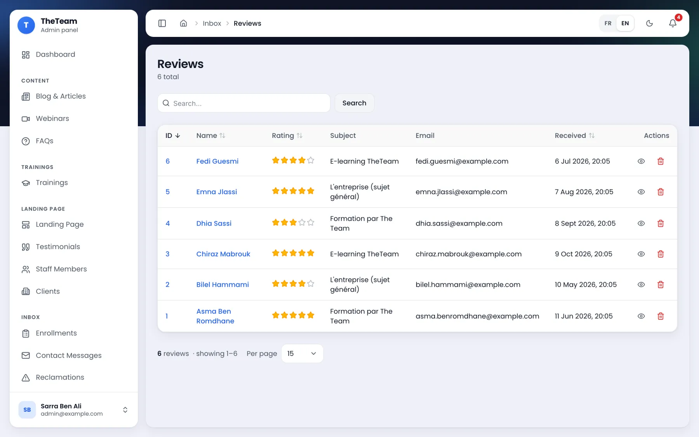
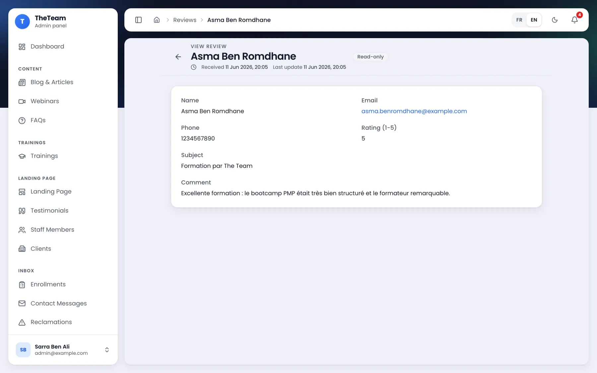

## The newsletter

Menu **Inbox → Newsletter**: every email address that agreed to receive your news.

<Info>
  **Both roles** can view the list, add an address and export. Only an **administrator** can delete an address.
</Info>

<Tip>
  To see the newsletter sign-up as the visitor fills it in on the website, read [Newsletter](/en/guide-utilisateur/formulaire-newsletter) (visitor side).
</Tip>

<Frame caption="The list of subscribers. The Source column shows where each address comes from.">
  
</Frame>

The list fills itself. The **Source** column shows where each address comes from:

| Source | Where the address comes from |
| :-- | :-- |
| Newsletter form | The visitor signed up for the newsletter. |
| Devis form | They requested a quote. |
| Contact form | They sent a contact message. |
| Reclamation form | They sent a complaint. |
| Added by staff | Someone added it by hand in the panel. |

**Adding an address**: **New Newsletter subscriber**, enter the email and click **Create**.

<Frame caption="Adding an address by hand.">
  
</Frame>

**Exporting**: **Export all (CSV)** downloads the list (email, source, date) so you can import it into your email-sending tool. Tick rows to export only those.

<Note>
  A subscriber who unsubscribes from the website is removed from this list automatically.
</Note>

## Reviews

Menu **Inbox → Reviews**: the reviews left by visitors (rating out of 5, subject and comment).

<Info>
  **Both roles** can read reviews. Only an **administrator** can delete one.
</Info>

<Frame caption="The list of reviews, with the star rating.">
  
</Frame>

Reviews are **read-only**: they cannot be edited. Open one (eye icon) to read the full comment. On the dashboard, the **Reviews** box also shows the average rating.

<Frame caption="An open review.">
  
</Frame>

<Tip>
  A very positive review? Suggest that its author send a **testimonial** from the website: it can then be published on the landing page (see [Landing Page](/en/guide-utilisateur/page-accueil)).
</Tip>
