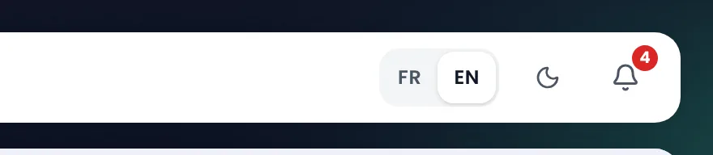
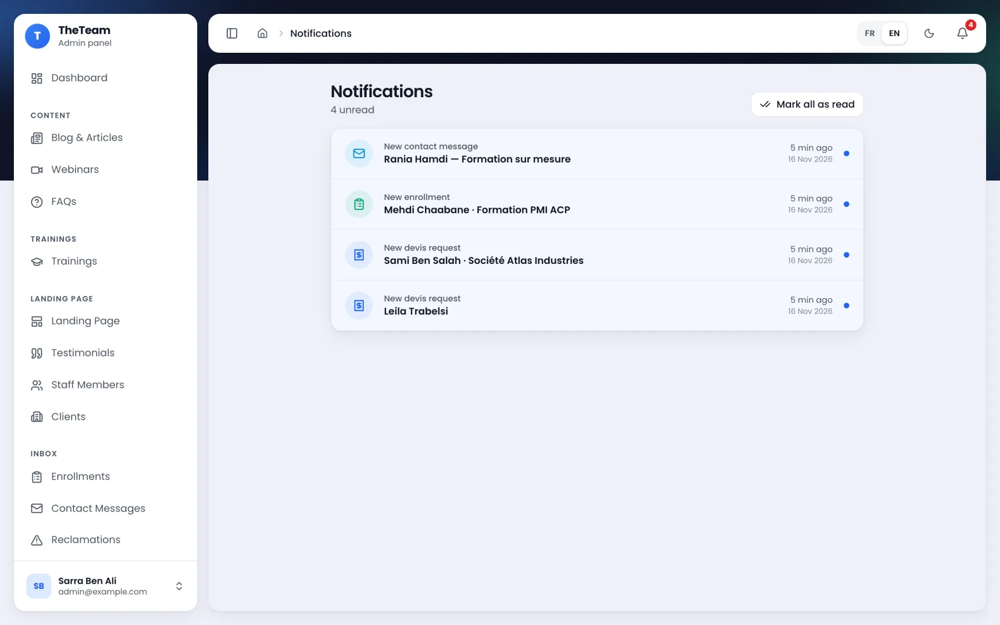
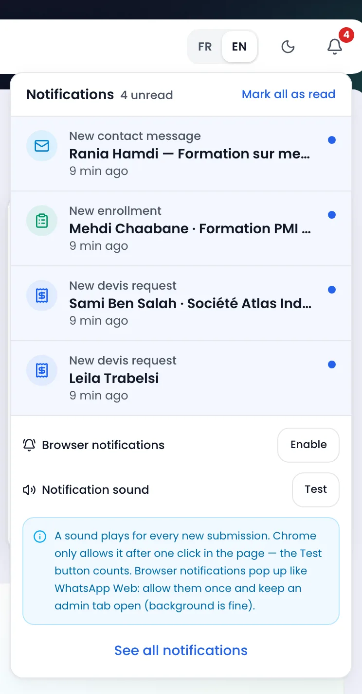
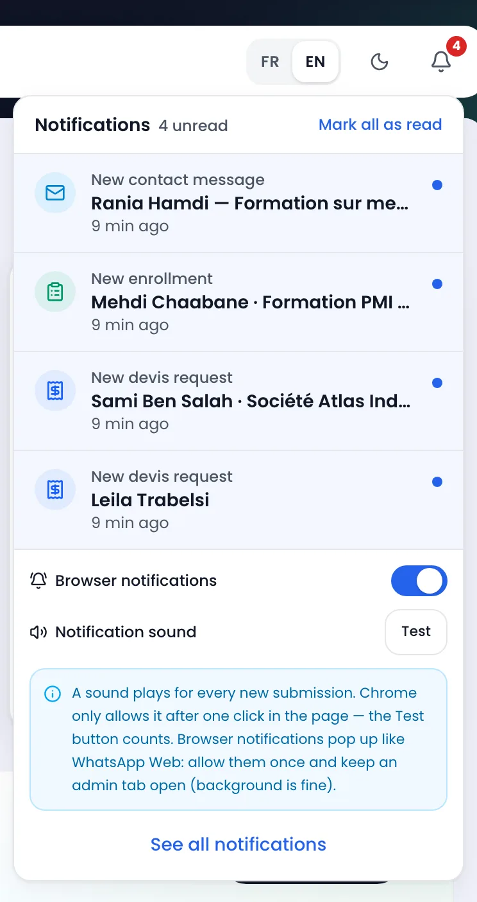
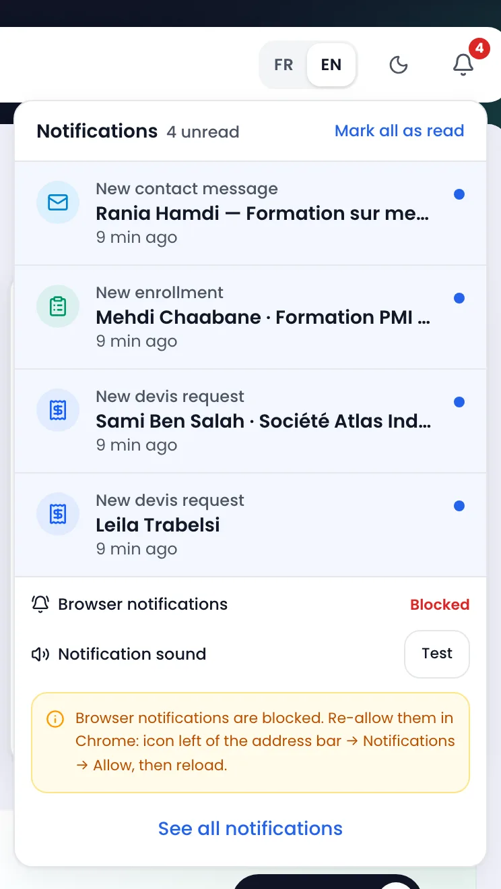

Every time a visitor fills in a form on the website, the panel lets you know. This page explains **where to see these notifications** and **how to turn them on** so you are alerted even when you are working in another window.

<Info>
  Notifications concern **both roles**: administrators and content managers. Each person has their own: what you read stays unread for your colleagues.
</Info>

## What triggers a notification

| Form filled in on the website | Notification received |
| :-- | :-- |
| Quote request | **New devis request** |
| Training enrollment | **New enrollment** |
| Contact form | **New contact message** |
| Reclamation | **New reclamation** |
| Review | **New review** |
| Newsletter sign-up | **New newsletter subscriber** |
| Testimonial | **New testimonial** |

## The bell, top right

The bell is **at the top right** of every page of the panel. The **red number** shows how many notifications you have not read yet. The panel checks for new requests **roughly every 25 seconds**, and also as soon as you come back to the tab: no need to reload the page.

<Frame caption="The bell with 4 unread notifications.">
  
</Frame>

Click the bell to open the menu:

- the **latest requests**, unread ones in bold with a blue dot;
- **click a request** to open it directly: it becomes « read »;
- **Mark all as read** resets the counter to zero;
- **See all notifications** opens the full page, with the history.

<Frame caption="The Notifications page (« See all notifications » button).">
  
</Frame>

## The two alerts to turn on

At the bottom of the bell menu, two lines set how you are alerted:

| Alert | What it does | When |
| :-- | :-- | :-- |
| **Notification sound** | Plays a short sound for each new request. | As soon as a tab of the panel is open. |
| **Browser notifications** | Shows a pop-up from your computer (like WhatsApp Web), with the type of request and the visitor's name. | When the panel is open but you are on another tab or another application. |

<Frame caption="The bell menu before activation: the « Enable » button and the « Test » button.">
  
</Frame>

## Turning on notifications (once per computer)

<Steps>
  <Step title="Open the panel in Google Chrome">
    Chrome is recommended (Edge and Firefox work the same way). Sign in to the panel.
  </Step>
  <Step title="Click the bell, top right">
    The notifications menu opens.
  </Step>
  <Step title="Click « Enable », to the right of « Browser notifications »">
    The browser shows a small window near the address bar: « admin.theteam.com.tn wants to show notifications ». Click **Allow**.
  </Step>
  <Step title="Check the confirmation pop-up">
    A **« Notifications enabled »** notification appears on your screen: « You will now be pinged here when a visitor submits a form. » In the menu, the **Enable** button is replaced by a **blue switch**.
  </Step>
  <Step title="Click « Test », to the right of « Notification sound »">
    You should hear the sound. This click also unlocks sound from then on: browsers only allow sound after a first click in the page.
  </Step>
  <Step title="Keep a tab of the panel open">
    It can stay **in the background** or in a minimised window. You can work in other tabs or other applications: the sound and the pop-up will alert you.
  </Step>
</Steps>

<Frame caption="Notifications are turned on: the switch is blue.">
  
</Frame>

### When a request arrives

- **You are on the panel**: the bell's number goes up and the sound plays. No pop-up, since you can already see the bell.
- **You are on another tab or another application**: a pop-up from your computer appears (for example « New devis request — Sami Ben Salah · Société Atlas Industries »), as well as the sound. **Click the pop-up**: the panel opens directly on the request.
- **Several requests at once**: a single pop-up sums them up, « 3 new submissions — Open the admin panel to see them. »

### Pausing the pop-ups

The blue switch turns the pop-ups off or back on **in this browser**, without changing the permission. The setting is specific to each computer and each browser: turn notifications on again on every computer you work on.

## The browser shows « Blocked »

If you clicked **Block** (or closed the permission window), the menu shows **Blocked** in red and an orange box. The « Enable » button can no longer ask for permission again: you have to restore it in the browser.

<Frame caption="Browser notifications are blocked.">
  
</Frame>

<Steps>
  <Step title="Click the icon to the left of the address">
    In Chrome, the settings icon (two small sliders) just before `admin.theteam.com.tn`.
  </Step>
  <Step title="Set « Notifications » to « Allow »">
    If the line does not appear, click **Site settings** and look for **Notifications**.
  </Step>
  <Step title="Reload the page">
    Press **F5** (or **Cmd + R** on a Mac). The bell menu now shows the switch.
  </Step>
</Steps>

## The sound cannot be heard

The menu then shows an orange box « The browser blocked the sound ».

- Click **Test** once in the bell menu: that is usually enough.
- Otherwise, in Chrome: icon to the left of the address → **Site settings** → **Sound** → **Allow**.
- Also check that your computer's sound is not muted and that the tab is not muted (right-click the tab).

## No pop-up appears even though everything is turned on

The computer itself may block the browser's pop-ups:

<Tabs>
  <Tab title="Windows">
    **Settings → System → Notifications**: check that notifications are turned on and that **Google Chrome** is allowed. Also turn off **Focus assist** (« Do not disturb ») during your working hours.
  </Tab>
  <Tab title="Mac">
    **System Settings → Notifications → Google Chrome**: turn on **Allow notifications**. Check that no **Focus** mode (« Do Not Disturb ») is active.
  </Tab>
</Tabs>

<Warning>
  **The browser must stay open.** If every tab of the panel is closed, or if the computer is switched off, you are not alerted. Nothing is lost, though: the requests wait for you in the bell and in the **Inbox**, and the team also receives the contact, quote, review and reclamation forms by email.
</Warning>

## In short

<Check>
  1. Click the bell, then **Enable** and **Allow**.
  2. Click **Test** to unlock the sound.
  3. Keep a tab of the panel open, even in the background.
</Check>
