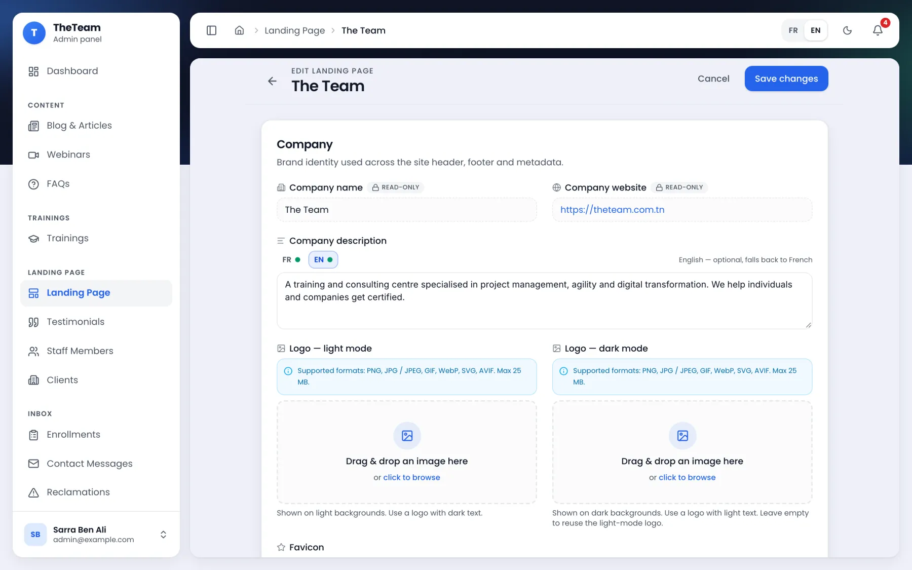
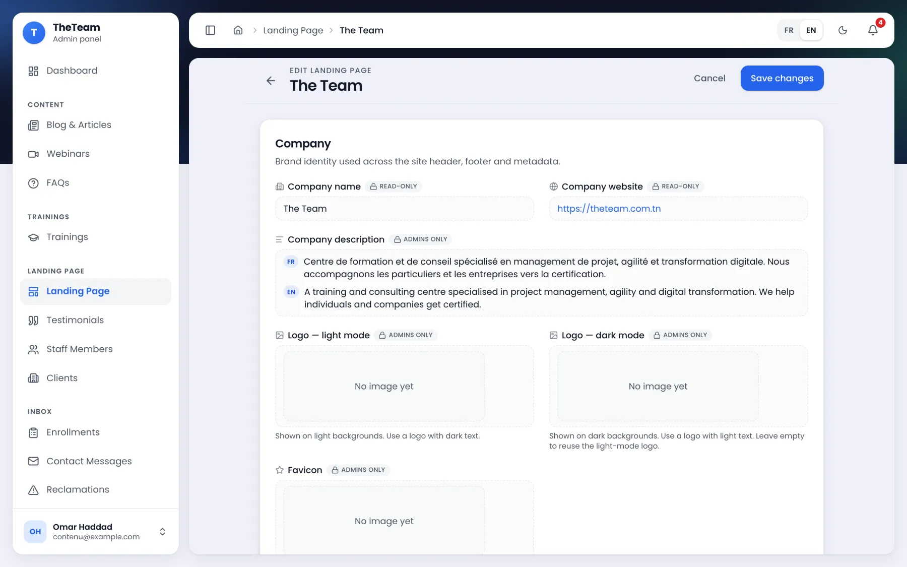
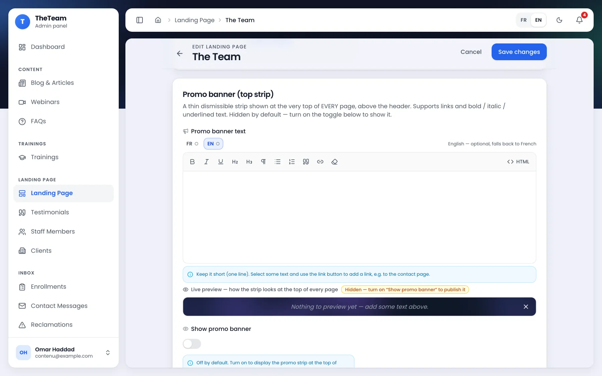
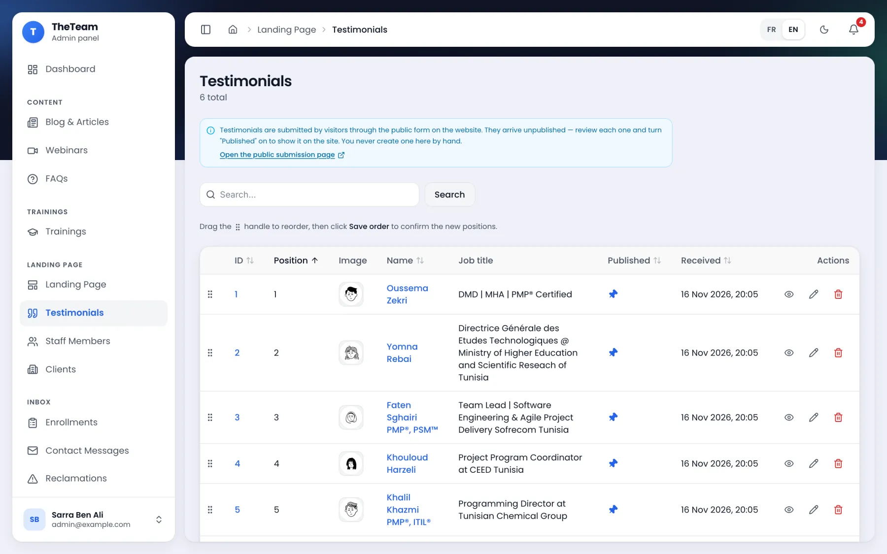
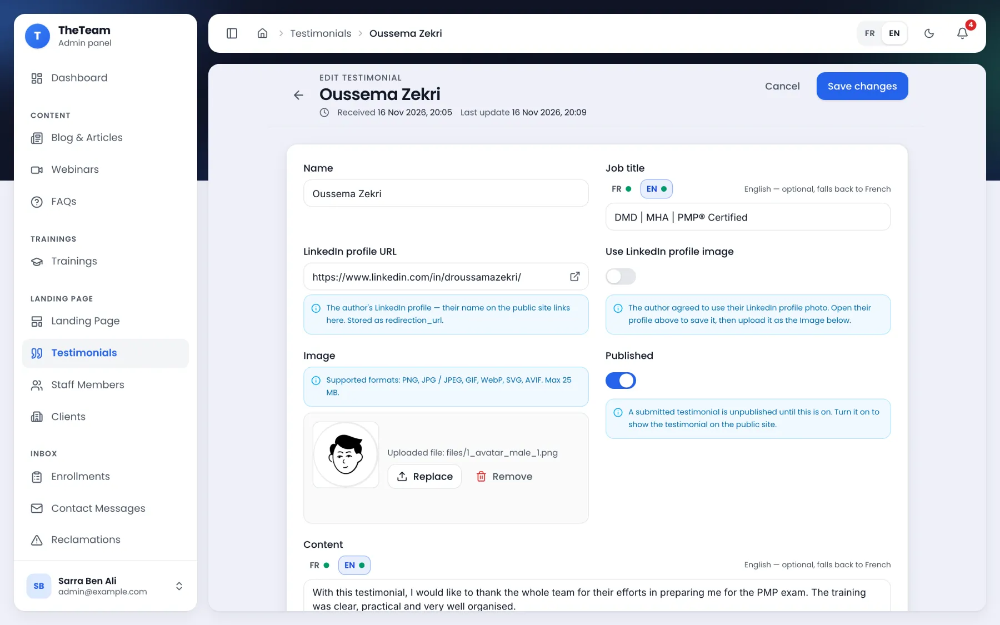
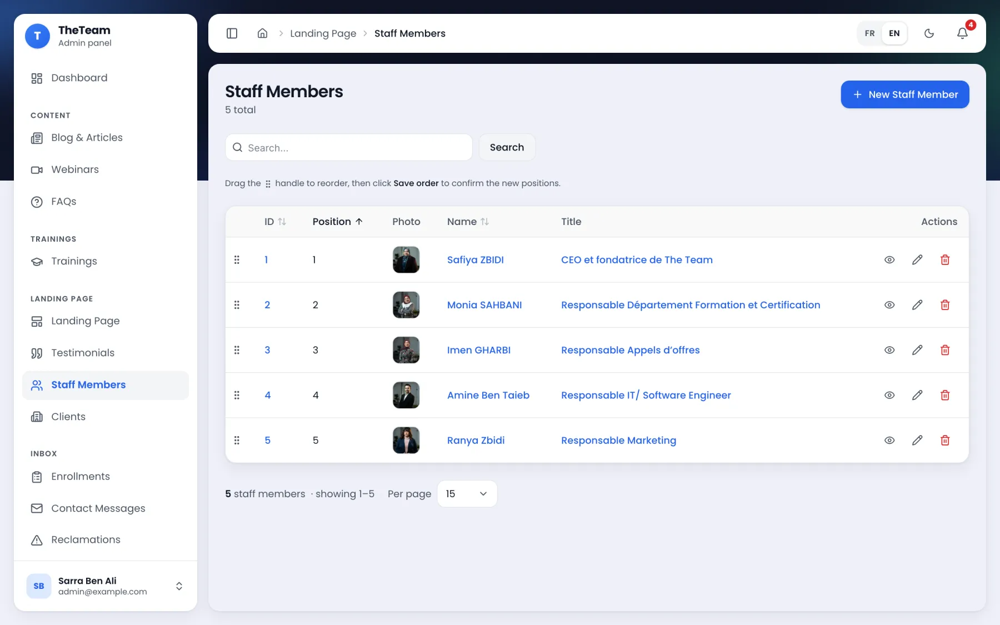
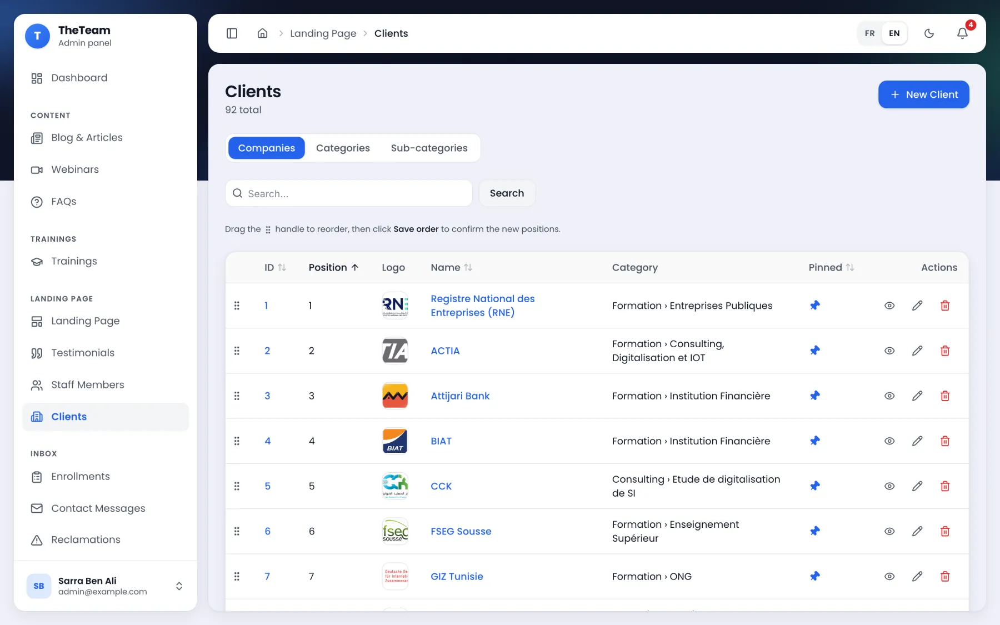

The **LANDING PAGE** group in the menu contains four parts: **Landing Page**, **Testimonials**, **Staff Members** and **Clients**.

| Part | Administrator | Content Manager |
| :-- | :-- | :-- |
| Landing Page | Edit everything | Only the **promo banner** and the **banner** |
| Testimonials | Everything | View, edit, publish |
| Staff Members | Everything | View only |
| Clients | Everything | Create and edit |

## The landing page

Menu **Landing Page**, then the pencil. There is only one record, split into sections:

| Section | Content |
| :-- | :-- |
| **Company** | Name, description, logos (light / dark mode), site icon. |
| **Header / Hero** | The big title at the top of the landing page, its subtitle and its button. |
| **Banner** | An optional promotional strip (title, link, image) between two sections. |
| **Promo banner (top strip)** | A thin strip at the very top of **every** page of the website. |
| **Contact details** | Address, phone numbers, contact email (footer). |
| **Mobile apps** | App Store and Google Play links. |
| **Social links** | Facebook, Instagram, LinkedIn, YouTube, X, WhatsApp, Google Maps. |
| **Embeds — calendar** | The Google Calendar embedded in the website. |

<Frame caption="The landing page record, as seen by an administrator.">
  
</Frame>

### What the content manager sees

The content manager sees the whole record, but only the **Banner** and the **Promo banner (top strip)** can be edited. The other fields carry the **ADMINS ONLY** label.

<Frame caption="The content manager's view: the company fields are locked.">
  
</Frame>

### The promo banner and the banner

<Frame caption="The Banner and Promo banner (top strip) sections, editable by both roles.">
  
</Frame>

- **Promo banner (top strip)**: write the text (bold, italic and links allowed), then turn on **Show promo banner**. Turn it off to hide it without erasing the text.
- **Banner**: a title, a link (the page opened on click) and an image. Leave it empty if you do not want one.

Do not forget **Save changes**.

## Testimonials

Menu **Testimonials**. Testimonials are **sent by visitors** from a form on the website (the **Open the public submission page** link opens it; see [the form on the visitor side](/en/guide-utilisateur/formulaire-avis-et-temoignage)). They arrive **unpublished**: you read them over, then decide whether to show them.

<Frame caption="The list of testimonials. The Published column shows which ones are visible on the website.">
  
</Frame>

<Steps>
  <Step title="Open the testimonial">
    Click the pencil. A notification alerts you to each new testimonial.
  </Step>
  <Step title="Read it over">
    If needed, correct a typo in the content or the job title.
  </Step>
  <Step title="Add the photo (if the author agreed)">
    If **Use LinkedIn profile image** is on, open their profile with the link, save the photo, then upload it in **Image**.
  </Step>
  <Step title="Publish">
    Turn on **Published** and save.
  </Step>
</Steps>

<Frame caption="A testimonial record.">
  
</Frame>

To choose the display order, drag the rows of the list then click **Save order**.

## Staff Members

Menu **Staff Members**: the people presented on the website (photo, name, title). The administrator can add them, edit them and change their order; the content manager can only view them.

<Frame caption="The list of staff members.">
  
</Frame>

## Clients

Menu **Clients**: the logos of client companies and organisations. Three tabs:

- **Companies**: each client (name, description, category, logo, website, Pinned);
- **Categories** and **Sub-categories**: how clients are classified (for example *Formation › Institution financière*).

<Frame caption="The list of clients.">
  
</Frame>

To add a client: **New Client**, fill in the name, choose the category, add the logo and save.
