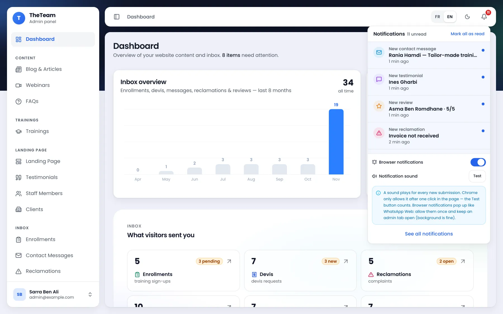
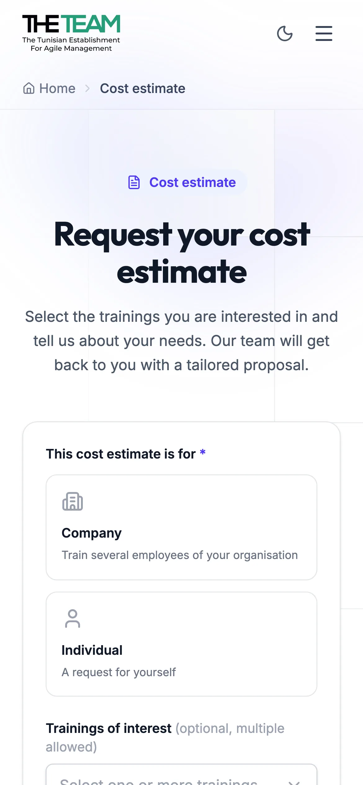

To handle a request well, it helps to know **what the visitor saw and filled in**. This part of the guide shows each form on the **theteam.com.tn** website as the visitor sees it, then what they see after sending it.

## The path of a request

<Steps>
  <Step title="The visitor fills in a form on the website">
    For example the **Cost estimate** page. Fields marked with an asterisk (*) are required.
  </Step>
  <Step title="They see a confirmation message">
    The website confirms that their request has been sent.
  </Step>
  <Step title="The panel alerts you">
    A notification arrives on the **bell**, with a sound (see [Notifications](/en/guide-utilisateur/notifications)). For some forms, the team also receives an email.
  </Step>
  <Step title="You handle the request">
    It is waiting for you in the panel's **Inbox**.
  </Step>
</Steps>

<Frame caption="Team side: requests sent from the website arrive in the panel's bell straight away.">
  
</Frame>

## The website's forms

| Form | Address on the website | Arrives in the panel | Email sent |
| :-- | :-- | :-- | :-- |
| [Cost estimate](/en/guide-utilisateur/formulaire-devis) | theteam.com.tn/en/devis | Inbox → **Devis** | To the team |
| [Enrollment](/en/guide-utilisateur/formulaire-inscription) | theteam.com.tn/en/enrollment | Inbox → **Enrollments** | — |
| [Contact](/en/guide-utilisateur/formulaire-contact) | theteam.com.tn/en/contact-us | Inbox → **Contact Messages** | To the team |
| [Complaint](/en/guide-utilisateur/formulaire-reclamation) | theteam.com.tn/en/reclamation | Inbox → **Reclamations** | To the client, team in copy |
| [Review](/en/guide-utilisateur/formulaire-avis-et-temoignage) | theteam.com.tn/en/review | Inbox → **Reviews** | To the team |
| [Testimonial](/en/guide-utilisateur/formulaire-avis-et-temoignage) | theteam.com.tn/en/testimonials/submit | Landing Page → **Testimonials** | — |
| [Newsletter](/en/guide-utilisateur/formulaire-newsletter) | theteam.com.tn/en/newsletter and the footer | Inbox → **Newsletter** | — |

Every form triggers a notification on the bell. The team's email address is set in [Website Settings](/en/guide-utilisateur/journal-et-parametres).

<Note>
  The website exists in **French** and **English**: French at the historical addresses (for example theteam.com.tn/devis), English under `/en/` (for example theteam.com.tn/en/devis). Both versions send requests to the same place in the panel.
</Note>

## On a phone

Every form adapts to phone screens: the fields simply stack one below the other.

<Frame caption="The Cost estimate page on a phone.">
  
</Frame>

<Tip>
  To see a form as a visitor does, simply open its address in your browser. **Do not send fake forms on the real website**: they would create real notifications and real emails for the whole team.
</Tip>

<Info>
  The screenshots in this part were taken on a test copy of the website, with **fictional visitors**.
</Info>
