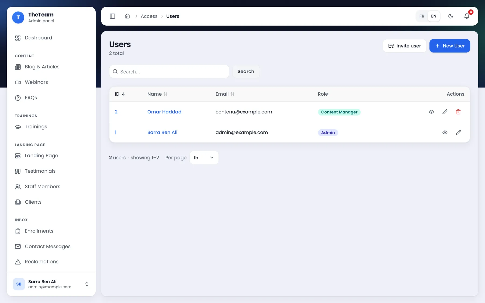
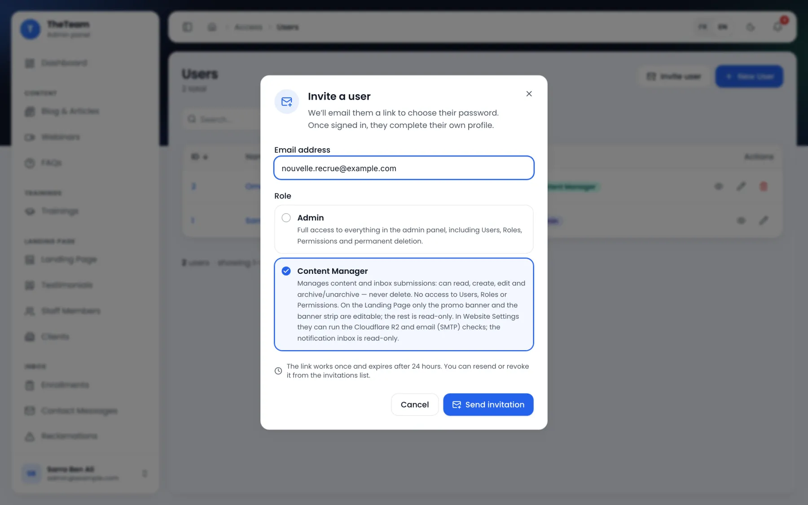
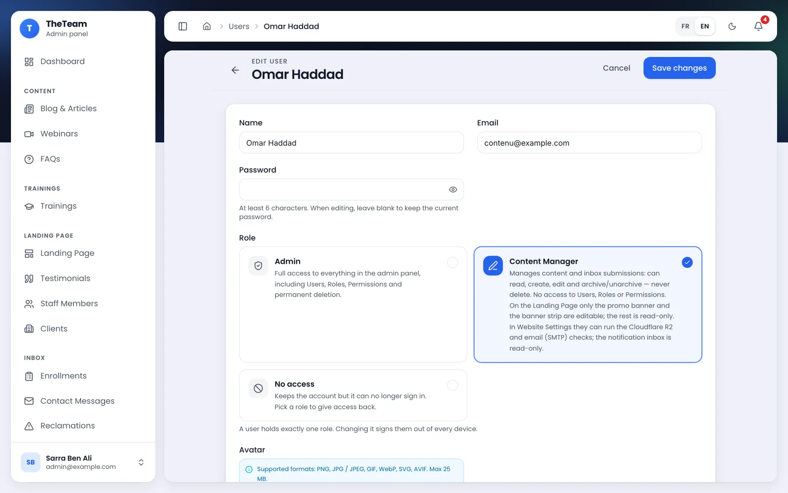
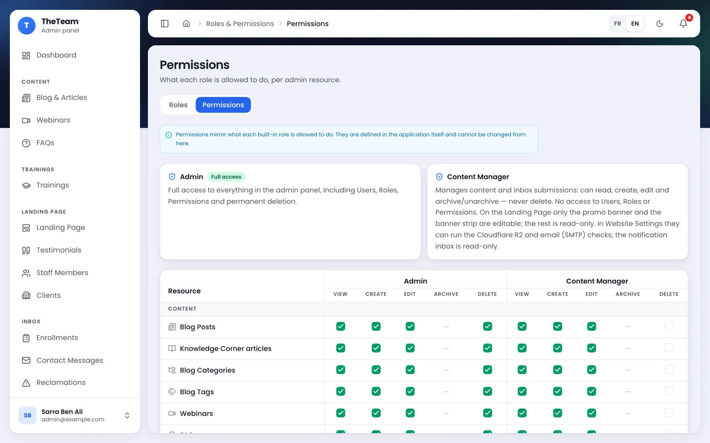

<Warning>
  **Administrators only.** The content manager does not see this part of the menu.
</Warning>

Menu **Access → Users**. This is where you manage the accounts of the team members who use the panel. There is no open sign-up: **every account is created by an administrator**.

<Frame caption="The list of users with each person's role.">
  
</Frame>

## Inviting a new member (recommended)

An invitation is the simplest and safest method: the person chooses their own password.

<Steps>
  <Step title="Click « Invite user »">
    At the top right of the list.
  </Step>
  <Step title="Enter their email address">
    The person's work address.
  </Step>
  <Step title="Choose their role">
    **Admin** or **Content Manager**. If in doubt, choose Content Manager: you can always change it later.
  </Step>
  <Step title="Click « Send invitation »">
    The person receives an email with a link **valid for 24 hours**, usable only once.
  </Step>
</Steps>

<Frame caption="The « Invite user » window.">
  
</Frame>

Invitations you have sent appear above the list (**Pending** / **All sent** tabs), with their expiry date. For each one, you can:

- **Resend**: sends a new link (if the first one has expired or been lost);
- **Revoke**: cancels the invitation, the link no longer works.

<Note>
  The **New User** button also creates an account, but you set the password yourself and must pass it on to the person. Prefer the invitation.
</Note>

## Changing a user's role

Open the user (pencil), click the card of the role you want, then **Save changes**.

<Frame caption="A user record: the role is chosen by clicking a card.">
  
</Frame>

- A user has **a single role** at a time.
- **Changing their role signs them out of all their devices**: they will have to sign in again.
- **No access** keeps the account but stops it from signing in. It is the right option when someone leaves the team: their name stays on their articles and in the activity log. Choose a role to give them access again.
- You cannot remove your own administrator role or delete your own account: the panel always keeps at least one administrator.

## Roles and permissions

Menu **Access → Roles & Permissions**. These pages are **for information**: they show what each role is allowed to do. Roles are defined in the application and cannot be changed here.

<Frame caption="The Permissions tab: a green tick = allowed; an empty box = not allowed.">
  
</Frame>

The table crosses each part of the panel (rows) with the actions **View, Create, Edit, Archive, Delete** (columns), for each role. A dash means the action does not exist for that part. A plain-language summary is also on the [Welcome](/en/guide-utilisateur#who-can-do-what) page.
