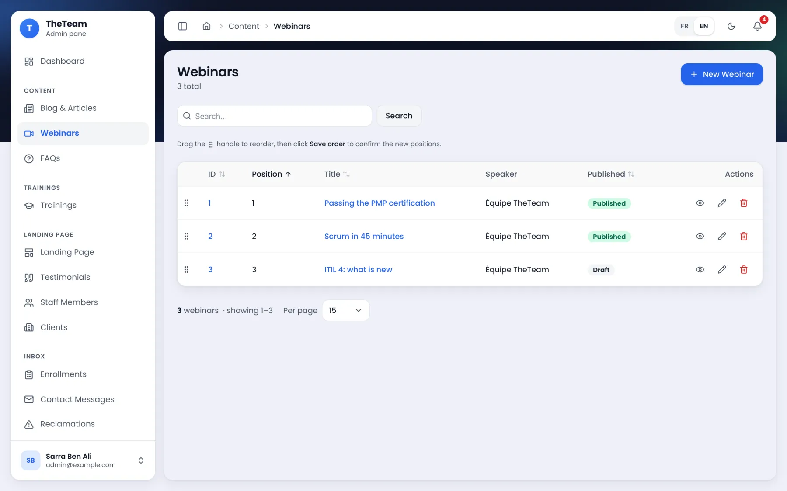
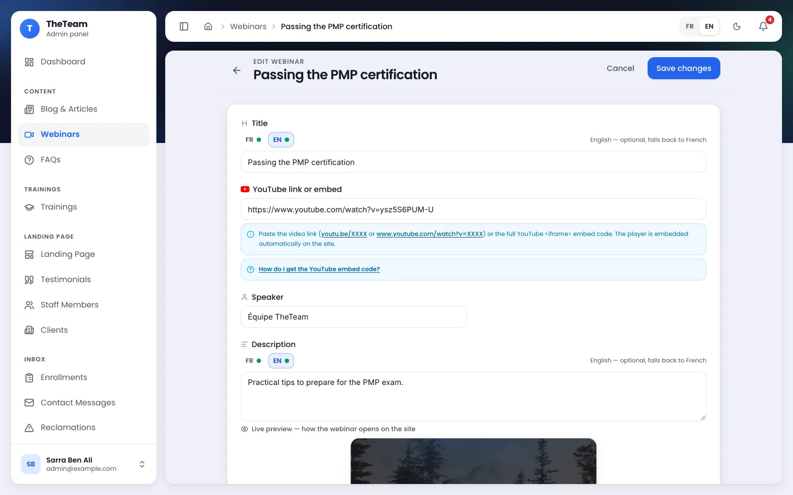
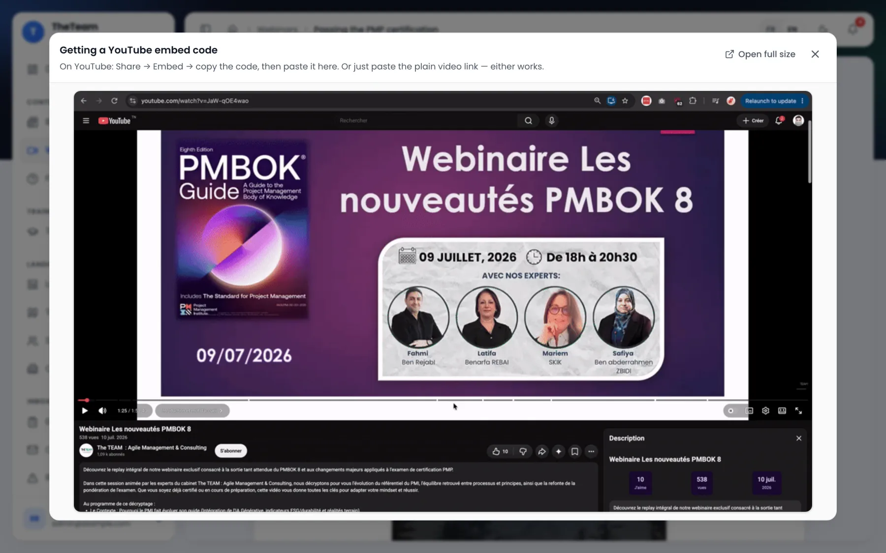
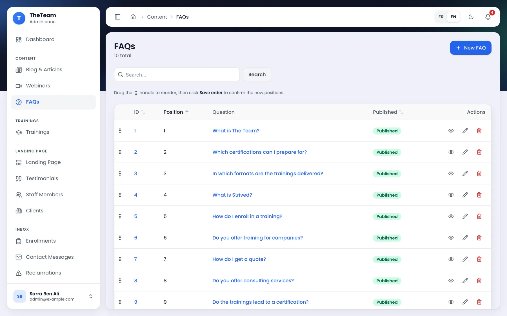

<Info>
  **Both roles** can create and edit webinars and FAQs. Only an **administrator** can delete.
</Info>

## Webinars

Menu **Content → Webinars**. Each webinar is a **YouTube** video shown on the website.

<Frame caption="The list of webinars. « Draft » = not yet visible on the website.">
  
</Frame>

<Steps>
  <Step title="Click « New Webinar »">
    The blue button at the top right.
  </Step>
  <Step title="Give it a title">
    In French (and in English if you have it).
  </Step>
  <Step title="Paste the YouTube link">
    The video link (`youtu.be/…` or `www.youtube.com/watch?v=…`) or the embed code provided by YouTube: both work.
  </Step>
  <Step title="Enter the speaker and a description">
    Then check the **live preview** at the bottom of the form: it is exactly what visitors will see.
  </Step>
  <Step title="Publish">
    Turn on **Published** and save.
  </Step>
</Steps>

<Frame caption="A webinar record, with the live preview at the bottom.">
  
</Frame>

<Tip>
  Not sure where to find the link? Click **How do I get the YouTube embed code?** under the field: a short animation shows the way (on YouTube: **Share → Embed → Copy**).
</Tip>

<Frame caption="The help built into the form.">
  
</Frame>

## FAQs

Menu **Content → FAQs**: the frequently asked questions shown on the website.

<Frame caption="The list of questions. The handle on the left of each row lets you change the order.">
  
</Frame>

- **Add a question**: **New FAQ**, then fill in **Question** and **Answer**, turn on **Published** and click **Create**.
- **Change the order**: drag the rows by their handle, then click **Save order**.
- **Hide a question** without deleting it: turn off **Published**.

A question's record is shown in [Getting to know the panel](/en/guide-utilisateur/interface#records-and-forms).
