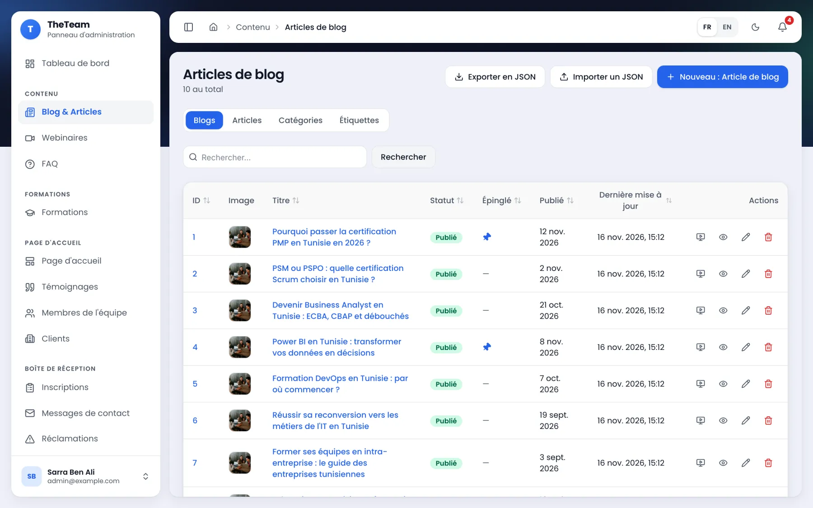
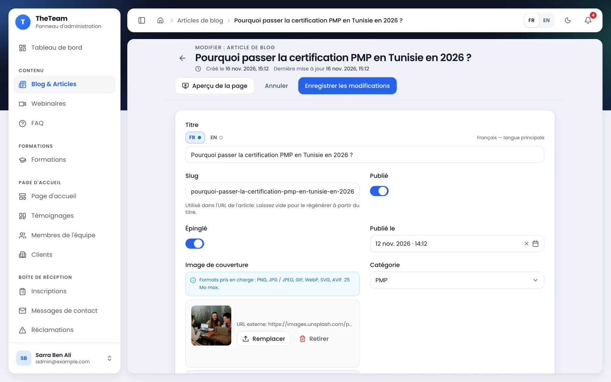
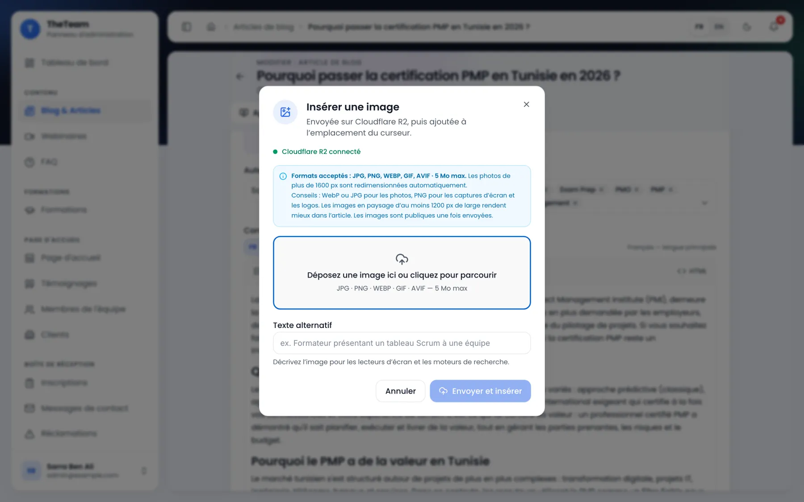
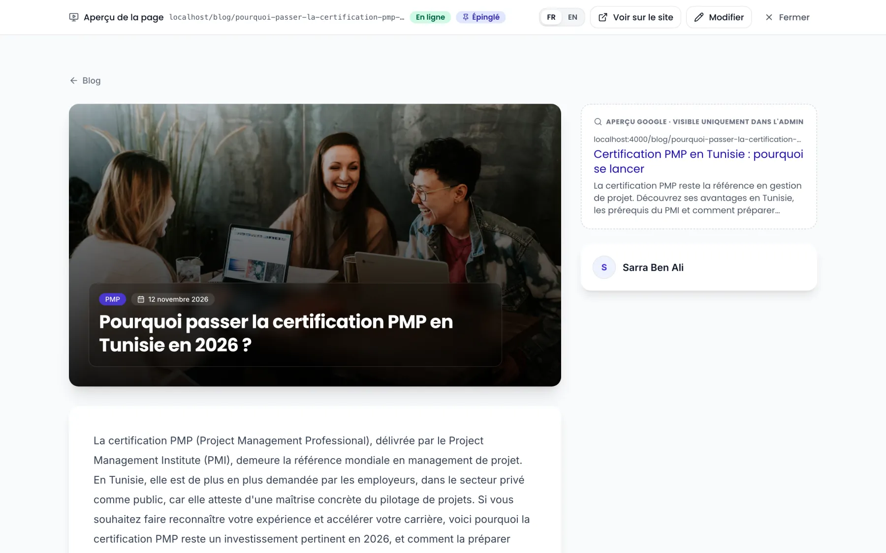
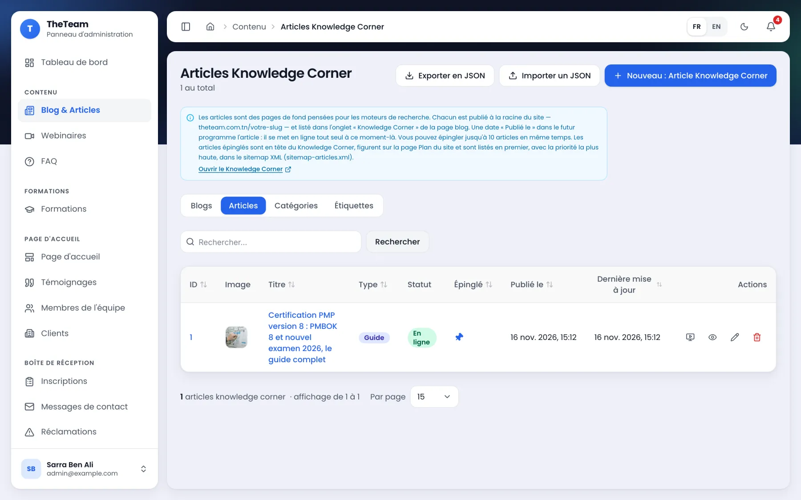
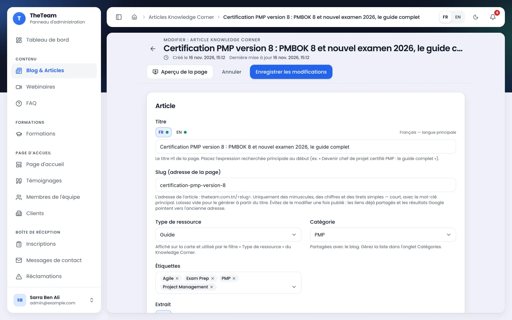
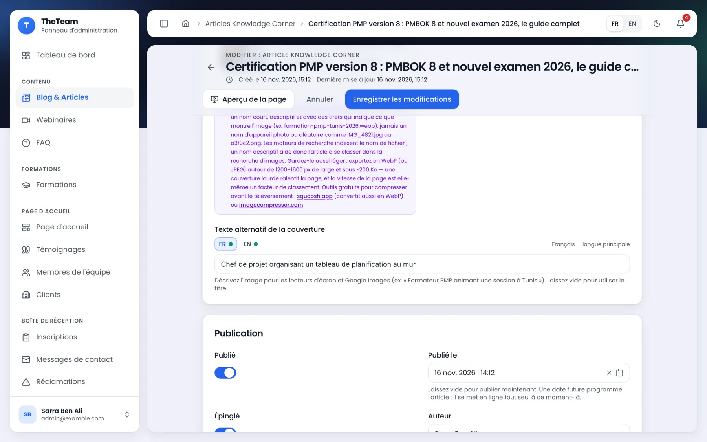
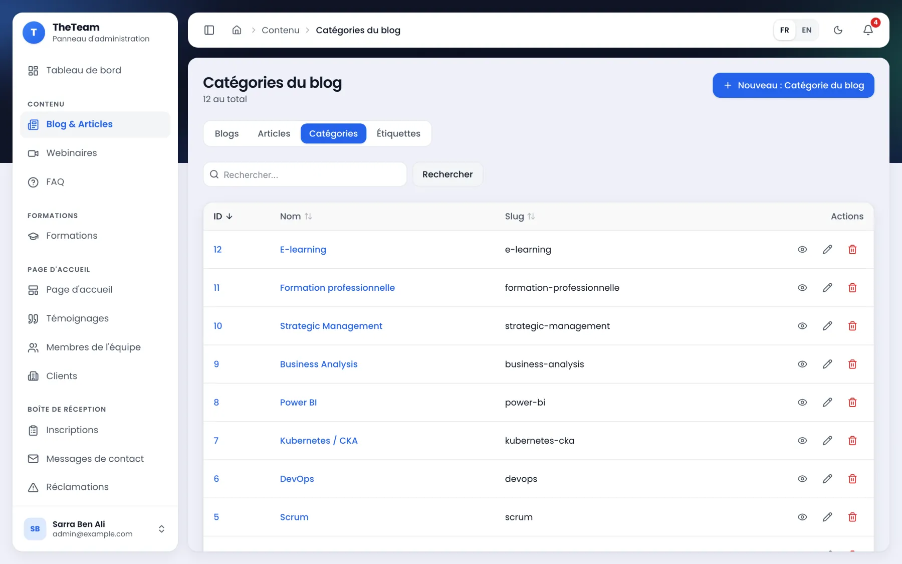

Menu **Contenu → Blog & Articles**. La page a quatre onglets :

| Onglet | Ce que c’est |
| :-- | :-- |
| **Blogs** | Les actualités et articles du blog du site. |
| **Articles** | Les articles de fond du **Knowledge Corner**, pensés pour Google. Chacun a sa propre adresse : `theteam.com.tn/nom-de-l-article`. |
| **Catégories** | Les thèmes (PMP, Scrum, DevOps…), communs au blog et aux articles. |
| **Étiquettes** | Des mots-clés plus fins, communs aussi. |

<Info>
  **Les deux rôles** peuvent créer et modifier. Seul un **administrateur** peut supprimer.
</Info>

<Frame caption="L’onglet Blogs. Les icônes de chaque ligne : aperçu de la page, voir, modifier, supprimer.">
  
</Frame>

## Écrire un article de blog

<Steps>
  <Step title="Cliquez sur « Nouveau : Article de blog »">
    Le bouton bleu en haut à droite.
  </Step>
  <Step title="Remplissez le titre (FR, et EN si vous l’avez)">
    Le **slug** (la fin de l’adresse de la page) est créé automatiquement à partir du titre.
  </Step>
  <Step title="Ajoutez une image de couverture">
    Obligatoire. Glissez l’image dans le cadre ou cliquez pour la choisir.
  </Step>
  <Step title="Choisissez la catégorie, l’auteur et les étiquettes">
    Les étiquettes se choisissent dans une liste : vous pouvez en mettre plusieurs.
  </Step>
  <Step title="Écrivez le contenu">
    Avec l’éditeur de texte (voir ci-dessous).
  </Step>
  <Step title="Publiez">
    Activez **Publié**, puis cliquez sur **Créer** (ou **Enregistrer les modifications**).
  </Step>
</Steps>

<Frame caption="La fiche d’un article de blog : titre, slug, Publié, Épinglé, date de publication, image et catégorie.">
  
</Frame>

Les réglages de publication :

- **Publié** : activé = visible sur le site ; désactivé = brouillon, invisible pour les visiteurs.
- **Épinglé** : l’article est mis en avant en tête du blog.
- **Publié le** : la date affichée sur l’article.

<Tip>
  **Bien nommer l’image avant de l’envoyer** aide Google à trouver l’article : un nom court et descriptif comme `formation-pmp-tunis-2026.webp`, plutôt que `IMG_4821.jpg`. Gardez aussi l’image légère (moins de 200 Ko environ) : le site s’affiche plus vite. Le site gratuit [squoosh.app](https://squoosh.app/) compresse une image en quelques secondes.
</Tip>

## L’éditeur de texte

<Frame caption="L’éditeur : la barre d’outils au-dessus du texte.">
  
</Frame>

Il fonctionne comme un traitement de texte : sélectionnez un mot puis cliquez sur **B** (gras), *I* (italique), **H2 / H3** (intertitres), listes à puces ou numérotées, lien…

**Insérer une image dans le texte** : placez le curseur à l’endroit voulu, cliquez sur **Image**, déposez le fichier, écrivez un **texte alternatif** (une courte description de l’image) puis cliquez sur **Envoyer et insérer**. Vous pouvez aussi simplement coller ou glisser une image dans le texte.

<Frame caption="La fenêtre « Insérer une image ». La ligne verte confirme que le stockage des images fonctionne.">
  
</Frame>

<Note>
  Formats acceptés : JPG, PNG, WebP, GIF, AVIF, **5 Mo maximum**. Les grandes photos sont réduites automatiquement. Si la fenêtre affiche un cadre rouge « Cloudflare R2 n’est pas connecté », prévenez un administrateur : voir [Paramètres du site](/guide-utilisateur/journal-et-parametres).
</Note>

## Prévisualiser avant de publier

Le bouton **Aperçu de la page** (en haut de la fiche, ou l’icône d’écran dans la liste) ouvre l’article tel qu’il apparaîtra sur le site, avec l’aperçu du résultat Google. Le bouton **FR / EN** de l’aperçu change de langue.

<Frame caption="L’aperçu d’un article de blog, avant ou après publication.">
  
</Frame>

## Les articles du Knowledge Corner

Onglet **Articles**. Ce sont des articles longs, rédigés pour être bien classés sur Google. Chacun est publié **à la racine du site** : `theteam.com.tn/votre-slug`.

<Frame caption="L’onglet Articles. La colonne Statut indique En ligne, Programmé ou Brouillon.">
  
</Frame>

Le formulaire est découpé en sections, avec une aide sous chaque champ :

- **Article** : titre, **slug** (l’adresse de la page), type de ressource (article, guide, tutoriel…), catégorie, étiquettes, **extrait** (une ou deux phrases affichées sur la carte) et contenu. Structurez le texte avec des intertitres **H2 / H3** : ils construisent la table des matières de la page.
- **Image de couverture** et son **texte alternatif**.
- **Publication** : Publié, date de publication, Épinglé, auteur.
- **SEO** : comment l’article apparaît sur Google (tout est facultatif).

<Frame caption="La fiche d’un article : la section Article.">
  
</Frame>

### Programmer un article

Activez **Publié** et choisissez une **date future** dans **Publié le** : l’article reste « Programmé » et **se met en ligne tout seul** à cette date. Laissez la date vide pour publier tout de suite.

<Frame caption="La section Publication.">
  
</Frame>

<Warning>
  **Évitez de changer le slug d’un article déjà publié** : les liens partagés et les résultats Google pointent vers l’ancienne adresse. Certains mots sont aussi refusés pour le slug, car ils correspondent déjà à des pages du site.
</Warning>

<Note>
  Vous pouvez épingler **jusqu’à 10 articles** à la fois. Pour en épingler un onzième, désépinglez-en d’abord un autre.
</Note>

## Catégories et étiquettes

Onglets **Catégories** et **Étiquettes** : cliquez sur **Nouveau**, donnez un nom (le slug se remplit tout seul) et enregistrez. Ces listes sont partagées entre le blog et les articles.

<Frame caption="L’onglet Catégories.">
  
</Frame>

<Note>
  **Exporter / Importer en JSON** (en haut des listes Blogs et Articles) sert à copier un article d’un site à un autre. C’est un usage technique : ne l’utilisez que si on vous le demande.
</Note>
