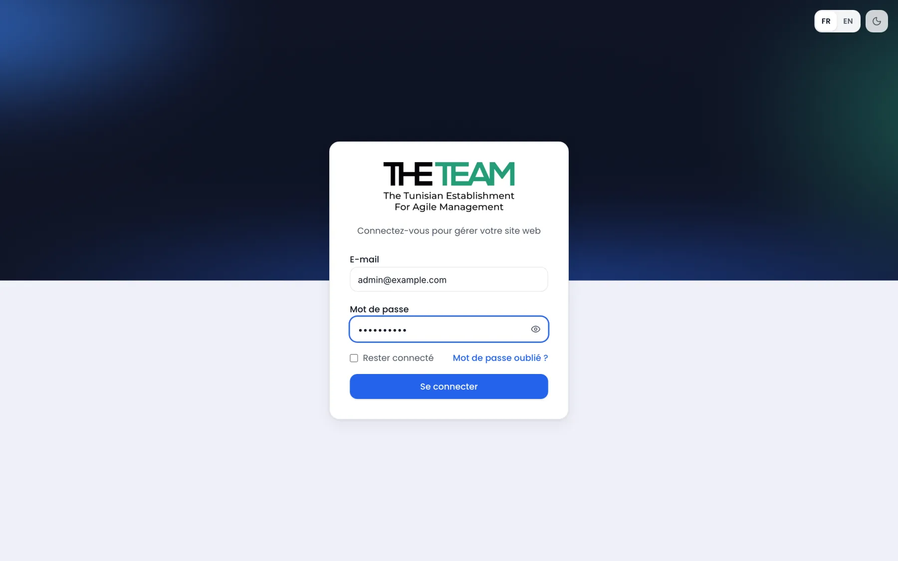
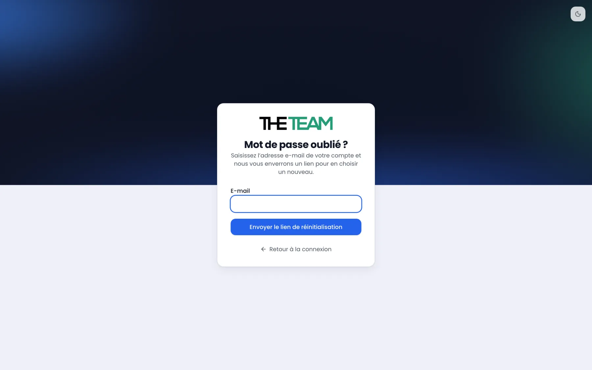
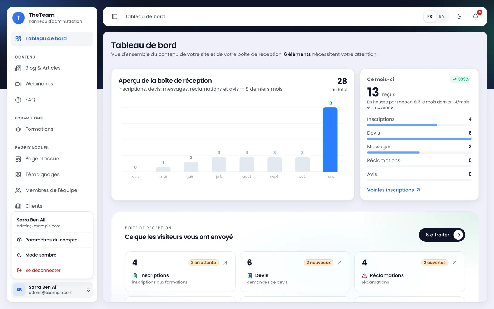

## Première connexion : l’invitation

Personne ne crée son compte seul. Un **administrateur vous envoie une invitation par e-mail**.

<Steps>
  <Step title="Ouvrez l’e-mail d’invitation">
    Cliquez sur le bouton de l’e-mail. **Le lien n’est valable que 24 heures** et ne sert qu’une fois. S’il a expiré, demandez à un administrateur de vous renvoyer l’invitation.
  </Step>
  <Step title="Choisissez votre mot de passe">
    Au moins 8 caractères, à saisir deux fois.
  </Step>
  <Step title="Connectez-vous">
    Vous arrivez sur la page de connexion, votre adresse déjà remplie. Une fois connecté, complétez votre profil (votre nom, votre photo) : voir [Mon compte](/guide-utilisateur/mon-compte).
  </Step>
</Steps>

## Se connecter

<Steps>
  <Step title="Ouvrez la page de connexion">
    Allez sur **admin.theteam.com.tn/admin**. La page de connexion s’affiche.
  </Step>
  <Step title="Saisissez votre e-mail et votre mot de passe">
    L’icône en forme d’œil affiche le mot de passe en clair pour vérifier ce que vous avez tapé.
  </Step>
  <Step title="Cliquez sur « Se connecter »">
    Cochez **Rester connecté** uniquement sur votre ordinateur personnel, jamais sur un poste partagé.
  </Step>
</Steps>

<Frame caption="La page de connexion. En haut à droite : la langue (FR / EN) et le mode sombre.">
  
</Frame>

<Note>
  Si vous avez activé la **double authentification**, une deuxième page vous demande le **code à 6 chiffres** affiché dans votre application Google Authenticator. Voir [Mon compte](/guide-utilisateur/mon-compte#la-double-authentification).
</Note>

<Warning>
  Après **5 essais ratés en une minute**, la connexion est bloquée un court instant. Attendez une minute avant de réessayer, ou utilisez « Mot de passe oublié ? ».
</Warning>

## Mot de passe oublié

<Steps>
  <Step title="Cliquez sur « Mot de passe oublié ? »">
    Le lien se trouve sous le champ mot de passe.
  </Step>
  <Step title="Saisissez votre adresse e-mail">
    Puis cliquez sur **Envoyer le lien de réinitialisation**.
  </Step>
  <Step title="Ouvrez l’e-mail reçu">
    Cliquez sur le lien et choisissez un nouveau mot de passe. Pensez à regarder dans les courriers indésirables (spam).
  </Step>
</Steps>

<Frame caption="La page « Mot de passe oublié ? ».">
  
</Frame>

## Se déconnecter

En bas du menu de gauche, cliquez sur **votre nom**, puis sur **Se déconnecter**.

<Frame caption="Le menu de votre compte, en bas à gauche : paramètres du compte, mode sombre et déconnexion.">
  
</Frame>
