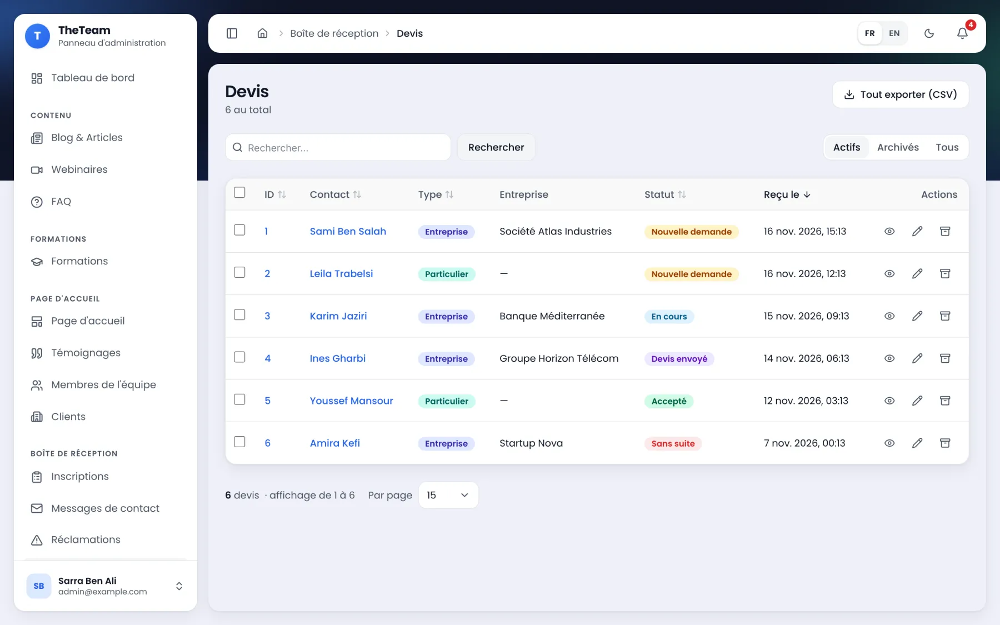
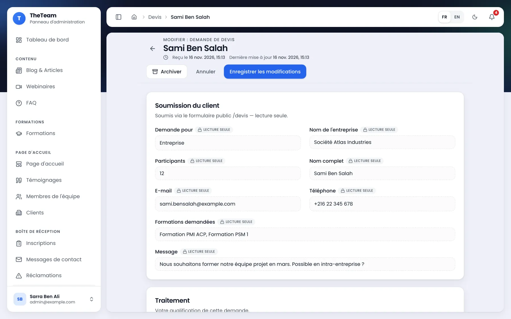
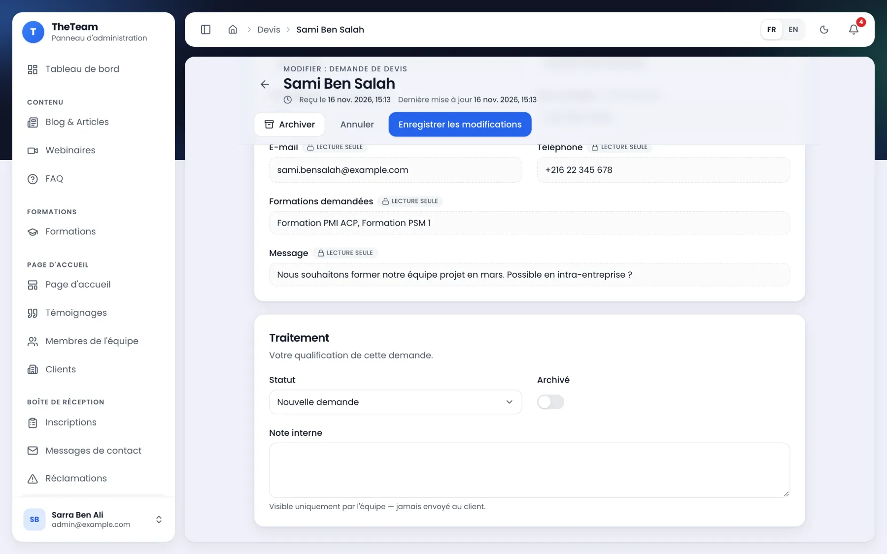

Menu **Boîte de réception → Devis**. Chaque demande envoyée avec le formulaire **Devis** du site arrive ici. Une notification vous prévient et l’équipe reçoit aussi un e-mail.

<Info>
  **Les deux rôles** peuvent consulter, traiter, archiver et exporter les devis. Seul un **administrateur** peut supprimer un devis, et seulement après l’avoir archivé.
</Info>

<Tip>
  Pour voir le formulaire tel que le visiteur le remplit sur le site, consultez [Le formulaire de devis](/guide-utilisateur/formulaire-devis) (côté visiteur).
</Tip>

<Frame caption="La liste des devis : contact, type (entreprise ou particulier), entreprise, statut et date de réception.">
  
</Frame>

## Les statuts

Le statut indique où en est chaque demande. C’est vous qui le changez au fil du traitement.

| Statut | Signification |
| :-- | :-- |
| **Nouvelle demande** | Personne ne l’a encore traitée. |
| **En cours** | Quelqu’un s’en occupe (appel, échange d’e-mails…). |
| **Devis envoyé** | L’offre a été envoyée au client. |
| **Accepté** | Le client a accepté. |
| **Sans suite** | Le client n’a pas donné suite. |

## Traiter une demande

<Steps>
  <Step title="Ouvrez la demande">
    Cliquez sur le nom du contact ou sur le crayon.
  </Step>
  <Step title="Lisez la demande du client">
    La section **Soumission du client** montre ce que le visiteur a rempli : entreprise ou particulier, nombre de participants, coordonnées, formations demandées et message. Ces champs sont en **lecture seule**.
  </Step>
  <Step title="Contactez le client">
    Par téléphone ou par e-mail, avec les coordonnées affichées. Le panneau n’envoie pas le devis lui-même.
  </Step>
  <Step title="Mettez à jour le statut et la note interne">
    Dans la section **Traitement**, choisissez le **Statut** et notez ce qui a été fait dans la **Note interne** (date d’appel, prix proposé…). Cliquez sur **Enregistrer les modifications**.
  </Step>
</Steps>

<Frame caption="La fiche d’un devis : la demande du client, en lecture seule.">
  
</Frame>

<Frame caption="La section Traitement, en bas de la fiche.">
  
</Frame>

<Tip>
  La **note interne** n’est **jamais envoyée au client** : elle sert à l’équipe. Si un collègue reprend le dossier, il sait tout de suite où vous en êtes.
</Tip>

## Archiver

Quand une demande est terminée (Accepté ou Sans suite), **archivez-la** pour garder une liste claire : bouton **Archiver** en haut de la fiche, ou icône boîte dans la liste. Retrouvez-la avec le filtre **Archivés**.

## Exporter

**Tout exporter (CSV)** télécharge les devis dans un fichier à ouvrir avec Excel. Cochez des lignes d’abord pour n’exporter que celles-ci.

<Note>
  L’adresse e-mail de chaque demandeur est aussi ajoutée à la liste [Newsletter](/guide-utilisateur/newsletter-et-avis).
</Note>
