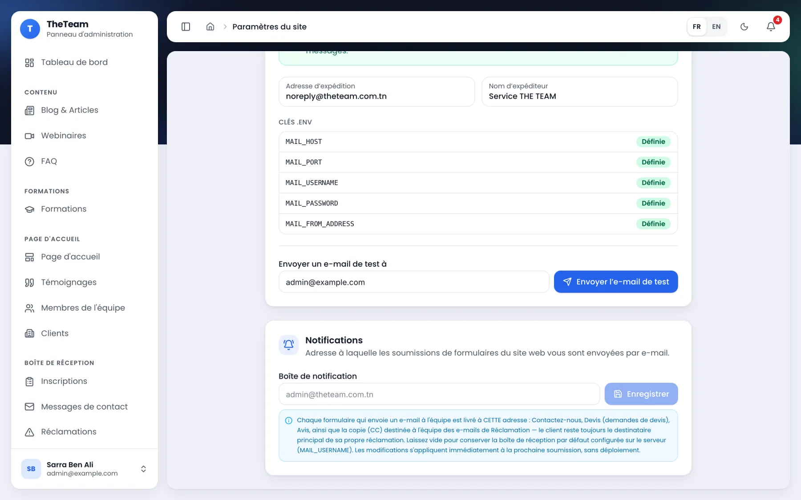

Menu **Système → Paramètres du site**, carte **Envoi d’e-mails (SMTP)**.

Le **SMTP** est le service qui envoie les e-mails du site : copie des formulaires de contact, de devis et d’avis à l’équipe, e-mails de réclamation au client, invitations du personnel, réinitialisation de mot de passe… Si l’envoi ne fonctionne pas, les demandes arrivent quand même dans la **Boîte de réception** du panneau, mais **plus aucun e-mail ne part**.

<Info>
  Les **administrateurs** et les **gestionnaires de contenu** peuvent consulter cette carte et envoyer un e-mail de test. La configuration elle-même se fait sur le serveur (fichier `.env`) par la personne en charge technique.
</Info>

<Frame caption="La carte Envoi d’e-mails (SMTP) : adresse d’expédition, clés de configuration et e-mail de test.">
  
</Frame>

## Lire l’état de la carte

| Message affiché | Signification | Que faire |
| :-- | :-- | :-- |
| **SMTP est configuré** (vert) | Tous les réglages sont présents. | Envoyez un e-mail de test pour confirmer que les e-mails arrivent. |
| **SMTP n’est pas configuré** (rouge) | Des réglages manquent sur le serveur ; ils sont listés par leur nom. | Prévenez la personne en charge technique. |
| **Les e-mails ne sont pas envoyés (mode test)** (orange) | Le serveur écrit les e-mails dans son journal au lieu de les envoyer. Normal sur un poste de développement, **anormal sur le site réel**. | Prévenez la personne en charge technique. |

La carte affiche aussi l’**adresse d’expédition** (l’adresse qui apparaît comme expéditeur, par exemple `noreply@theteam.com.tn`) et le **nom d’expéditeur**. Les clés de configuration sont listées par leur **nom** avec la mention **Définie** ou **Manquante** : leur valeur (mot de passe, identifiant) n’est **jamais affichée**.

## Envoyer un e-mail de test

<Steps>
  <Step title="Saisissez votre adresse">
    Dans le champ **Envoyer un e-mail de test à** (votre adresse est proposée par défaut).
  </Step>
  <Step title="Cliquez sur « Envoyer l’e-mail de test »">
    L’envoi se fait immédiatement.
  </Step>
  <Step title="Vérifiez votre boîte de réception">
    Un message vert confirme : « E-mail de test envoyé à … Vérifiez la boîte de réception (et le dossier spam). » Vous recevez un e-mail intitulé **« E-mail de test — THETEAM »**. Pensez au dossier **spam**.
  </Step>
</Steps>

<Note>
  Vous pouvez envoyer **5 e-mails de test par minute** au plus. Au-delà : « Trop d’e-mails de test. Patientez une minute puis réessayez. »
</Note>

## Si l’e-mail de test échoue

Un message rouge explique la cause. Transmettez-le tel quel à la personne en charge technique :

| Message | Ce qu’il veut dire |
| :-- | :-- |
| « Le serveur SMTP a refusé l’identifiant… » | L’identifiant ou le mot de passe du compte e-mail est incorrect. |
| « Le serveur SMTP est injoignable… » | Le serveur d’envoi ne répond pas (adresse, port, ou hébergeur qui bloque l’envoi). |
| « La connexion sécurisée au serveur SMTP a échoué… » | Mauvais réglage de sécurité (port 465 ou 587). |
| « Le serveur SMTP a refusé l’expéditeur ou le destinataire… » | L’adresse d’expédition n’est pas autorisée par ce compte e-mail. |
| « L’envoi d’e-mails n’est pas configuré… » | Des réglages manquent sur le serveur. |
| « L’e-mail de test n’a pas pu être envoyé. Les détails ont été écrits dans le journal du serveur. » | Autre erreur : le détail technique est dans le journal du serveur. |

<Warning>
  **Le message est vert mais rien n’arrive ?** Regardez dans le dossier **spam**, puis réessayez avec une autre adresse (Gmail, Outlook…). Si rien n’arrive toujours, prévenez la personne en charge technique : le serveur a accepté l’e-mail mais ne le livre pas.
</Warning>

## À quelle adresse arrivent les formulaires ?

L’adresse de l’équipe qui reçoit les formulaires du site se règle juste en dessous, dans la carte **Notifications** : voir [Journal et paramètres](/guide-utilisateur/journal-et-parametres). Après l’avoir changée, envoyez un e-mail de test pour vérifier que tout fonctionne.
