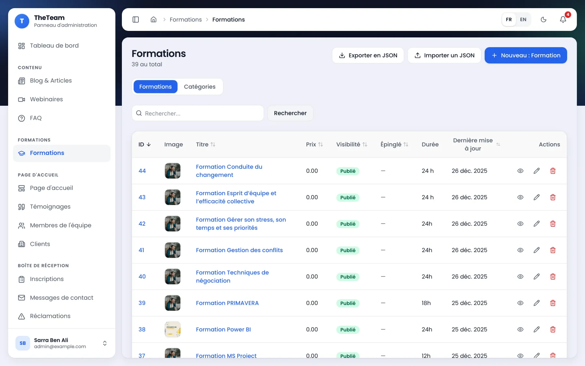
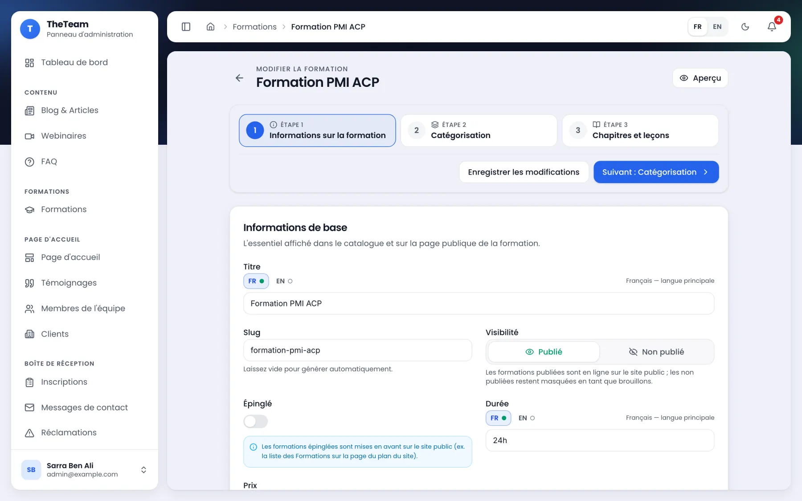
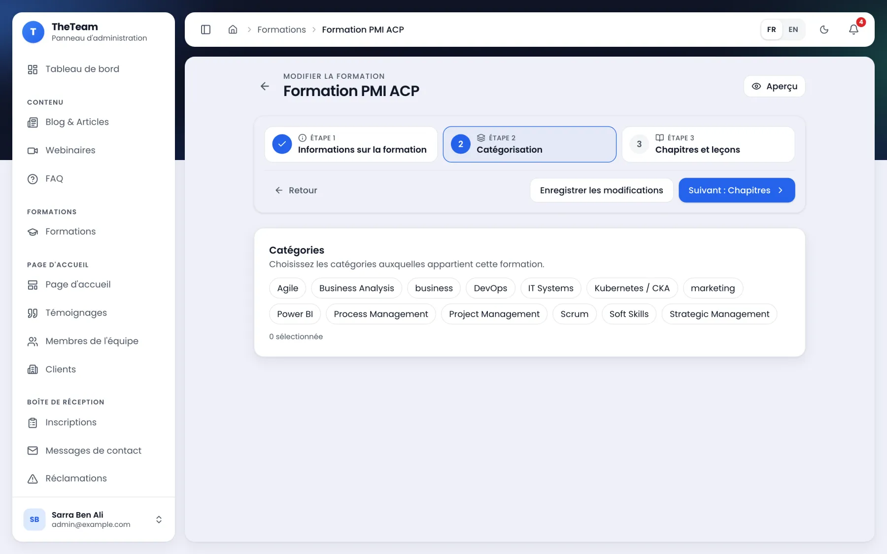
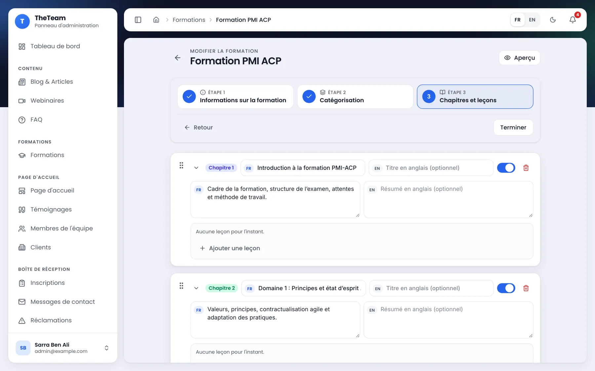
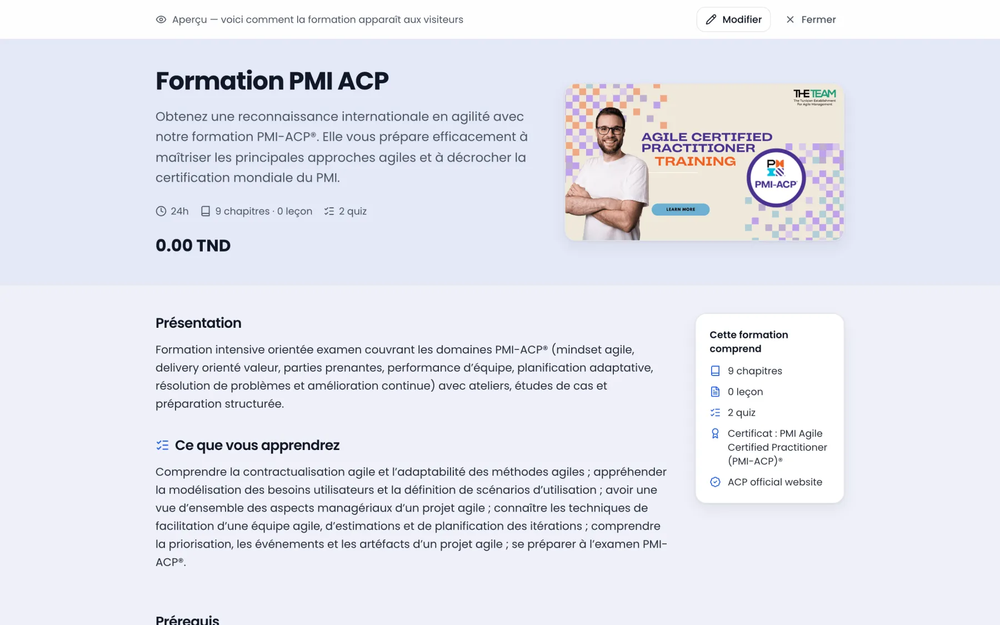
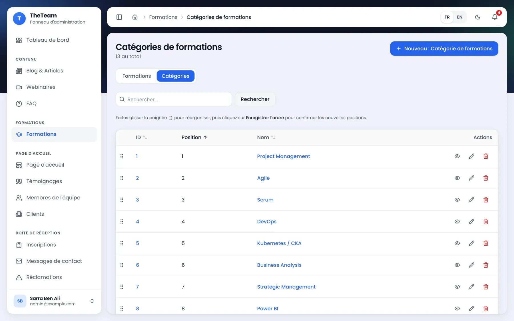

Menu **Formations**. On y gère le catalogue affiché sur le site.

<Info>
  **Les deux rôles** peuvent créer et modifier des formations et des catégories. Seul un **administrateur** peut supprimer.
</Info>

<Frame caption="La liste des formations. Icônes de chaque ligne : aperçu, modifier, supprimer.">
  
</Frame>

## Créer ou modifier une formation

Cliquez sur **Nouveau : Formation**, ou sur le crayon d’une formation existante. Le formulaire se remplit en **trois étapes**, affichées en haut de la page. Vous pouvez enregistrer à tout moment avec **Enregistrer les modifications**.

### Étape 1 — Informations sur la formation

<Frame caption="Étape 1 : les informations de la formation.">
  
</Frame>

Le formulaire est découpé en blocs :

| Bloc | Contenu |
| :-- | :-- |
| **Informations de base** | Titre, slug (laissez vide : il se crée seul), **Visibilité**, Épinglé, Durée, Prix. |
| **Médias** | Image à la une, image du badge de certification. |
| **Description** | Introduction et présentation de la formation. |
| **Certification** | Nom et lien officiel de la certification. |
| **E-learning et ressources** | Accès e-learning, nombre de quiz, ressource incluse. |
| **Informations complémentaires** | Prérequis et objectifs pédagogiques. |

- **Visibilité → Publié** : la formation est en ligne. **Non publié** : elle reste cachée (brouillon).
- **Épinglé** : la formation est mise en avant sur le site.

Cliquez sur **Suivant : Catégorisation**.

### Étape 2 — Catégorisation

Cliquez sur les catégories auxquelles appartient la formation (plusieurs choix possibles). Elles servent aux filtres du catalogue sur le site.

<Frame caption="Étape 2 : cliquez sur une catégorie pour la sélectionner.">
  
</Frame>

### Étape 3 — Chapitres et leçons

C’est le **programme** de la formation. Une formation nouvelle doit d’abord être enregistrée (étapes 1 et 2) avant de pouvoir ajouter des chapitres.

<Frame caption="Étape 3 : chaque chapitre a un titre, un résumé et ses leçons.">
  
</Frame>

- **Ajouter un chapitre** puis, dans chaque chapitre, **Ajouter une leçon**.
- Chaque titre et résumé a sa version **FR** et, en option, **EN**.
- **Réorganiser** : faites glisser un chapitre ou une leçon par sa poignée (à gauche).
- La flèche replie ou déplie un chapitre pour y voir plus clair.

Cliquez sur **Terminer** lorsque le programme est complet.

## Prévisualiser

Le bouton **Aperçu** (en haut à droite du formulaire, ou l’icône œil dans la liste) montre la formation telle que les visiteurs la verront.

<Frame caption="L’aperçu d’une formation.">
  
</Frame>

<Note>
  **Une modification n’apparaît pas tout de suite sur le site ?** C’est normal : le site garde le catalogue des formations en mémoire **jusqu’à 5 minutes** pour s’afficher plus vite. Patientez quelques minutes puis rechargez la page.
</Note>

## Les catégories de formations

Onglet **Catégories**, en haut de la liste des formations. Cliquez sur **Nouveau : Catégorie de formations** pour en créer une. Faites glisser les lignes puis **Enregistrer l’ordre** pour choisir l’ordre d’affichage sur le site.

<Frame caption="L’onglet Catégories.">
  
</Frame>
