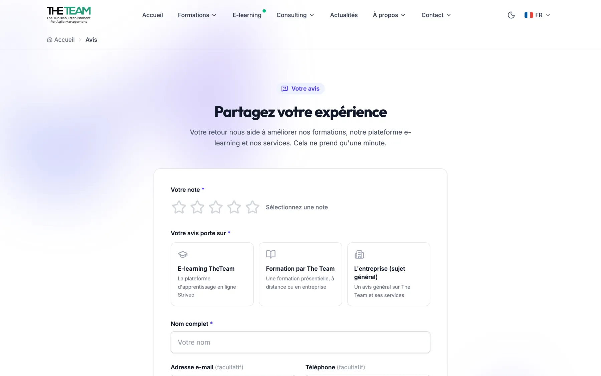
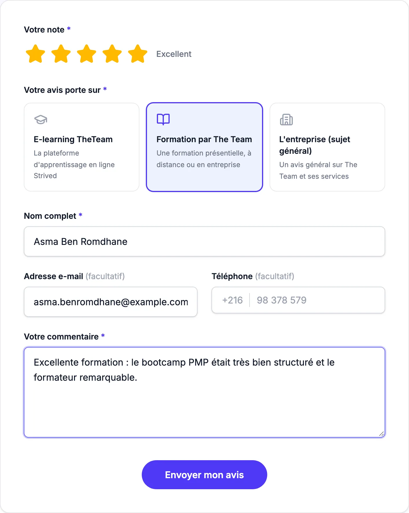
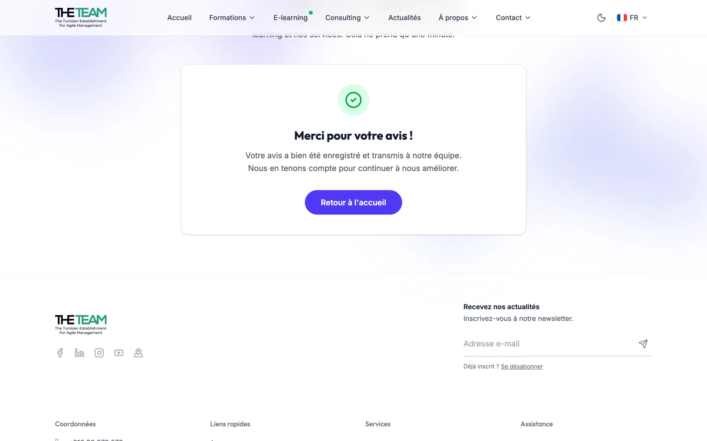
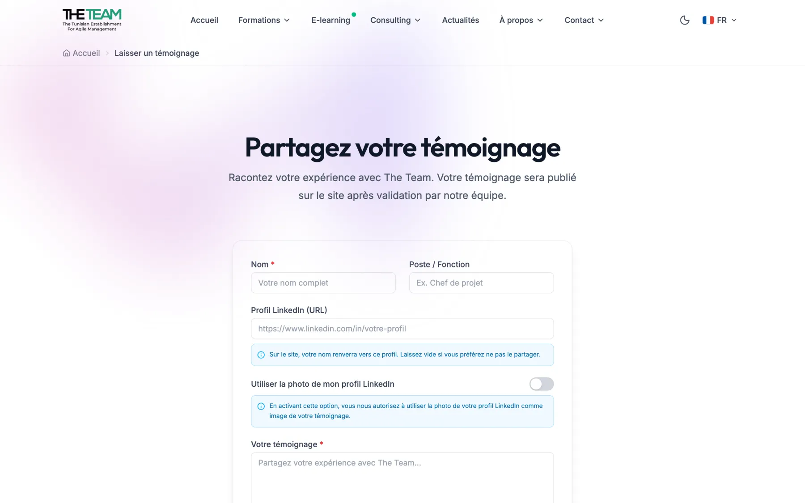
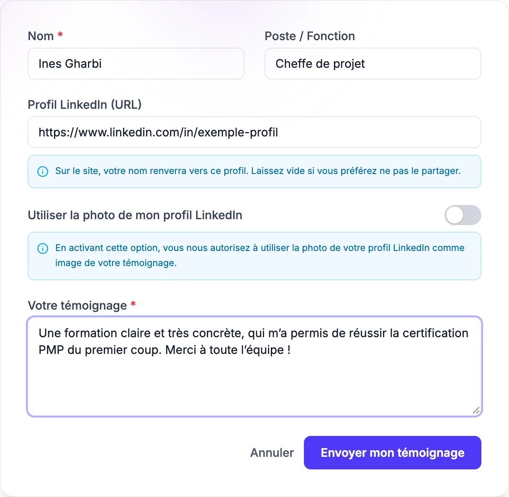

Deux formulaires permettent aux visiteurs de donner leur opinion. Ils ne servent pas à la même chose :

| | Avis | Témoignage |
| :-- | :-- | :-- |
| **But** | Un retour pour l’équipe (note et commentaire). | Un texte destiné à être **publié** sur le site. |
| **Adresse** | theteam.com.tn/review | theteam.com.tn/testimonials/submit |
| **Visible sur le site ?** | Non | Oui, **après votre validation** |
| **Dans le panneau** | Boîte de réception → Avis | Page d’accueil → Témoignages |

## Le formulaire d’avis

<Frame caption="La page « Partagez votre expérience ».">
  
</Frame>

| Champ | Obligatoire | Remarque |
| :-- | :-- | :-- |
| **Votre note** | Oui | De 1 à 5 étoiles. |
| **Votre avis porte sur** | Oui | *E-learning TheTeam*, *Formation par The Team* ou *L’entreprise (sujet général)*. |
| **Nom complet** | Oui | |
| **Adresse e-mail** | Non | |
| **Téléphone** | Non | |
| **Votre commentaire** | Oui | |

<Frame caption="Un avis rempli : 5 étoiles sur une formation.">
  
</Frame>

Après l’envoi, le visiteur voit **« Merci pour votre avis ! »**.

<Frame caption="La confirmation affichée au visiteur.">
  
</Frame>

**De votre côté :** l’avis arrive dans **Boîte de réception → Avis** (lecture seule), avec une notification **« Nouvel avis »** et un **e-mail** à l’équipe. Voir [Newsletter et avis](/guide-utilisateur/newsletter-et-avis).

## Le formulaire de témoignage

<Frame caption="La page « Partagez votre témoignage ».">
  
</Frame>

| Champ | Obligatoire | Remarque |
| :-- | :-- | :-- |
| **Nom** | Oui | |
| **Poste / Fonction** | Non | |
| **Profil LinkedIn (URL)** | Non | Sur le site, le nom renverra vers ce profil. |
| **Utiliser la photo de mon profil LinkedIn** | Non | En l’activant, l’auteur vous autorise à utiliser sa photo LinkedIn. |
| **Votre témoignage** | Oui | |

<Frame caption="Un témoignage rempli.">
  
</Frame>

Après l’envoi, le visiteur voit **« Merci pour votre témoignage ! »** : le site lui indique qu’il sera publié **après validation par l’équipe**.

<Frame caption="La confirmation affichée au visiteur.">
  
</Frame>

**De votre côté :** le témoignage arrive **non publié** dans **Page d’accueil → Témoignages**, avec une notification **« Nouveau témoignage »**. Relisez-le, ajoutez la photo si l’auteur l’a autorisé, puis activez **Publié** : voir [Page d’accueil](/guide-utilisateur/page-accueil).
