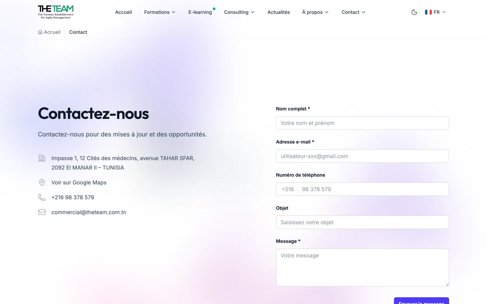
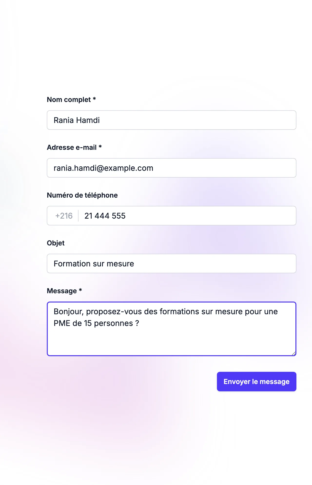
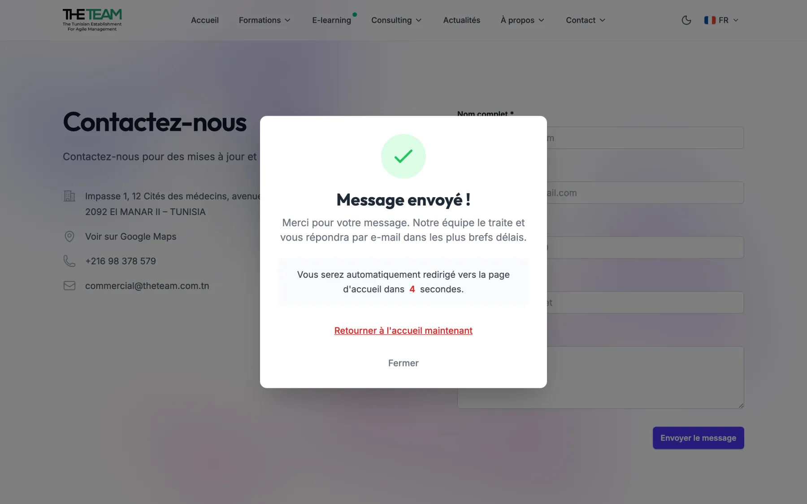

Adresse : **theteam.com.tn/contact-us** (menu « Contact » du site). À gauche, le visiteur trouve les coordonnées de l’entreprise ; à droite, le formulaire.

<Frame caption="La page « Contactez-nous ».">
  
</Frame>

## Ce que le visiteur remplit

| Champ | Obligatoire |
| :-- | :-- |
| **Nom complet** | Oui |
| **Adresse e-mail** | Oui |
| **Numéro de téléphone** | Non |
| **Objet** | Non |
| **Message** | Oui |

<Frame caption="Le formulaire rempli.">
  
</Frame>

## Après l’envoi

Une fenêtre **« Message envoyé ! »** confirme l’envoi et annonce une réponse par e-mail. Le visiteur est ensuite ramené automatiquement à la page d’accueil.

<Frame caption="La confirmation affichée au visiteur.">
  
</Frame>

## De votre côté

- Le message apparaît dans **Boîte de réception → Messages de contact**.
- Une notification **« Nouveau message de contact »** arrive sur la cloche, et l’équipe reçoit un **e-mail**.
- L’adresse du visiteur est ajoutée à la liste **Newsletter**.

**Répondez depuis votre messagerie**, à l’adresse indiquée par le visiteur : voir [Messages et réclamations](/guide-utilisateur/messages-et-reclamations).
