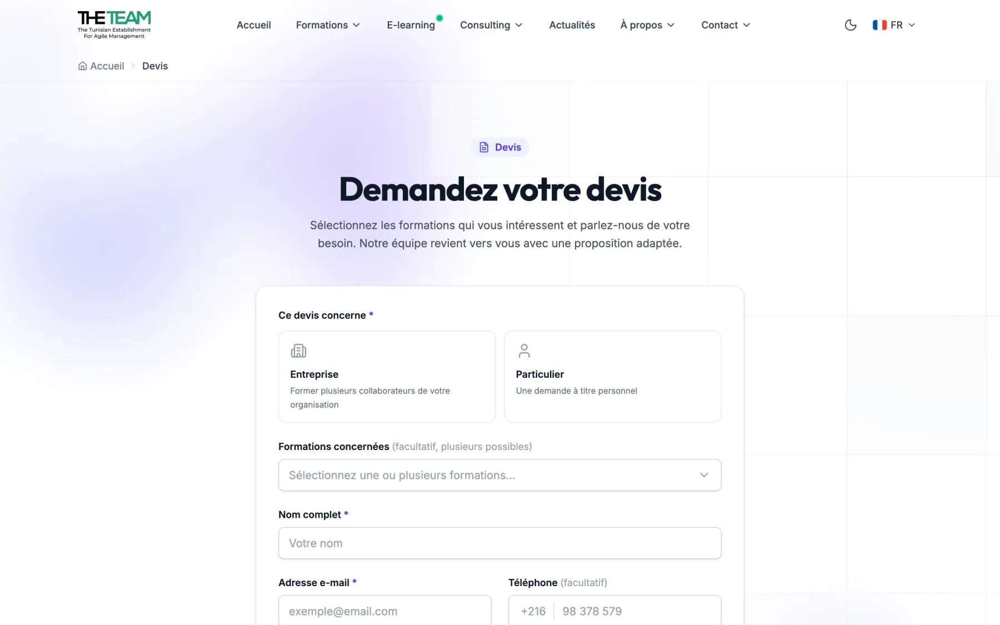
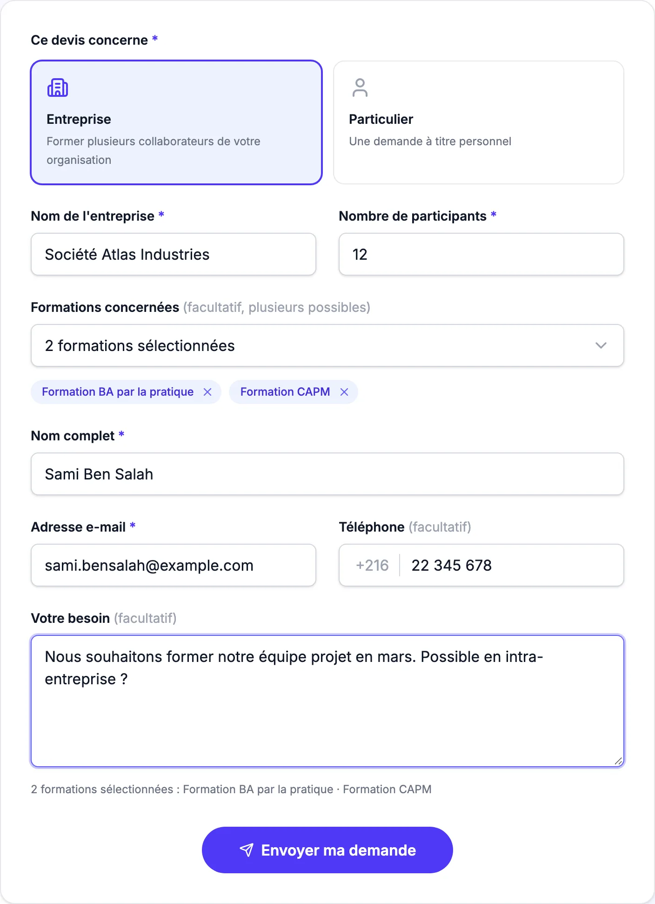
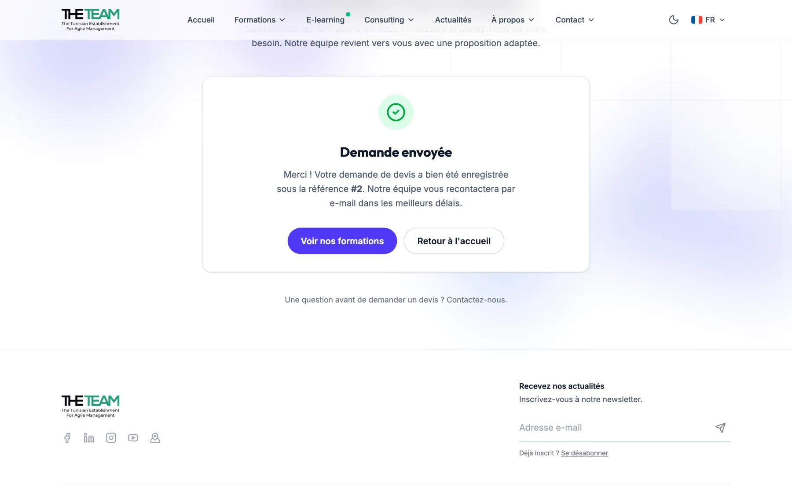

Adresse : **theteam.com.tn/devis** (lien « Devis » dans le pied de page du site). Le visiteur y demande une offre de prix pour une ou plusieurs formations.

<Frame caption="La page « Demandez votre devis », telle que la découvre le visiteur.">
  
</Frame>

## Ce que le visiteur remplit

| Champ | Obligatoire | Remarque |
| :-- | :-- | :-- |
| **Ce devis concerne** | Oui | *Entreprise* (former plusieurs collaborateurs) ou *Particulier* (à titre personnel). |
| **Nom de l’entreprise** et **Nombre de participants** | Oui, pour une entreprise | N’apparaissent que si « Entreprise » est choisi. |
| **Formations concernées** | Non | Une liste du catalogue ; plusieurs choix possibles. |
| **Nom complet** | Oui | |
| **Adresse e-mail** | Oui | |
| **Téléphone** | Non | Indicatif +216 proposé par défaut. |
| **Votre besoin** | Non | Dates souhaitées, format (présentiel, à distance…), questions. |

<Frame caption="Un formulaire rempli par une entreprise, avec deux formations choisies.">
  
</Frame>

## Après l’envoi

Le visiteur voit le message **« Demande envoyée »** avec un **numéro de référence** (ici #2) : c’est le numéro de la demande dans le panneau. Le message lui indique que l’équipe le recontactera par e-mail.

<Frame caption="La confirmation affichée au visiteur.">
  
</Frame>

## De votre côté

- La demande apparaît dans **Boîte de réception → Devis**, au statut **Nouvelle demande**.
- Une notification **« Nouvelle demande de devis »** arrive sur la cloche, et l’équipe reçoit un **e-mail**.
- L’adresse du visiteur est ajoutée à la liste **Newsletter**.

Comment la traiter : [Devis](/guide-utilisateur/devis).
