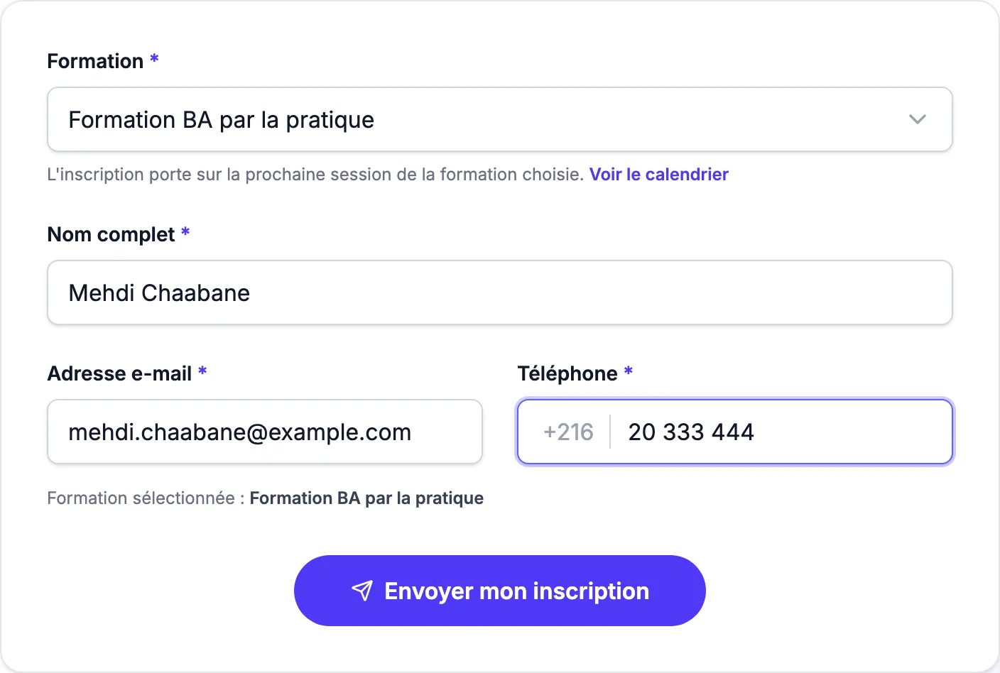
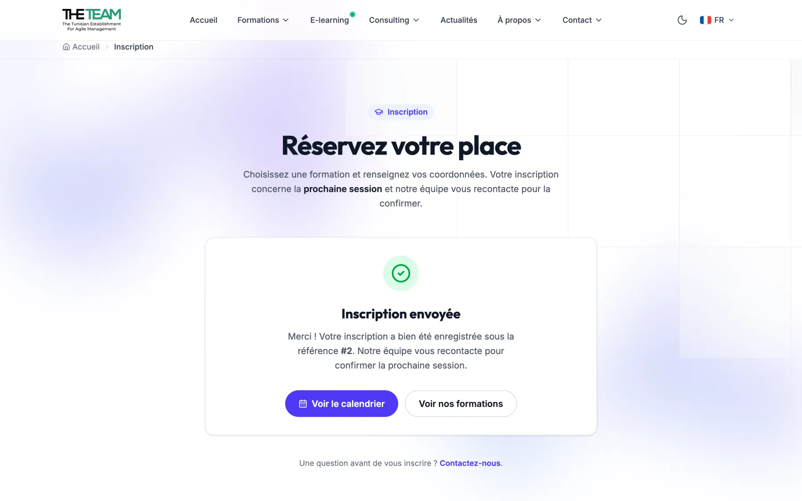

Adresse : **theteam.com.tn/enrollment** (lien « Inscription Formations » dans le pied de page). Le visiteur y réserve une place à la **prochaine session** d’une formation.

<Frame caption="La page « Réservez votre place ».">
  
</Frame>

## Ce que le visiteur remplit

| Champ | Obligatoire | Remarque |
| :-- | :-- | :-- |
| **Formation** | Oui | Liste des formations **publiées**. Un lien « Voir le calendrier » montre les dates des sessions. |
| **Nom complet** | Oui | |
| **Adresse e-mail** | Oui | |
| **Téléphone** | Oui | |

<Frame caption="Le formulaire rempli.">
  
</Frame>

<Note>
  Seules les formations **publiées** sont proposées. Une formation en brouillon n’apparaît pas dans la liste.
</Note>

## Après l’envoi

Le visiteur voit **« Inscription envoyée »** avec un numéro de référence, et l’annonce que l’équipe le recontactera pour confirmer la prochaine session.

<Frame caption="La confirmation affichée au visiteur.">
  
</Frame>

## De votre côté

- L’inscription apparaît dans **Boîte de réception → Inscriptions**, non confirmée.
- Une notification **« Nouvelle inscription »** arrive sur la cloche. Aucun e-mail n’est envoyé : **gardez un œil sur la cloche**.

Comment la traiter : [Inscriptions](/guide-utilisateur/inscriptions).
