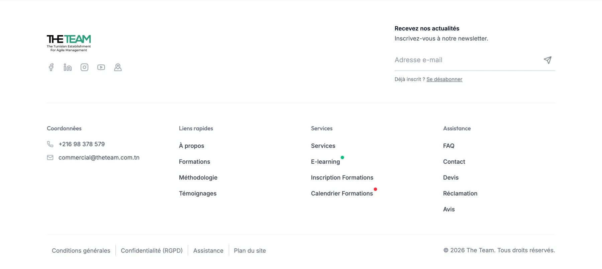
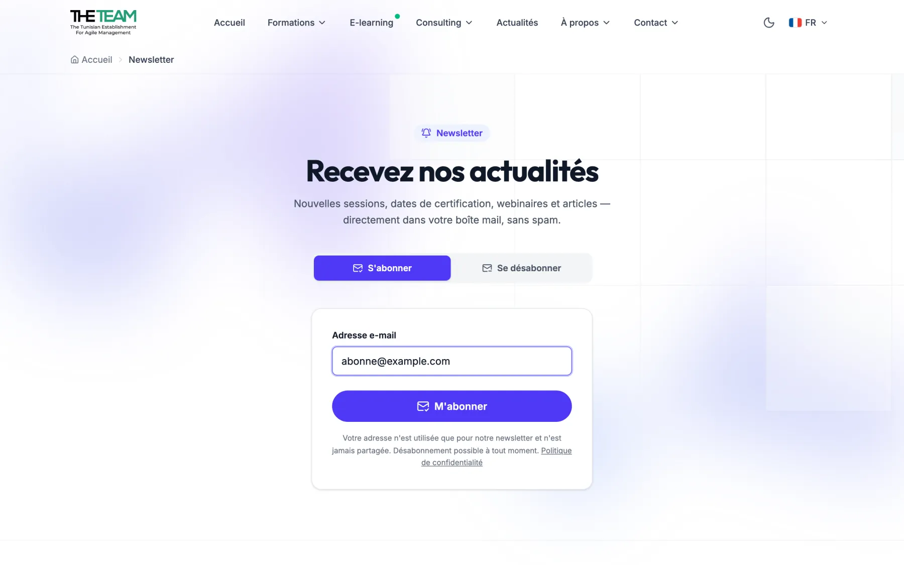

Un visiteur peut s’abonner à la newsletter de deux façons.

## 1. Depuis le pied de page, sur toutes les pages

En bas de chaque page du site, le bloc **« Recevez nos actualités »** contient un champ e-mail : le visiteur tape son adresse et clique sur la flèche. Le lien **« Se désabonner »** juste en dessous ouvre la page de désabonnement.

<Frame caption="Le pied de page du site, avec le champ d’inscription en haut à droite.">
  
</Frame>

## 2. Depuis la page Newsletter

Adresse : **theteam.com.tn/newsletter**. La page a deux onglets : **S’abonner** et **Se désabonner**. Il suffit d’une adresse e-mail.

<Frame caption="La page Newsletter, onglet « S’abonner », adresse saisie.">
  
</Frame>

Après avoir cliqué sur **M’abonner**, le visiteur voit **« Inscription confirmée »**.

<Frame caption="La confirmation affichée au visiteur.">
  
</Frame>

<Note>
  Une adresse déjà abonnée peut se réinscrire sans erreur. Avec l’onglet **Se désabonner**, l’adresse est retirée automatiquement de votre liste.
</Note>

## De votre côté

- L’adresse apparaît dans **Boîte de réception → Newsletter**, avec la source **Formulaire newsletter**.
- Une notification **« Nouvel abonné à la newsletter »** arrive sur la cloche (seulement pour une nouvelle adresse).
- Les adresses laissées dans les formulaires de **devis**, de **contact** et de **réclamation** sont aussi ajoutées à cette liste, avec leur propre source.

Voir [Newsletter et avis](/guide-utilisateur/newsletter-et-avis).
