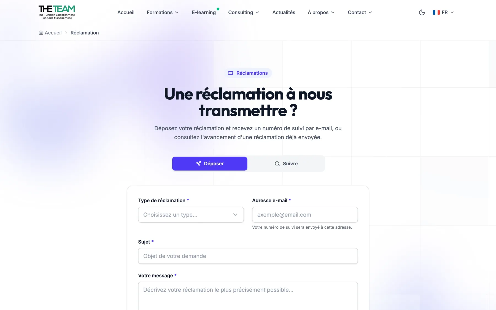
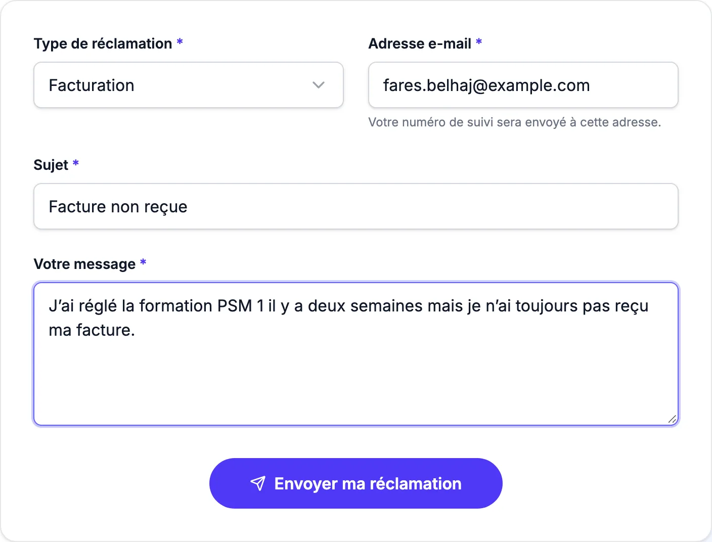
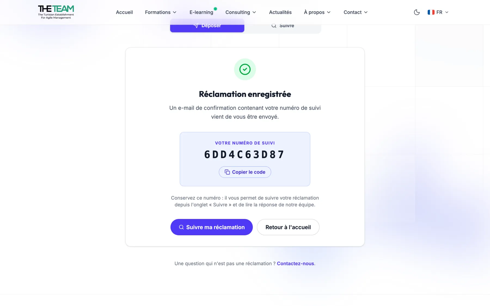
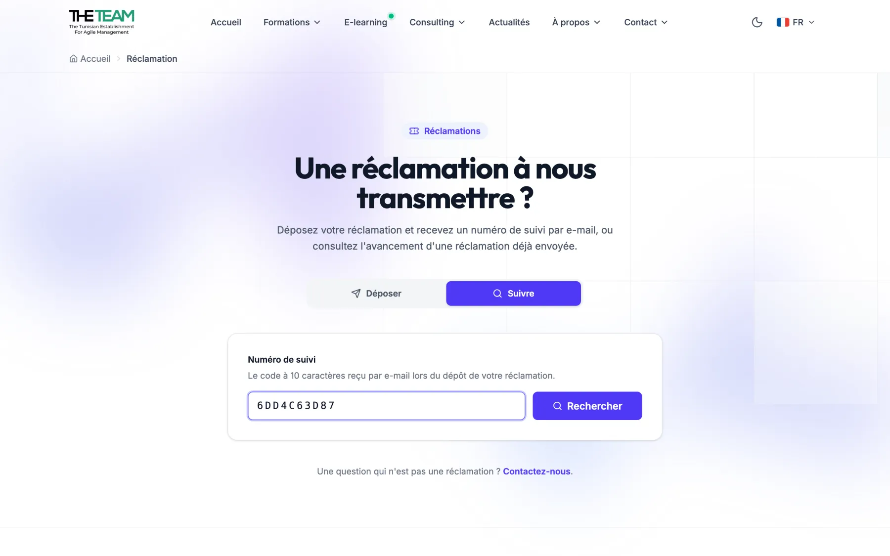
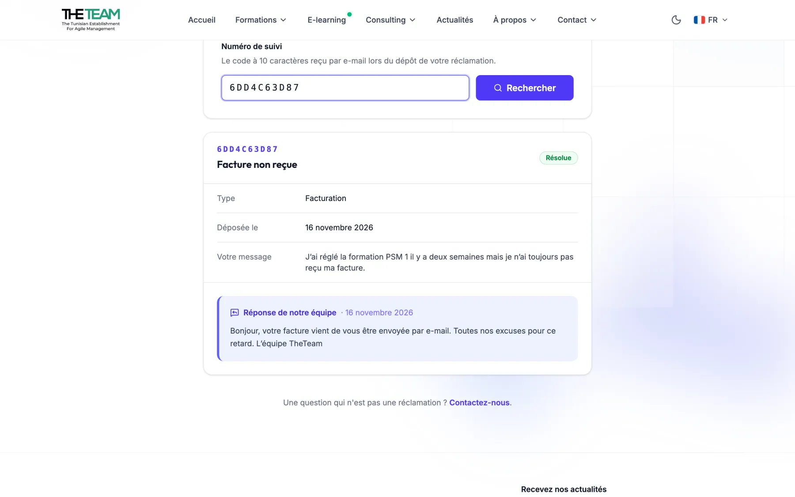

Adresse : **theteam.com.tn/reclamation** (lien « Réclamation » dans le pied de page). La page a deux onglets :

- **Déposer** : envoyer une nouvelle réclamation ;
- **Suivre** : consulter l’avancement d’une réclamation avec son **numéro de suivi**.

<Frame caption="La page des réclamations, onglet « Déposer ».">
  
</Frame>

## Déposer une réclamation

| Champ | Obligatoire | Remarque |
| :-- | :-- | :-- |
| **Type de réclamation** | Oui | Remboursement, Réclamation, Problème technique, Facturation ou Autre. |
| **Adresse e-mail** | Oui | Le numéro de suivi est envoyé à cette adresse. |
| **Sujet** | Oui | |
| **Votre message** | Oui | |

<Frame caption="Le formulaire rempli.">
  
</Frame>

## Après l’envoi : le numéro de suivi

Le visiteur voit **« Réclamation enregistrée »** et son **numéro de suivi** de 10 caractères (par exemple `6DD4C63D87`), avec un bouton pour le copier. Il le reçoit aussi **par e-mail** ; l’équipe est en copie de cet e-mail.

<Frame caption="La confirmation et le numéro de suivi.">
  
</Frame>

## Suivre sa réclamation

Plus tard, le client ouvre l’onglet **Suivre**, saisit son numéro et clique sur **Rechercher**.

<Frame caption="L’onglet « Suivre » : le client saisit son numéro de suivi.">
  
</Frame>

Il voit alors le **statut** de sa réclamation et **la réponse de l’équipe** dès qu’elle a été enregistrée dans le panneau.

<Frame caption="Le résultat du suivi : statut « Résolue » et réponse de l’équipe.">
  
</Frame>

<Tip>
  Ce que vous écrivez dans le champ **Réponse** du panneau est **visible par le client** sur cette page, même avant de cliquer sur « Notifier le client par e-mail ». Rédigez-la comme un message au client.
</Tip>

## De votre côté

- La réclamation apparaît dans **Boîte de réception → Réclamations**, au statut **En attente de traitement**.
- Une notification **« Nouvelle réclamation »** arrive sur la cloche.
- L’adresse du client est ajoutée à la liste **Newsletter**.

Comment répondre : [Messages et réclamations](/guide-utilisateur/messages-et-reclamations).
