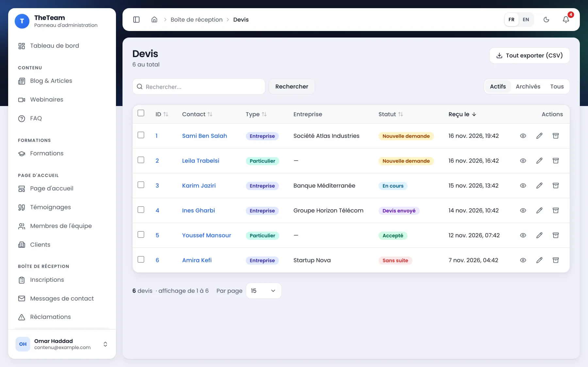
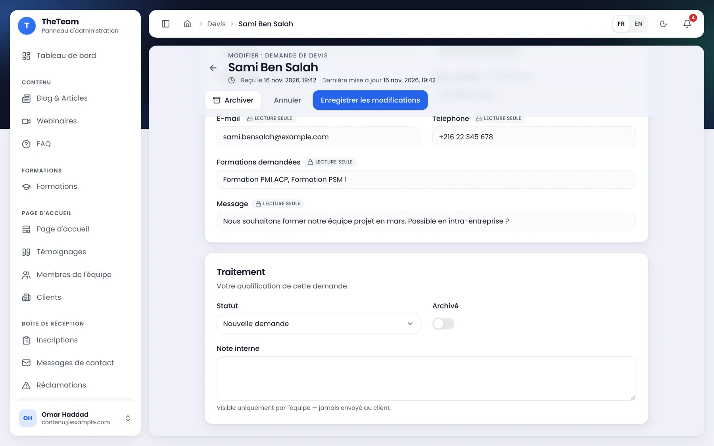
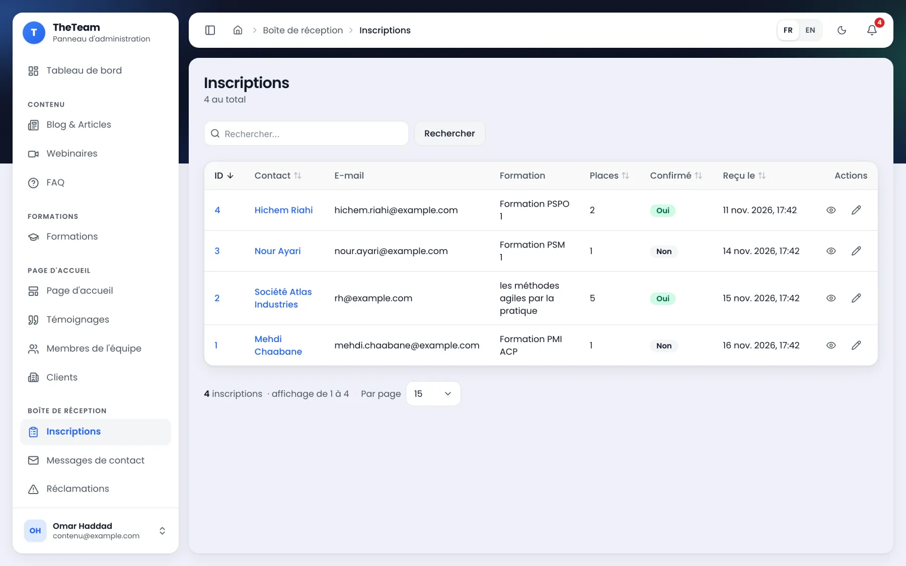
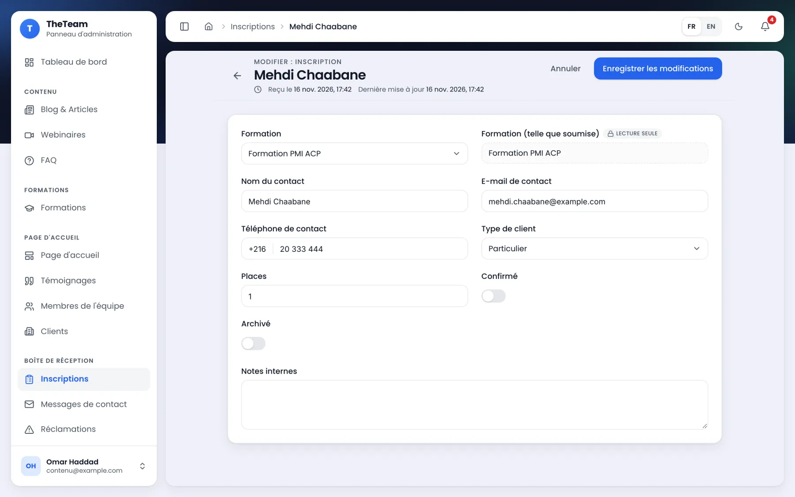
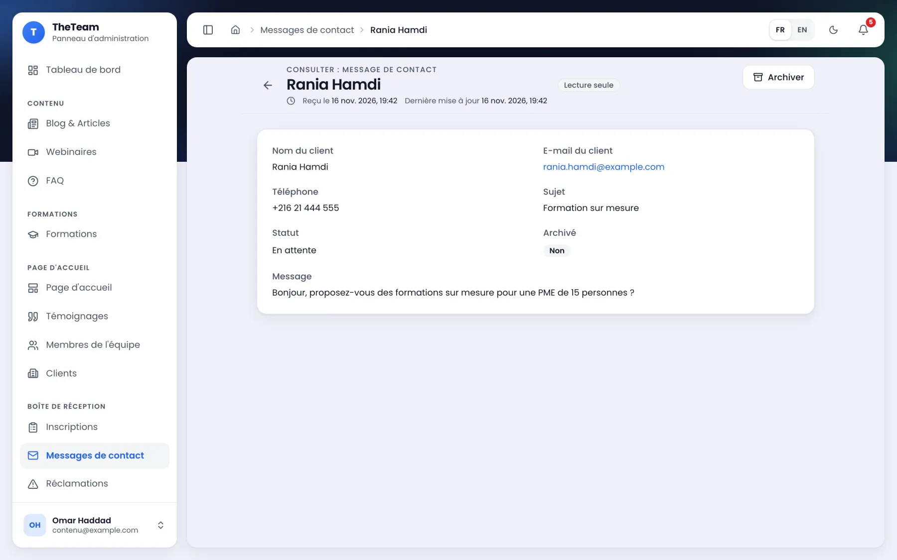
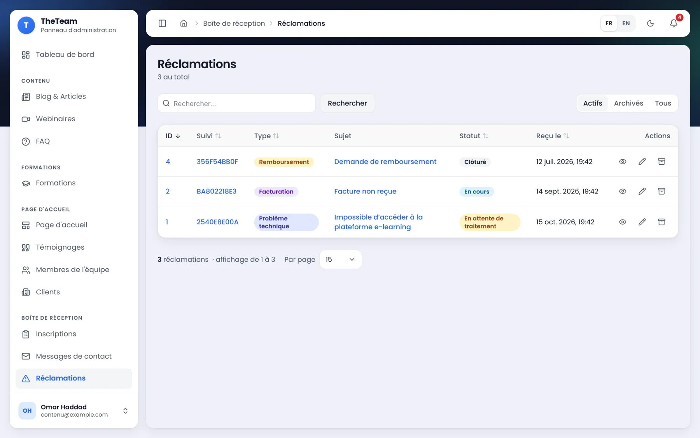
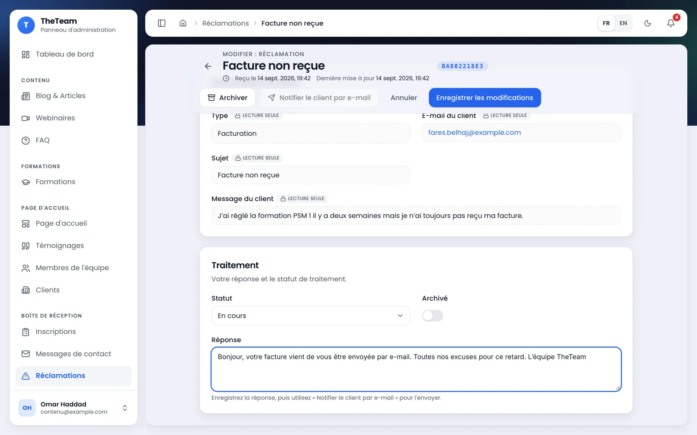
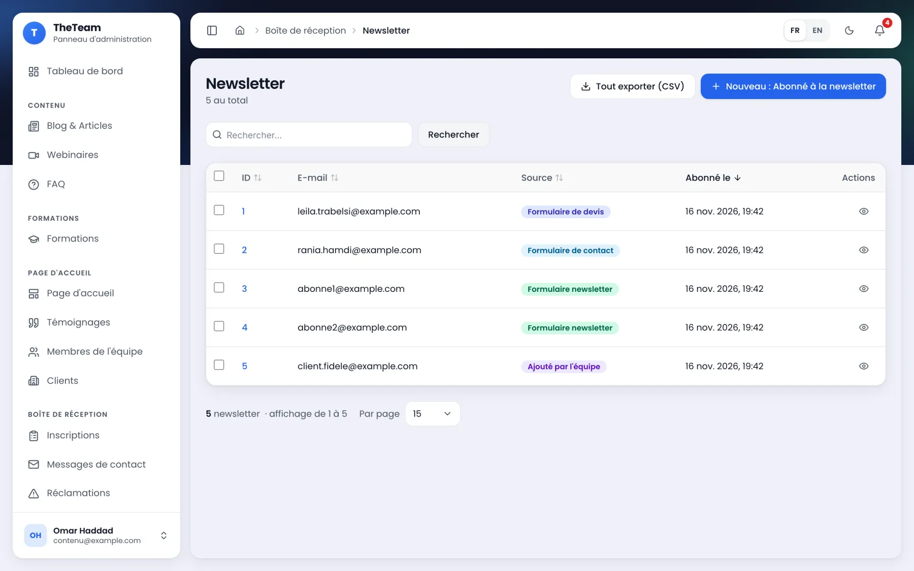
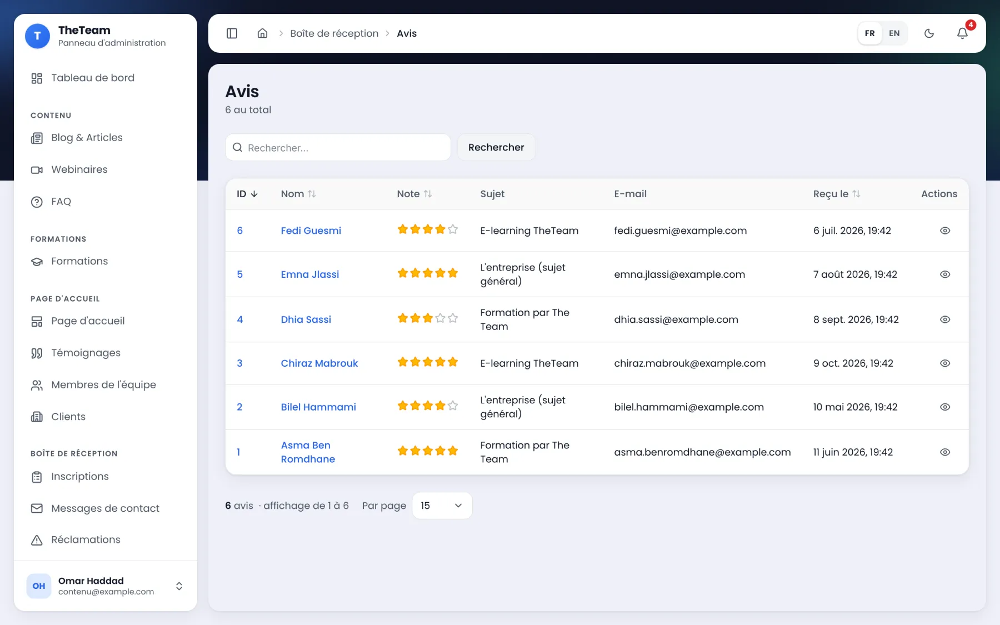

Chaque formulaire rempli sur le site arrive dans la **Boîte de réception** du menu, avec une notification sur la cloche.

| Demande | Ce que vous pouvez faire |
| :-- | :-- |
| Devis | Lire, changer le statut, noter, archiver, exporter |
| Inscriptions | Lire, modifier, confirmer |
| Messages de contact | Lire, archiver |
| Réclamations | Lire, répondre, prévenir le client, archiver |
| Newsletter | Consulter, ajouter une adresse, exporter |
| Avis | Lire |

<Info>
  Vous ne pouvez rien supprimer : **archivez** ce qui est terminé. Les éléments archivés restent consultables avec le filtre **Archivés**.
</Info>

## Les devis

Menu **Boîte de réception → Devis**.

<Frame caption="La liste des devis : icônes voir, modifier et archiver.">
  
</Frame>

<Steps>
  <Step title="Ouvrez la demande">
    La section **Soumission du client** (lecture seule) montre ce que le visiteur a rempli : entreprise ou particulier, participants, coordonnées, formations demandées, message.
  </Step>
  <Step title="Contactez le client">
    Par téléphone ou e-mail. Le panneau n’envoie pas le devis lui-même.
  </Step>
  <Step title="Mettez à jour le statut et la note interne">
    Section **Traitement** : **Nouvelle demande → En cours → Devis envoyé → Accepté** ou **Sans suite**. La **note interne** n’est jamais envoyée au client. Enregistrez.
  </Step>
  <Step title="Archivez quand c’est terminé">
    Bouton **Archiver** en haut de la fiche.
  </Step>
</Steps>

<Frame caption="La section Traitement d’un devis.">
  
</Frame>

**Tout exporter (CSV)** télécharge les devis pour Excel (cochez des lignes pour n’exporter qu’elles).

## Les inscriptions

Menu **Boîte de réception → Inscriptions**.

<Frame caption="La liste des inscriptions.">
  
</Frame>

Ouvrez l’inscription (crayon), contactez la personne pour confirmer la session, puis activez **Confirmé** et enregistrez. Les **Notes internes** servent à l’équipe.

<Frame caption="La fiche d’une inscription.">
  
</Frame>

## Les messages de contact

Menu **Boîte de réception → Messages de contact**. Les messages sont en **lecture seule** : ouvrez-en un (œil), **répondez depuis votre messagerie** à l’adresse indiquée, puis cliquez sur **Archiver**.

<Frame caption="Un message de contact ouvert, avec le bouton Archiver.">
  
</Frame>

## Les réclamations

Menu **Boîte de réception → Réclamations**. Chaque réclamation a un **numéro de suivi** que le client utilise pour suivre l’avancement sur le site.

<Frame caption="La liste des réclamations.">
  
</Frame>

<Steps>
  <Step title="Ouvrez la réclamation">
    Lisez la **Soumission du client** (lecture seule).
  </Step>
  <Step title="Écrivez la réponse et choisissez le statut">
    Section **Traitement** : **Réponse** et **Statut** (En attente, En cours, Résolue, Clôturée).
  </Step>
  <Step title="Enregistrez">
    La réponse devient visible pour le client sur la page de suivi du site.
  </Step>
  <Step title="Cliquez sur « Notifier le client par e-mail »">
    Le client reçoit votre réponse par e-mail (l’équipe en copie).
  </Step>
</Steps>

<Frame caption="La section Traitement : statut et réponse au client.">
  
</Frame>

<Warning>
  **Enregistrez d’abord, notifiez ensuite** : le bouton envoie la réponse **enregistrée**. Rédigez-la comme un message au client.
</Warning>

## La newsletter

Menu **Boîte de réception → Newsletter** : les adresses abonnées. La colonne **Source** indique leur origine (formulaire newsletter, devis, contact, réclamation, ou ajoutée par l’équipe).

<Frame caption="La liste des abonnés.">
  
</Frame>

- **Ajouter une adresse** : **Nouveau : Abonné à la newsletter**, saisissez l’e-mail, **Créer**.
- **Exporter** : **Tout exporter (CSV)** pour votre outil d’envoi d’e-mails.

## Les avis

Menu **Boîte de réception → Avis** : note sur 5, sujet et commentaire. Les avis sont en **lecture seule** ; ouvrez-en un (œil) pour lire le commentaire en entier.

<Frame caption="La liste des avis.">
  
</Frame>
