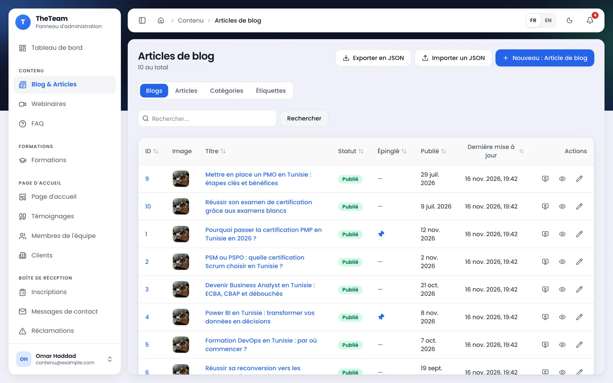
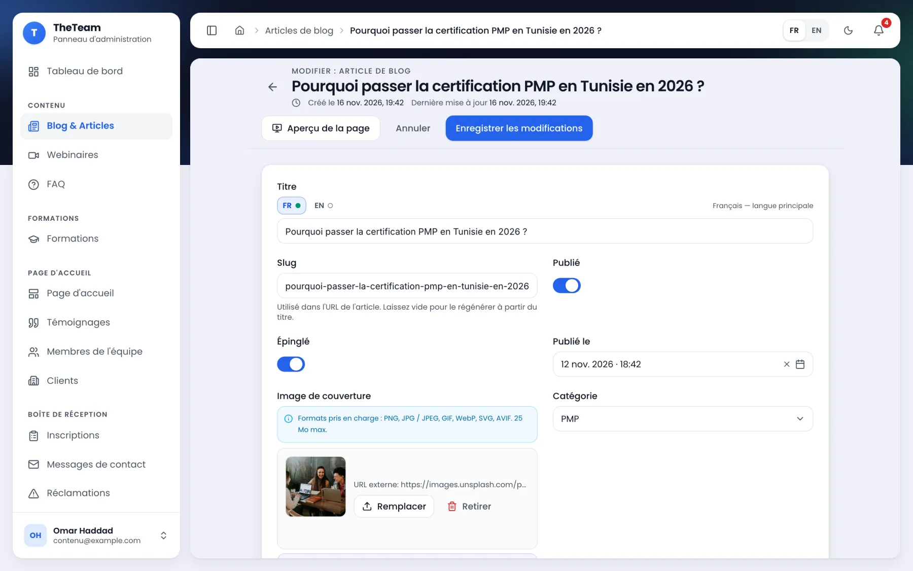
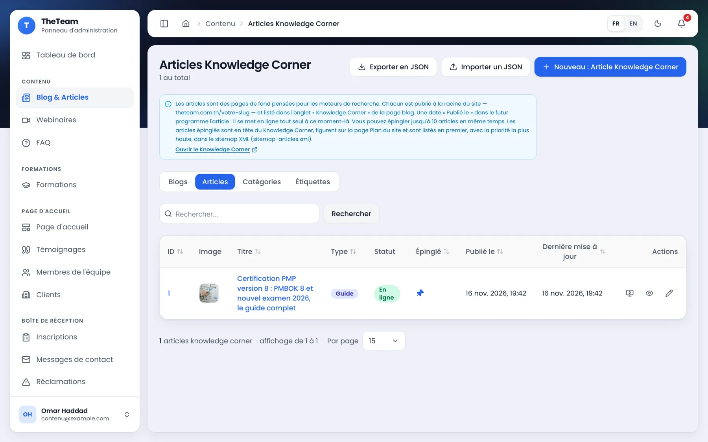
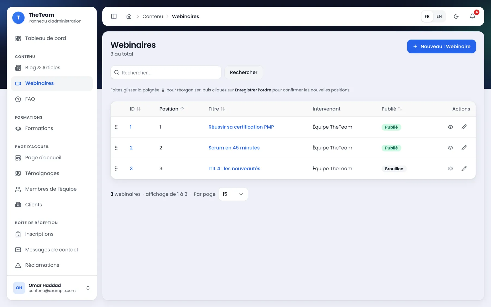
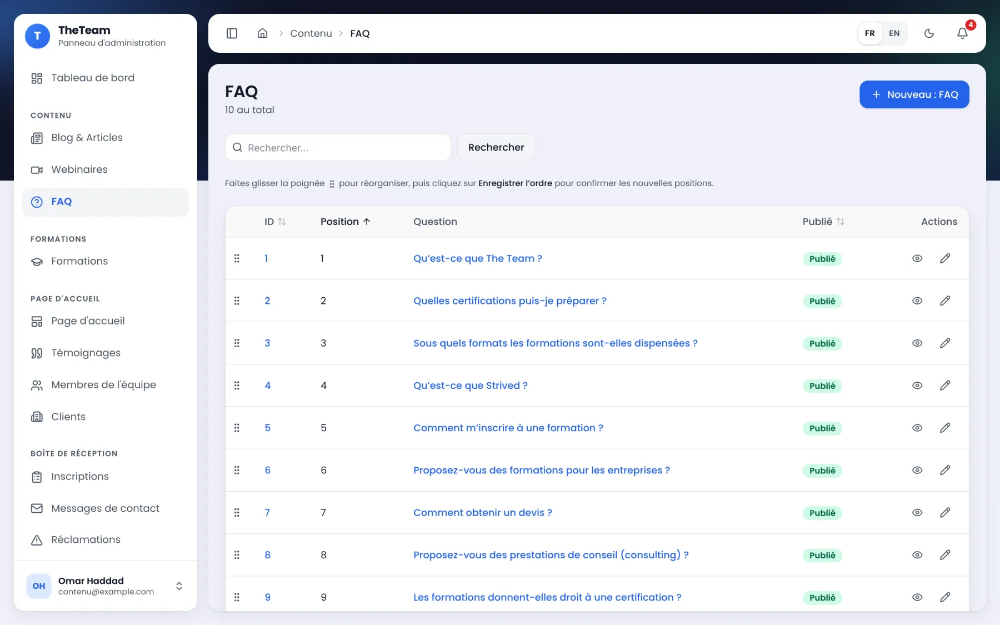
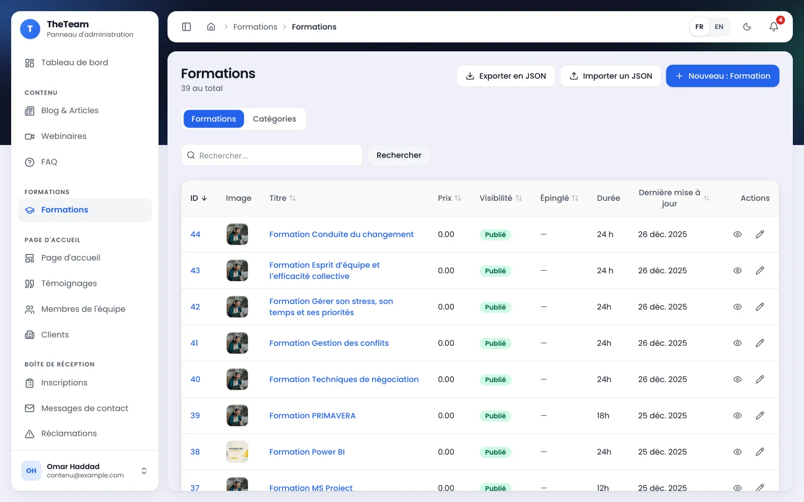
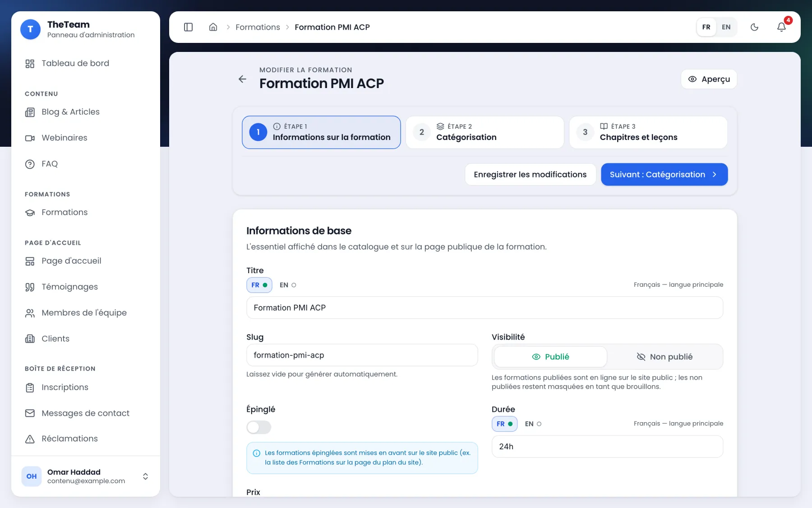
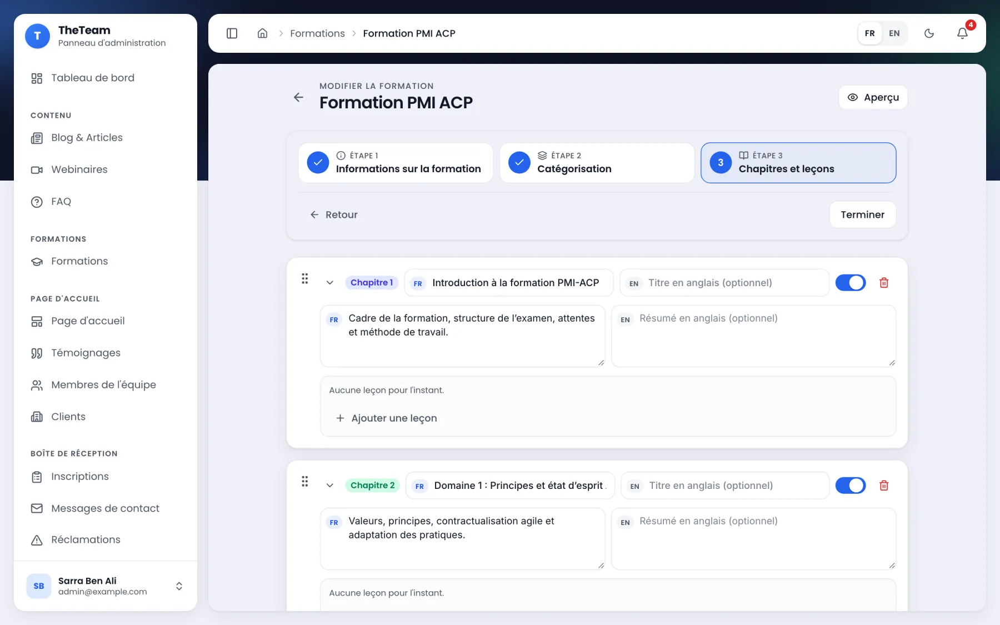

Vous pouvez **créer, modifier et publier** tout le contenu du site. La seule chose que vous ne pouvez pas faire est **supprimer** : pour retirer un contenu du site, **dépubliez-le** (voir en bas de page).

## Le blog

Menu **Contenu → Blog & Articles**, onglet **Blogs**.

<Frame caption="La liste des articles de blog : icônes aperçu, voir et modifier (pas de suppression pour votre rôle).">
  
</Frame>

<Steps>
  <Step title="Cliquez sur « Nouveau : Article de blog »">
    Ou sur le crayon d’un article existant.
  </Step>
  <Step title="Remplissez le titre, l’image de couverture, la catégorie et l’auteur">
    Le slug (fin de l’adresse) se crée tout seul. L’image de couverture est obligatoire.
  </Step>
  <Step title="Écrivez le contenu">
    L’éditeur fonctionne comme un traitement de texte (gras, intertitres H2/H3, listes, liens). Le bouton **Image** insère une image dans le texte.
  </Step>
  <Step title="Vérifiez avec « Aperçu de la page »">
    L’article s’ouvre tel qu’il apparaîtra sur le site.
  </Step>
  <Step title="Activez « Publié » et enregistrez">
    **Épinglé** met l’article en avant en tête du blog.
  </Step>
</Steps>

<Frame caption="La fiche d’un article de blog.">
  
</Frame>

<Tip>
  Avant d’envoyer une image, donnez-lui un nom descriptif (`formation-pmp-tunis-2026.webp` plutôt que `IMG_4821.jpg`) et gardez-la légère (moins de 200 Ko environ, par exemple avec [squoosh.app](https://squoosh.app/)) : le site sera mieux référencé et plus rapide.
</Tip>

## Les articles du Knowledge Corner

Onglet **Articles**. Des articles de fond pensés pour Google, publiés à l’adresse `theteam.com.tn/votre-slug`.

<Frame caption="L’onglet Articles. La colonne Statut indique En ligne, Programmé ou Brouillon.">
  
</Frame>

- Remplissez les sections **Article** (titre, slug, type, extrait, contenu structuré en H2/H3), **Image de couverture**, **Publication** et **SEO** (facultatif). Chaque champ a une aide en dessous.
- **Programmer** : activez **Publié** et choisissez une date future dans **Publié le** : l’article se mettra en ligne tout seul.
- **Épingler** : jusqu’à 10 articles à la fois.
- **Évitez de changer le slug** d’un article déjà publié : les liens existants ne marcheraient plus.

Les onglets **Catégories** et **Étiquettes** se gèrent de la même façon (**Nouveau**, un nom, **Créer**).

## Les webinaires

Menu **Contenu → Webinaires**.

<Frame caption="La liste des webinaires.">
  
</Frame>

**Nouveau : Webinaire** → titre, **lien YouTube** (le lien de la vidéo ou le code d’intégration), intervenant, description. Vérifiez l’**aperçu en direct** en bas du formulaire, activez **Publié** et enregistrez. Le lien **Comment obtenir le code d’intégration YouTube ?** montre le chemin sur YouTube (Partager → Intégrer → Copier).

## La FAQ

Menu **Contenu → FAQ**.

<Frame caption="La liste des questions. La poignée à gauche permet de changer l’ordre.">
  
</Frame>

- **Ajouter** : **Nouveau : FAQ**, puis Question, Réponse, **Publié**, **Créer**.
- **Changer l’ordre** : faites glisser les lignes, puis **Enregistrer l’ordre**.

## Les formations

Menu **Formations**.

<Frame caption="La liste des formations.">
  
</Frame>

Une formation se remplit en **trois étapes**, affichées en haut du formulaire :

<Steps>
  <Step title="Informations sur la formation">
    Titre, **Visibilité** (Publié / Non publié), durée, prix, images, description, certification, prérequis et objectifs.
  </Step>
  <Step title="Catégorisation">
    Cliquez sur les catégories de la formation (plusieurs possibles).
  </Step>
  <Step title="Chapitres et leçons">
    Le programme : **Ajouter un chapitre**, puis **Ajouter une leçon** dans chaque chapitre. Faites glisser pour réorganiser. Enregistrez d’abord les étapes 1 et 2 pour une nouvelle formation.
  </Step>
</Steps>

<Frame caption="Étape 1 d’une formation.">
  
</Frame>

<Frame caption="Étape 3 : chapitres et leçons.">
  
</Frame>

Le bouton **Aperçu** montre la formation telle que les visiteurs la verront.

<Note>
  Une modification de formation peut mettre **jusqu’à 5 minutes** à apparaître sur le site : c’est normal, le site garde le catalogue en mémoire pour aller plus vite.
</Note>

## Retirer un contenu du site

Vous ne pouvez pas supprimer, mais vous pouvez **masquer** :

| Contenu | Pour le retirer du site |
| :-- | :-- |
| Article de blog, article du Knowledge Corner | Désactivez **Publié** |
| Webinaire, question de la FAQ | Désactivez **Publié** |
| Formation | **Visibilité** → **Non publié** |

Le contenu reste dans le panneau (en brouillon) et peut être republié à tout moment. Si une suppression définitive est nécessaire, demandez-la à un administrateur.
