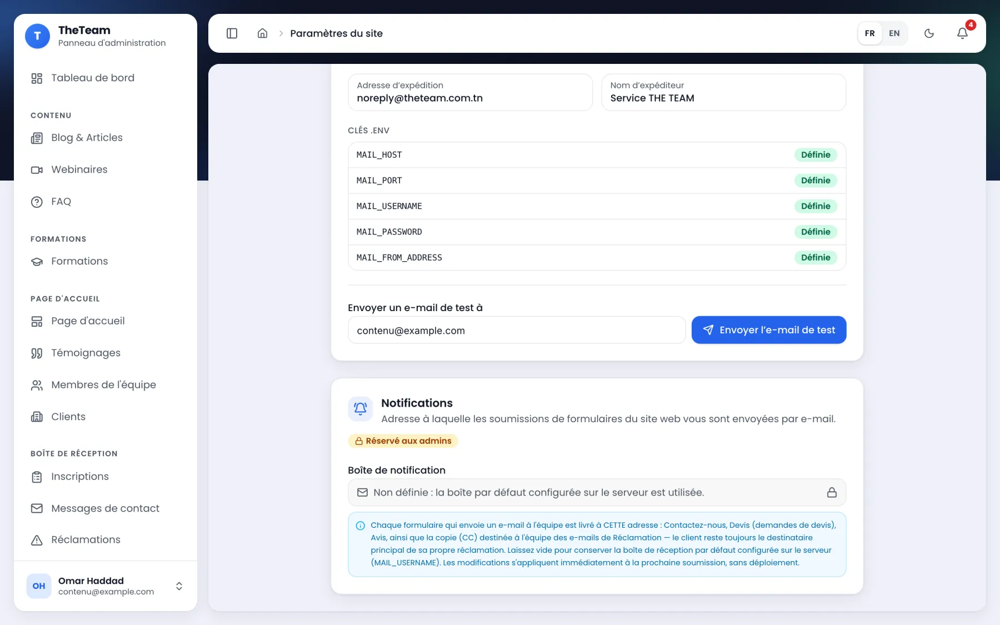

Menu **Système → Paramètres du site**, carte **Envoi d’e-mails (SMTP)**.

Le **SMTP** est le service qui envoie les e-mails du site : copie des formulaires de contact, de devis et d’avis à l’équipe, e-mails de réclamation au client (par exemple quand vous cliquez sur « Notifier le client par e-mail »), invitations, réinitialisation de mot de passe… Si l’envoi ne fonctionne pas, les demandes arrivent quand même dans votre **Boîte de réception**, mais **plus aucun e-mail ne part**.

<Info>
  Vous pouvez **consulter cette carte** et **envoyer un e-mail de test**. Vous ne pouvez rien régler ici : la configuration se fait sur le serveur. En cas de problème, prévenez un administrateur ou la personne en charge technique.
</Info>

<Frame caption="La carte Envoi d’e-mails (SMTP) : adresse d’expédition, clés de configuration et e-mail de test.">
  
</Frame>

## Lire l’état de la carte

| Message affiché | Signification | Que faire |
| :-- | :-- | :-- |
| **SMTP est configuré** (vert) | Tous les réglages sont présents. | Envoyez un e-mail de test pour confirmer que les e-mails arrivent. |
| **SMTP n’est pas configuré** (rouge) | Des réglages manquent sur le serveur. | Prévenez un administrateur. |
| **Les e-mails ne sont pas envoyés (mode test)** (orange) | Le serveur n’envoie pas les e-mails, il les écrit seulement dans son journal. | Prévenez un administrateur. |

La carte affiche aussi l’**adresse d’expédition** (l’expéditeur des e-mails du site, par exemple `noreply@theteam.com.tn`) et le **nom d’expéditeur**. Les clés de configuration sont listées par leur nom avec **Définie** ou **Manquante** ; leur valeur n’est jamais affichée.

## Envoyer un e-mail de test

À faire par exemple si un client dit ne pas avoir reçu votre réponse à sa réclamation.

<Steps>
  <Step title="Vérifiez l’adresse">
    Le champ **Envoyer un e-mail de test à** propose votre adresse ; vous pouvez en saisir une autre.
  </Step>
  <Step title="Cliquez sur « Envoyer l’e-mail de test »">
    L’envoi se fait immédiatement.
  </Step>
  <Step title="Vérifiez votre boîte de réception">
    Un message vert confirme : « E-mail de test envoyé à … Vérifiez la boîte de réception (et le dossier spam). » Vous recevez un e-mail intitulé **« E-mail de test — THETEAM »**. Pensez au dossier **spam**.
  </Step>
</Steps>

<Note>
  **5 e-mails de test par minute** au plus. Au-delà : « Trop d’e-mails de test. Patientez une minute puis réessayez. »
</Note>

## Si l’e-mail de test échoue

Un message rouge s’affiche. **Faites une capture de l’écran et transmettez-la à un administrateur** : le message lui indique quoi corriger.

| Message | En clair |
| :-- | :-- |
| « Le serveur SMTP a refusé l’identifiant… » | Le mot de passe ou l’identifiant du compte e-mail est incorrect. |
| « Le serveur SMTP est injoignable… » | Le serveur d’envoi ne répond pas. |
| « La connexion sécurisée au serveur SMTP a échoué… » | Un réglage de sécurité est incorrect. |
| « Le serveur SMTP a refusé l’expéditeur ou le destinataire… » | L’adresse d’expédition n’est pas autorisée. |
| « L’envoi d’e-mails n’est pas configuré… » | Des réglages manquent sur le serveur. |
| « L’e-mail de test n’a pas pu être envoyé… » | Autre erreur, détaillée dans le journal du serveur. |

<Warning>
  **Message vert mais rien n’arrive ?** Regardez dans le **spam**, puis réessayez avec une autre adresse. Si rien n’arrive toujours, prévenez un administrateur.
</Warning>

## L’adresse qui reçoit les formulaires

L’adresse de l’équipe qui reçoit les formulaires du site s’affiche dans la carte **Notifications**, juste en dessous. Elle est en **lecture seule** pour vous : voir [Paramètres du site](/guide-utilisateur/gestionnaire/parametres).
