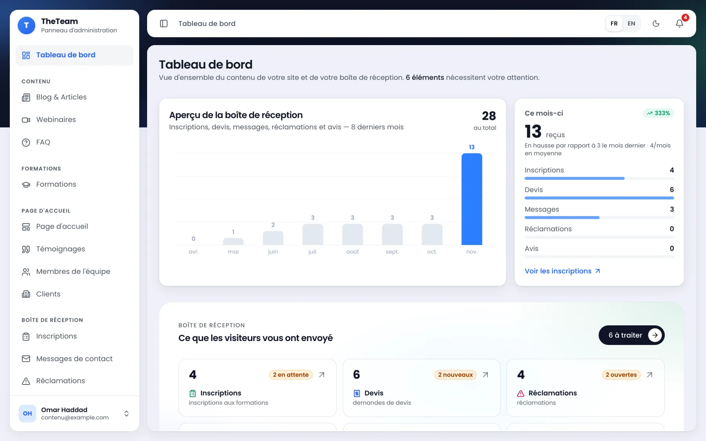
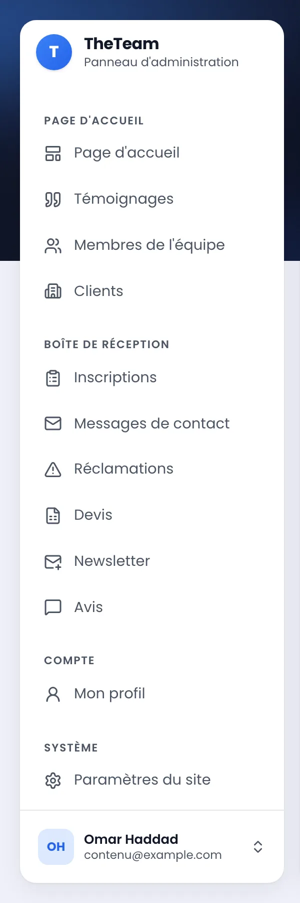

En tant que **gestionnaire de contenu**, vous faites vivre le site **theteam.com.tn** : vous publiez les articles, les formations, les webinaires et la FAQ, et vous **traitez les demandes** envoyées par les visiteurs (devis, inscriptions, réclamations…).

Ce guide est écrit pour vous : chaque capture a été prise avec un compte de gestionnaire de contenu, vous voyez donc **exactement votre écran**.

<Frame caption="Votre tableau de bord, juste après la connexion.">
  
</Frame>

## Ce que vous pouvez faire

<CardGroup cols={2}>
  <Card title="Publier du contenu" icon="newspaper" href="/guide-utilisateur/gestionnaire/contenu">
    Blog, articles du Knowledge Corner, webinaires, FAQ et formations : créer, modifier, publier.
  </Card>
  <Card title="Page d’accueil" icon="house" href="/guide-utilisateur/gestionnaire/page-accueil">
    Bandeau promo, bannière, témoignages et clients.
  </Card>
  <Card title="Traiter les demandes" icon="inbox" href="/guide-utilisateur/gestionnaire/boite-de-reception">
    Devis, inscriptions, messages, réclamations, newsletter et avis.
  </Card>
  <Card title="Paramètres du site" icon="gear" href="/guide-utilisateur/gestionnaire/parametres">
    Vérifier que l’envoi d’e-mails et le stockage des images fonctionnent.
  </Card>
</CardGroup>

## Vos droits, en un tableau

| Partie du panneau | Ce que vous pouvez faire |
| :-- | :-- |
| Blog, articles, catégories, étiquettes | Créer, modifier, publier |
| Webinaires, FAQ | Créer, modifier, publier, réorganiser |
| Formations et catégories de formations | Créer, modifier, publier |
| Page d’accueil | Modifier **seulement** le bandeau promo et la bannière |
| Témoignages | Relire, modifier, publier |
| Membres de l’équipe | Consulter |
| Clients | Ajouter, modifier |
| Devis, réclamations | Consulter, traiter, archiver, exporter |
| Inscriptions | Consulter, modifier, confirmer |
| Messages de contact | Lire, archiver |
| Newsletter | Consulter, ajouter une adresse, exporter |
| Avis | Lire |
| Paramètres du site | Lancer les tests ; adresse de notification en lecture seule |

## Ce qui est réservé aux administrateurs

- **Supprimer** quoi que ce soit. Vous pouvez **archiver** (ranger sans perdre) ou **dépublier** (masquer du site). Pour une vraie suppression, demandez à un administrateur.
- Les comptes du personnel (**Utilisateurs**), les **rôles et permissions** et le **journal d’activité** : ces entrées n’apparaissent pas dans votre menu.
- Les champs de la page d’accueil marqués **RÉSERVÉ AUX ADMINS** (nom, logos, coordonnées, réseaux sociaux…).
- L’adresse e-mail qui reçoit les formulaires du site.

<Tip>
  Le panneau n’affiche que ce que vous avez le droit de faire : pas de bouton « Supprimer », pas d’entrée « Utilisateurs ». Si un bouton manque, c’est normal.
</Tip>

## Votre menu

<Frame caption="Le bas de votre menu : la boîte de réception, puis « Mon profil » et « Paramètres du site ».">
  
</Frame>

## Par où commencer ?

<Steps>
  <Step title="Prise en main">
    [Se connecter et comprendre l’écran](/guide-utilisateur/gestionnaire/prise-en-main), puis [activer les notifications](/guide-utilisateur/gestionnaire/notifications).
  </Step>
  <Step title="Vos tâches quotidiennes">
    [Publier du contenu](/guide-utilisateur/gestionnaire/contenu) et [traiter les demandes](/guide-utilisateur/gestionnaire/boite-de-reception).
  </Step>
  <Step title="Le site côté visiteur">
    Pour savoir ce que le visiteur a rempli, l’onglet **Côté visiteur** montre chaque formulaire du site.
  </Step>
</Steps>
