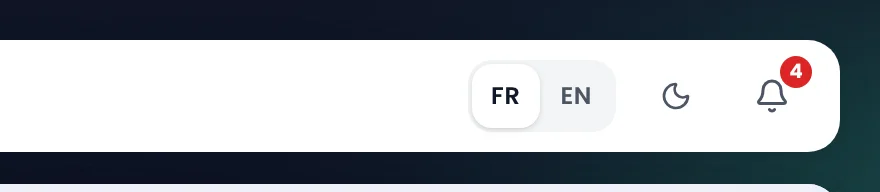
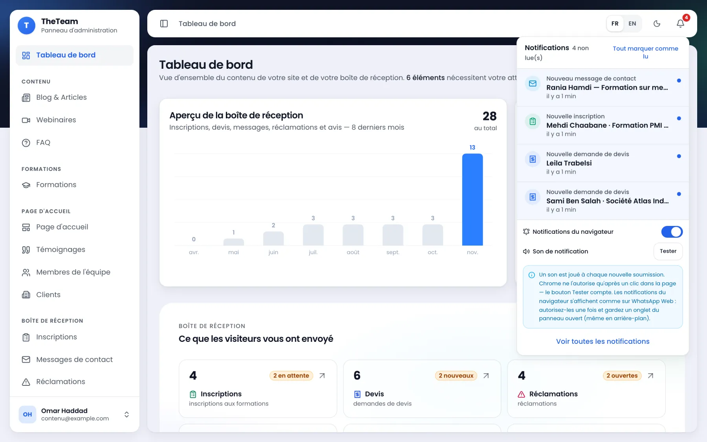
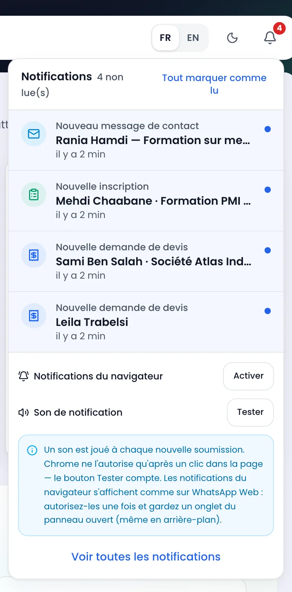
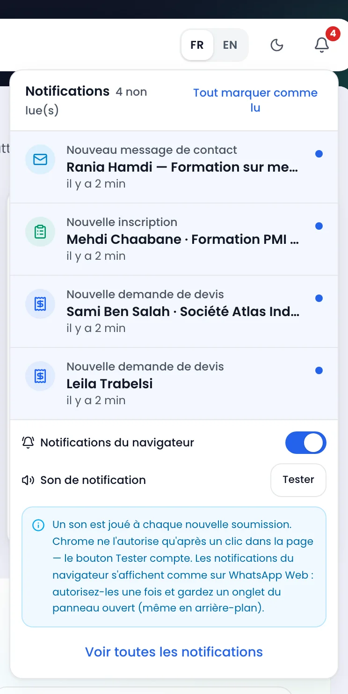
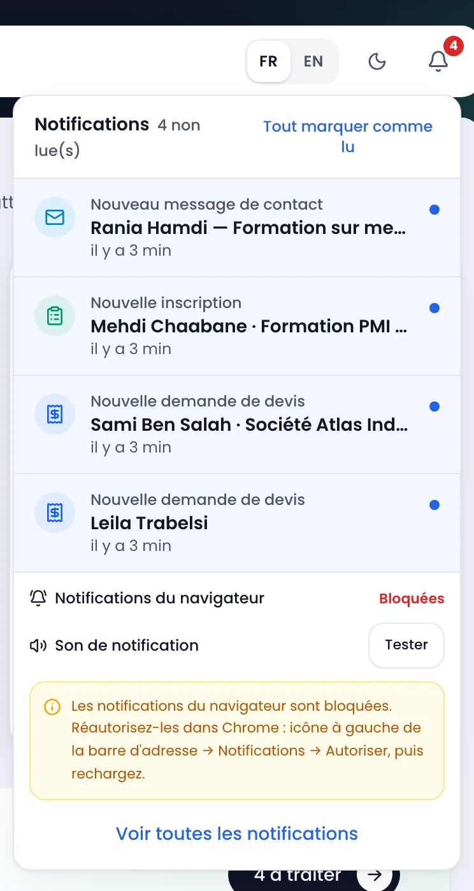

Chaque fois qu’un visiteur remplit un formulaire du site, le panneau vous prévient avec la **cloche**, en haut à droite. Vos notifications sont **personnelles** : ce que vous lisez reste non lu pour vos collègues.

## Ce qui déclenche une notification

| Formulaire rempli sur le site | Notification reçue | Où la traiter |
| :-- | :-- | :-- |
| Demande de devis | **Nouvelle demande de devis** | Boîte de réception → Devis |
| Inscription à une formation | **Nouvelle inscription** | Boîte de réception → Inscriptions |
| Formulaire de contact | **Nouveau message de contact** | Boîte de réception → Messages de contact |
| Réclamation | **Nouvelle réclamation** | Boîte de réception → Réclamations |
| Avis | **Nouvel avis** | Boîte de réception → Avis |
| Inscription à la newsletter | **Nouvel abonné à la newsletter** | Boîte de réception → Newsletter |
| Témoignage | **Nouveau témoignage** | Page d’accueil → Témoignages |

Comment traiter chaque demande : [Traiter les demandes](/guide-utilisateur/gestionnaire/boite-de-reception).

## La cloche

Le **chiffre rouge** sur la cloche indique vos notifications non lues. Le panneau vérifie les nouvelles demandes **toutes les 25 secondes environ** et dès que vous revenez sur l’onglet : inutile de recharger la page.

<Frame caption="La cloche avec 4 notifications non lues.">
  
</Frame>

Cliquez sur la cloche :

- les dernières demandes s’affichent, les non lues en gras avec un point bleu ;
- **cliquez sur une demande** pour l’ouvrir directement ;
- **Tout marquer comme lu** remet le compteur à zéro ;
- **Voir toutes les notifications** ouvre la page complète, avec l’historique.

<Frame caption="Le menu de la cloche ouvert sur votre tableau de bord.">
  
</Frame>

## Les deux alertes

En bas du menu de la cloche :

| Alerte | Ce qu’elle fait |
| :-- | :-- |
| **Son de notification** | Un petit son à chaque nouvelle demande, dès qu’un onglet du panneau est ouvert. |
| **Notifications du navigateur** | Une bulle de votre ordinateur (comme WhatsApp Web) quand vous êtes sur un autre onglet ou une autre application. Cliquez dessus pour ouvrir la demande. |

<Frame caption="Avant activation : le bouton « Activer » et le bouton « Tester ».">
  
</Frame>

## Activer les notifications (une fois par ordinateur)

<Steps>
  <Step title="Ouvrez le panneau dans Google Chrome">
    Chrome est recommandé ; Edge et Firefox fonctionnent de la même façon.
  </Step>
  <Step title="Cliquez sur la cloche, en haut à droite">
    Le menu des notifications s’ouvre.
  </Step>
  <Step title="Cliquez sur « Activer », puis sur « Autoriser »">
    À droite de **Notifications du navigateur**. Le navigateur affiche une petite fenêtre près de la barre d’adresse : cliquez sur **Autoriser**. Une bulle **« Notifications activées »** confirme, et le bouton devient un **interrupteur bleu**.
  </Step>
  <Step title="Cliquez sur « Tester »">
    À droite de **Son de notification** : vous entendez le son. Ce clic débloque le son pour la suite.
  </Step>
  <Step title="Gardez un onglet du panneau ouvert">
    Même en arrière-plan ou dans une fenêtre réduite.
  </Step>
</Steps>

<Frame caption="Notifications activées : l’interrupteur est bleu.">
  
</Frame>

- **Plusieurs demandes d’un coup** : une seule bulle les résume (« 3 nouvelles soumissions »).
- **Mettre les bulles en pause** : désactivez l’interrupteur bleu. Le réglage vaut pour ce navigateur et cet ordinateur : refaites l’activation sur chaque poste.

## Le menu affiche « Bloquées »

Si l’autorisation a été refusée, le menu affiche **Bloquées** en rouge et un cadre orange.

<Frame caption="Les notifications du navigateur sont bloquées.">
  
</Frame>

<Steps>
  <Step title="Cliquez sur l’icône à gauche de l’adresse">
    Dans Chrome, l’icône de réglages juste avant `admin.theteam.com.tn`.
  </Step>
  <Step title="Passez « Notifications » sur « Autoriser »">
    Sinon : **Paramètres du site** → **Notifications** → **Autoriser**.
  </Step>
  <Step title="Rechargez la page">
    Touche **F5** (ou **Cmd + R** sur Mac).
  </Step>
</Steps>

## Le son ou les bulles ne fonctionnent pas

- **Pas de son** : cliquez une fois sur **Tester**. Sinon, dans Chrome : icône à gauche de l’adresse → **Paramètres du site** → **Son** → **Autoriser**. Vérifiez aussi le volume de l’ordinateur.
- **Pas de bulle** alors que l’interrupteur est bleu : l’ordinateur peut les bloquer.

<Tabs>
  <Tab title="Windows">
    **Paramètres → Système → Notifications** : autorisez **Google Chrome** et désactivez l’**Assistant de concentration** (« Ne pas déranger »).
  </Tab>
  <Tab title="Mac">
    **Réglages Système → Notifications → Google Chrome** : activez **Autoriser les notifications**, et vérifiez qu’aucun mode **Concentration** n’est actif.
  </Tab>
</Tabs>

<Warning>
  **Le navigateur doit rester ouvert.** Si tous les onglets du panneau sont fermés, vous n’êtes pas alerté. Rien n’est perdu : les demandes vous attendent dans la cloche et dans la **Boîte de réception**.
</Warning>

## En résumé

<Check>
  1. Cliquez sur la cloche, puis sur **Activer** et sur **Autoriser**.
  2. Cliquez sur **Tester** pour débloquer le son.
  3. Gardez un onglet du panneau ouvert, même en arrière-plan.
</Check>
