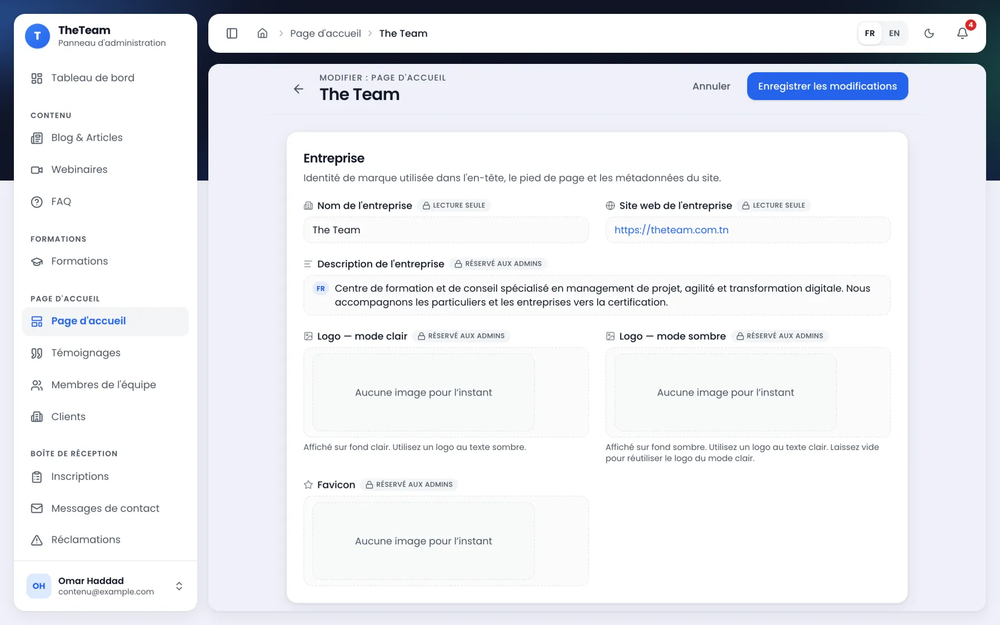
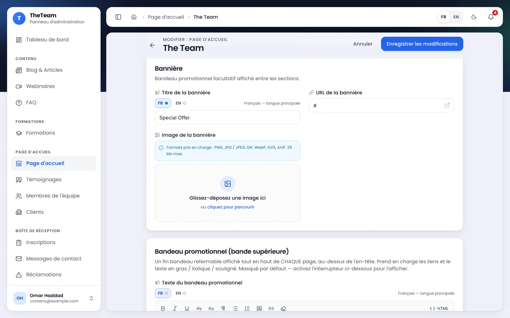
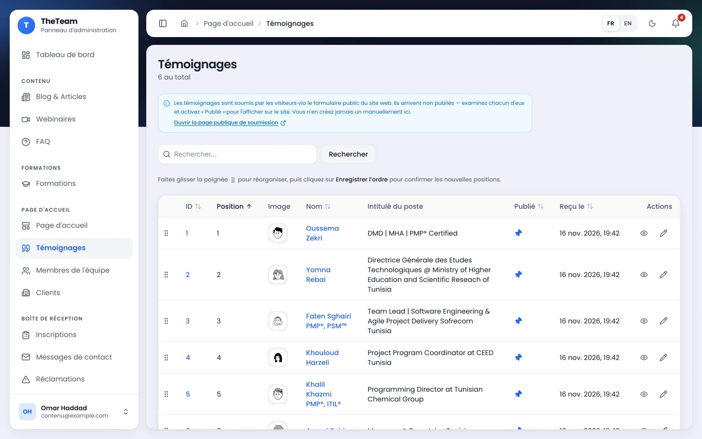
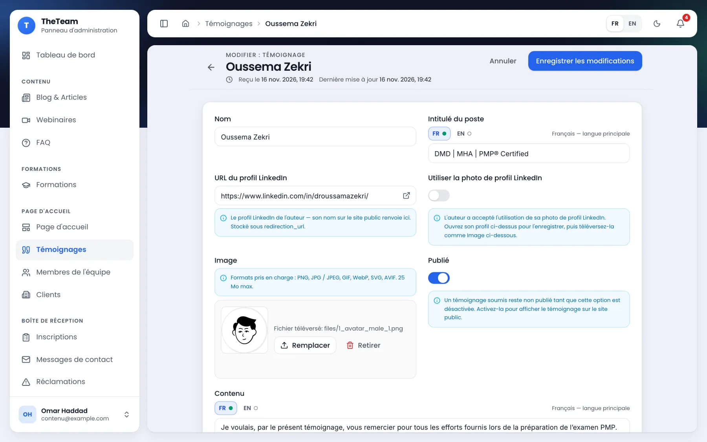
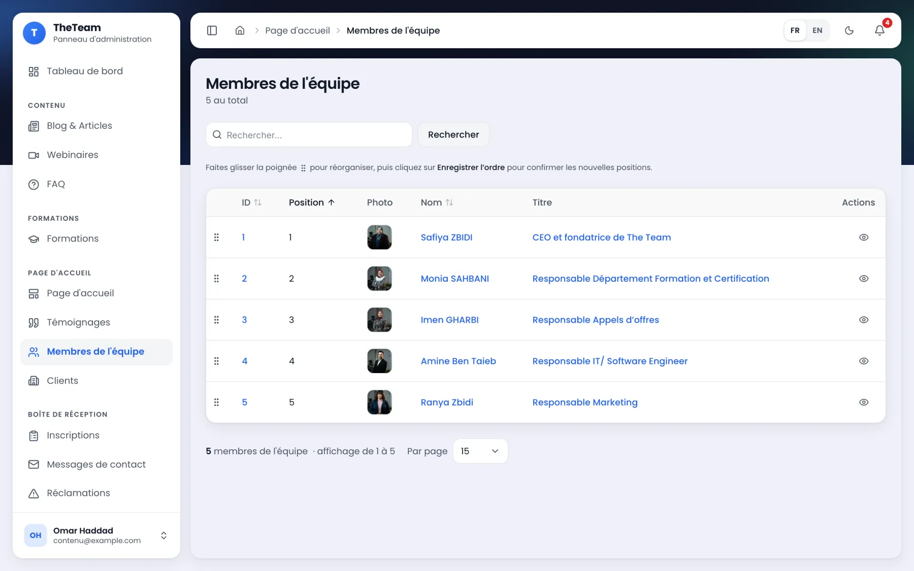
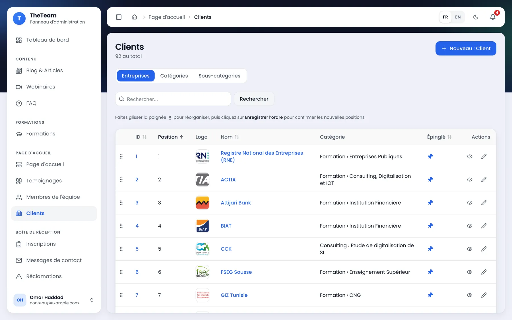

| Partie | Ce que vous pouvez faire |
| :-- | :-- |
| Page d’accueil | Modifier le **bandeau promotionnel** et la **bannière** |
| Témoignages | Relire, corriger, publier |
| Membres de l’équipe | Consulter |
| Clients | Ajouter, modifier |

## La page d’accueil

Menu **Page d’accueil**, puis le crayon. Vous voyez toute la fiche, mais la plupart des champs portent l’étiquette **RÉSERVÉ AUX ADMINS** : nom de l’entreprise, logos, en-tête, coordonnées, réseaux sociaux. Vous pouvez les lire, pas les changer.

<Frame caption="La fiche de la page d’accueil : les champs de l’entreprise sont verrouillés pour votre rôle.">
  
</Frame>

Vous pouvez modifier deux sections :

<Frame caption="Les sections Bannière et Bandeau promotionnel, modifiables par vous.">
  
</Frame>

### Le bandeau promotionnel

Un fin bandeau tout en haut de **chaque page** du site (par exemple « Nouvelle session PMP en mars : inscrivez-vous ! »).

<Steps>
  <Step title="Écrivez le texte">
    Dans **Texte du bandeau promotionnel**. Le gras, l’italique et les liens sont possibles.
  </Step>
  <Step title="Activez « Afficher le bandeau promotionnel »">
    Désactivez-le pour le masquer sans effacer le texte.
  </Step>
  <Step title="Cliquez sur « Enregistrer les modifications »">
    En haut à droite.
  </Step>
</Steps>

### La bannière

Une bande promotionnelle entre deux sections de la page d’accueil : un **titre**, un **lien** (la page ouverte au clic) et une **image**. Laissez-la vide si vous n’en voulez pas.

## Les témoignages

Menu **Témoignages**. Les visiteurs envoient leur témoignage depuis le site ; il arrive **non publié** et une notification vous prévient.

<Frame caption="La liste des témoignages.">
  
</Frame>

<Steps>
  <Step title="Ouvrez le témoignage (crayon)">
    Relisez le texte et corrigez une éventuelle faute de frappe.
  </Step>
  <Step title="Ajoutez la photo si l’auteur l’a autorisé">
    Si **Utiliser la photo de profil LinkedIn** est activé : ouvrez son profil avec le lien, enregistrez la photo, puis envoyez-la dans **Image**.
  </Step>
  <Step title="Activez « Publié » et enregistrez">
    Le témoignage apparaît sur le site.
  </Step>
</Steps>

<Frame caption="La fiche d’un témoignage.">
  
</Frame>

Pour changer l’ordre d’affichage : faites glisser les lignes de la liste, puis **Enregistrer l’ordre**. Pour retirer un témoignage du site, désactivez **Publié**.

## Les membres de l’équipe

Menu **Membres de l’équipe** : vous pouvez consulter les fiches (icône œil). Pour ajouter ou modifier un membre, demandez à un administrateur.

<Frame caption="Les membres de l’équipe, en consultation seulement.">
  
</Frame>

## Les clients

Menu **Clients** : les logos des entreprises clientes. Onglets **Entreprises**, **Catégories** et **Sous-catégories**.

<Frame caption="La liste des clients.">
  
</Frame>

**Ajouter un client** : **Nouveau : Client**, saisissez le nom, choisissez la catégorie, ajoutez le logo et le site web, puis **Créer**. Faites glisser les lignes puis **Enregistrer l’ordre** pour l’ordre d’affichage.
