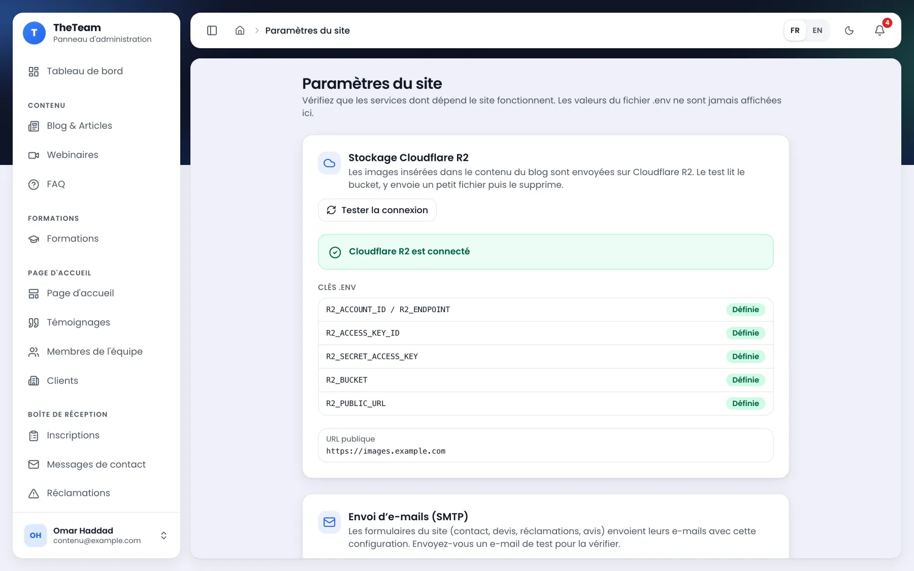
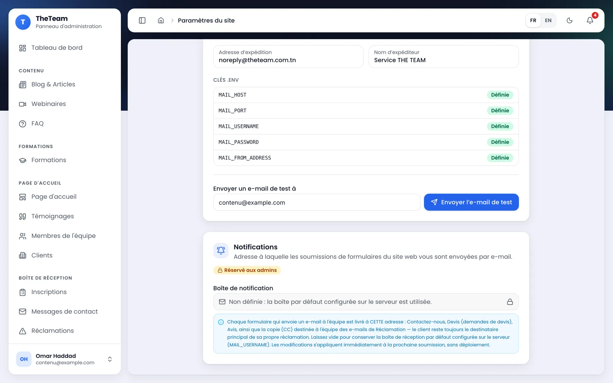

Menu **Système → Paramètres du site**. Cette page vérifie que les services dont dépend le site fonctionnent. Vous pouvez **lancer les tests** ; l’adresse de notification est **réservée aux administrateurs**.

<Frame caption="Les paramètres du site : le stockage des images (Cloudflare R2), puis l’envoi d’e-mails.">
  
</Frame>

## Stockage des images (Cloudflare R2)

C’est là que vont les images insérées dans les articles. Un cadre **vert** « Cloudflare R2 est connecté » signifie que tout va bien. **Tester la connexion** fait un essai complet.

## Envoi d’e-mails (SMTP)

C’est le service qui envoie les e-mails des formulaires du site. Pour le vérifier : saisissez votre adresse dans **Envoyer un e-mail de test à**, cliquez sur **Envoyer l’e-mail de test**, puis regardez votre boîte de réception.

## L’adresse qui reçoit les formulaires

La carte **Notifications** affiche l’adresse de l’équipe qui reçoit les formulaires (contact, devis, avis, copie des réclamations). Pour vous, elle est en **lecture seule** : demandez à un administrateur pour la changer.

<Frame caption="La carte Notifications : en lecture seule, marquée « Réservé aux admins ».">
  
</Frame>

<Warning>
  **Un cadre rouge ou orange ?** Le réglage se fait sur le serveur, pas dans le panneau. Prévenez un administrateur ou la personne en charge technique, avec une capture de l’écran.
</Warning>
